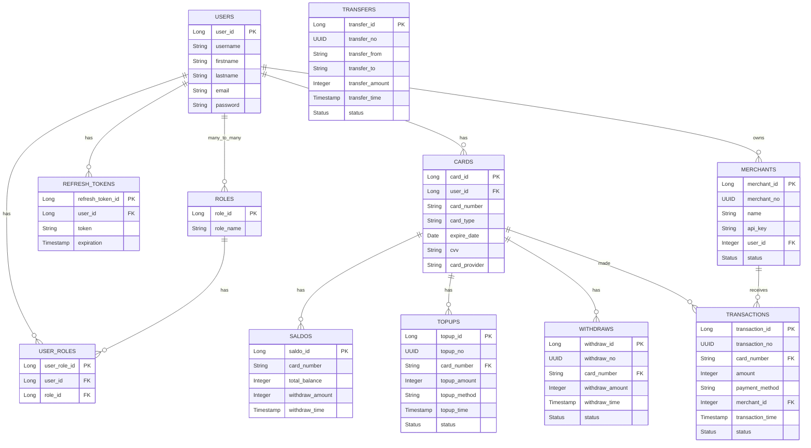

Here is a fluent English version with improved structure, terminology consistency, and a more professional engineering tone:

---

# Spring Boot Payment Gateway API

**A Robust Backend API for a Digital Payment Ecosystem**

The **Spring Boot Payment Gateway API** is a high-performance backend service designed to support a complete payment gateway ecosystem. Built using **Java 21** and **Spring Boot**, it provides full lifecycle financial capabilities, including JWT-based authentication, user and merchant management, card management, balance tracking, and multi-type financial transaction processing.

---

## Key Features

### Authentication & Security

* **JWT Authentication**: Secure user registration and login using JSON Web Tokens.
* **Role-Based Access Control (RBAC)**: Fine-grained access control ensuring secure access to sensitive endpoints based on user roles (user, admin, merchant).

---

### User & Merchant Management

* **User Profiles**: Registration, profile management, and user information handling.
* **Merchant Integration**: Merchant creation and management with dedicated API keys for external system integration.

---

### Card & Balance Management

* **Card Management**: Secure storage and management of user payment cards.
* **Balance Tracking**: Real-time balance monitoring for each user account or card.

---

### Financial Transaction Processing

* **Merchant Payments**: Direct payment processing from users to merchants.
* **Top-Up Operations**: Account balance top-ups using multiple payment methods.
* **Transfers**: Peer-to-peer fund transfers between users.
* **Withdrawals**: Secure withdrawal of funds from the system to external accounts.

---

## Technology Stack

* **Language**: Java 21
* **Framework**: Spring Boot 3.x
* **Security**: Spring Security with JWT
* **ORM / Data Access**: Spring Data JPA (Hibernate)
* **Database**: PostgreSQL
* **Build Tool**: Maven
* **API Documentation**: Springdoc OpenAPI (Swagger UI)

---

## Data Architecture & ERD

The database schema is designed to ensure transactional integrity, financial consistency, and strong relational modeling across users, merchants, and payment operations.



---

## Technical Decisions & Trade-offs

**Spring Boot on the JVM vs lighter stacks**
For a payment API the argument is less about raw throughput and more about correctness tooling: declarative transactions, a mature security filter chain, and a consistent configuration model reduce the chance of hand-rolled mistakes in money paths. The trade is a heavyweight runtime — hundreds of megabytes of RAM before serving the first request — and configuration ceremony that Go or Node would not impose. For a system whose bottleneck is trust rather than speed, that trade is easy to defend.

**Spring Data JPA (Hibernate) over hand-written SQL**
Entities and repositories keep persistence consistent across users, cards, merchants, and the movement tables, and transactional method boundaries come nearly free. The cost: Hibernate hides the exact SQL and locking behavior, which is precisely where payment bugs live — a missing lock on a balance row or an unintended flush order is invisible at the code level. Worth it at this scale, but it demands discipline around transaction boundaries.

**PostgreSQL as the ledger**
Every movement — topup, transfer, withdrawal, merchant payment — is its own row with a UUID reference number and a status column, which is the right shape for an audit trail: foreign keys tie movements to cards, and ACID commits make a half-applied transfer impossible at the storage layer. The trade-off is write amplification (each balance change produces movement rows plus a saldo update) and a schema that must be migrated carefully, because financial columns are the hardest thing in the system to change.

**JWT plus RBAC in a money API**
Stateless tokens scale horizontally and keep the contract clean for third-party integrators using merchant API keys, while role checks gate the sensitive admin, merchant, and user endpoints. The honest weakness: bearer tokens cannot be instantly revoked, and in a payment system a leaked token with minutes of validity is a bigger deal than on a content site. Refresh-token rotation narrows the window; closing it requires token introspection or very short TTLs, both of which cost infrastructure.

**One deployable vs service-per-domain**
Auth, cards, saldo, topups, transfers, withdrawals, and merchants run in a single Spring Boot process, so a transfer can debit one card and credit another inside one local database transaction — the exact operation that becomes a saga once services split. The cost is a shared failure domain and no per-domain scaling, acceptable while the whole system fits one database.

**Idempotency and balance consistency (the core domain risk)**
Each operation carries a unique reference — topup_no, withdraw_no, transfer_no, transaction_no — which is the foundation for idempotent retries instead of double charges. What the implementation still has to guarantee is conditional balance mutation: saldo updates need a row lock or an atomic compare-and-update that rejects insufficient funds, because two concurrent transfers against one card will race otherwise. The status columns also imply a reconciliation story for movements stuck in a non-final state — a defined retry or expiry path, not just a row that sits there.

---

## API Documentation

The API is fully documented using **Swagger UI**, providing interactive endpoint exploration, request/response schemas, and model-level visibility for easier integration and testing.


---

## Getting Started

### Prerequisites

* Java JDK 21+
* Apache Maven
* PostgreSQL database (running locally or remotely)

---

### Installation & Execution

#### 1. Clone the Repository

```bash
git clone https://github.com/MamangRust/example-payment-gateway-springboot-new.git
cd example-payment-gateway-springboot-new
```

#### 2. Configure Database

Edit `application.properties`:

```properties
spring.datasource.url=jdbc:postgresql://localhost:5432/example-payment-gateway-springboot-new
spring.datasource.username=postgres
spring.datasource.password=postgres
spring.jpa.hibernate.ddl-auto=update
```

#### 3. Run the Application

Linux/macOS:

```bash
./mvnw spring-boot:run
```

Windows:

```cmd
mvnw.cmd spring-boot:run
```

#### 4. Access the API

* Base URL: `http://localhost:8080`
* Swagger UI: `http://localhost:8080/swagger-ui.html`

---

## Source Code

Repository available at:
[https://github.com/MamangRust/example-payment-gateway-springboot-new](https://github.com/MamangRust/example-payment-gateway-springboot-new)
