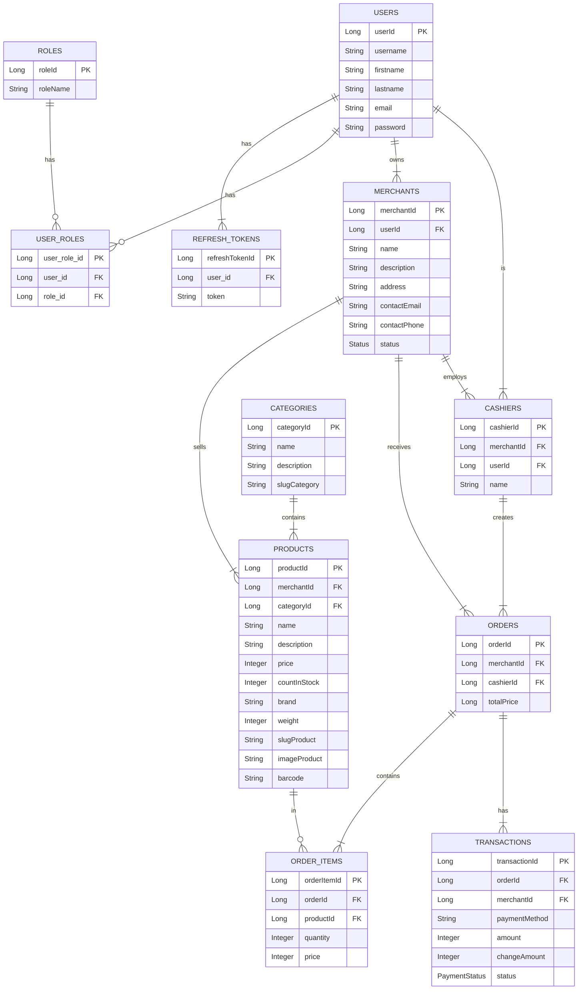

# Spring Boot Point of Sale API

**A Robust Backend API for a Full-Featured Point of Sale (POS) System**

The **Spring Boot Point of Sale API** is a high-performance backend service designed to power a complete retail Point of Sale system. Built using **Java 21** and **Spring Boot**, it delivers a comprehensive set of features including JWT-based authentication, user and role management, product and category handling, order processing, transaction management, and integrated merchant and cashier administration.

---

## Key Features

### Authentication & Security

* **JWT Authentication**: Secure registration and login system using JSON Web Tokens for authentication.
* **Role-Based Access Control (RBAC)**: Fine-grained access control enforcing permissions based on user roles such as admin, merchant, and cashier.

### Product & Category Management

* **Product CRUD Operations**: Full lifecycle management of products including price, stock, brand, weight, barcode, and image support.
* **Category Management**: Structured product categorization using unique slug-based identifiers for efficient lookup and organization.

### Merchant & Cashier Management

* **Merchant Onboarding**: Self-service merchant registration with profile, address, contact details, and business metadata.
* **Cashier Management**: Assignment and administration of cashiers under specific merchant entities.

### Order & Transaction Processing

* **Order Management System**: End-to-end order creation with cashier tracking, merchant association, and automatic total calculation.
* **Transaction Processing**: Payment validation, amount handling, change calculation, and transaction status tracking.

---

## Technology Stack

* **Language**: Java 21
* **Framework**: Spring Boot 3.x
* **Security**: Spring Security with JWT
* **ORM / Data Layer**: Spring Data JPA (Hibernate)
* **Database**: PostgreSQL
* **Build Tool**: Maven
* **API Documentation**: Springdoc OpenAPI (Swagger UI)

---

## Data Architecture & ERD

The database schema is designed to support a scalable retail ecosystem with clear separation between merchants, cashiers, products, and transactions.



---

## Technical Decisions & Trade-offs

**Spring Boot and the JVM vs lighter stacks**
A POS backend is CRUD plus transactions, which is exactly the workload Spring Boot is built for: Spring Security for the admin, merchant, and cashier role model, Springdoc for the Swagger UI a register client would be developed against, and one consistent repository layer. The cost is a JVM process idling at a memory level a Go binary would not reach, plus generous boilerplate. For a back-office API where correctness and documentation matter more than cold starts, the trade is reasonable.

**Spring Data JPA (Hibernate) vs SQL-first development**
Entities mirror the schema — merchants, cashiers, products, orders, order items, transactions — and repositories remove most hand-written persistence code. The trade-off is that Hibernate decides when stock decrements and totals actually hit the database, and a wrong flush order can silently change which value wins. Keeping writes short and explicitly transactional is the discipline that makes the abstraction safe here.

**PostgreSQL vs lighter storage options**
Checkout is a multi-table write: create the order, decompose order items, record a transaction with amount and change, all under one ACID commit. PostgreSQL also enforces the foreign keys between merchants, cashiers, products, and orders that keep per-merchant reporting trustworthy. The cost is running and backing up a real database server where an embedded store would be simpler — justified, because sales records are exactly the data you cannot afford to lose or corrupt.

**JWT roles on shared register hardware**
Stateless tokens fit POS clients that reconnect often and should not need server-side session affinity, and RBAC keeps a cashier token away from merchant and admin endpoints. The weak spot is revocation: a cashier token stays valid until expiry even if the employee is deactivated mid-shift, and refresh tokens only shorten that window when rotation is enforced. For internal staff devices the blast radius is contained, but it is a real limitation to design around.

**Single service vs splitting merchant, catalog, and sales**
Everything from product management to transaction processing runs in one deployable, so an order and its stock update commit atomically in one database transaction — no sagas, no eventual consistency in the checkout path. What is lost is isolation: a heavy admin report can slow the register lane, and the whole API redeploys as one unit. At the scale of a handful of merchants per instance, that is the right trade.

**Cash handling and register integrity (the core domain risk)**
Transactions store the paid amount and a computed change amount, which moves cash math into application code — change must be validated against the amount paid inside the same transaction that records the sale, or the till drifts. Attribution matters just as much: every order carries a cashier id so end-of-day reconciliation is possible, but only if voids and failed payments are persisted as first-class records rather than silent edits. A POS that lets a sale and its payment record diverge is worse than one that refuses the sale.

---

## API Documentation

The API is fully documented using **Swagger UI**, providing interactive endpoint exploration, request validation, and response schema visualization.

Preview:


---

## Getting Started

### Prerequisites

* Java JDK 21+
* Apache Maven
* PostgreSQL database instance

---

### Installation & Execution

#### 1. Clone Repository

```bash
git clone https://github.com/MamangRust/example-pointofsale-springboot
cd example-pointofsale-springboot
```

#### 2. Configure Database

Update `application.properties`:

```properties
spring.datasource.url=jdbc:postgresql://localhost:5432/pos_db
spring.datasource.username=postgres
spring.datasource.password=postgres
spring.jpa.hibernate.ddl-auto=update
```

#### 3. Run Application

Linux/macOS:

```bash
./mvnw spring-boot:run
```

Windows:

```cmd
mvnw.cmd spring-boot:run
```

#### 4. Access Application

* API Base URL: `http://localhost:8080`
* Swagger UI: `http://localhost:8080/swagger-ui.html`

---

## Source Code

Repository available at:
[https://github.com/MamangRust/example-pointofsale-springboot](https://github.com/MamangRust/example-pointofsale-springboot)
