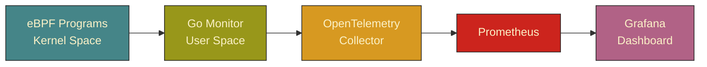

# eBPF Network & DNS Monitoring

A comprehensive network and DNS activity monitoring solution using **eBPF** instrumentation, the **Go** programming language, and a modern observability stack. This system dynamically tracks data traffic and domain resolution at the Linux kernel level to generate real-time analytics with minimal CPU overhead.

---

## Architecture Overview

This project is designed to capture data packets directly at the kernel entry point before they are distributed to user applications, encompassing the following vital components:

* **eBPF Programs**: Low-level (kernel-space) components for efficient and low-overhead data packet monitoring.
* **Go Monitor Application**: A user-space data processing component for handling raw data and distributing metrics.
* **OpenTelemetry**: Standard instrumentation libraries for distributed metric collection and tracing.
* **Prometheus**: A time-series data store for centralized metric storage.
* **Grafana**: A dynamic, graphical dashboard for performance analytics visualization.
* **Jaeger**: A platform for distributed request tracing.



---

## Key Features

* **Real-time DNS Monitoring**: Tracks all DNS resolution queries along with source/destination IP addresses, query types, and Process ID (PID) attribution.
* **Network Traffic Analysis**: Monitors TCP/UDP protocol activity in real-time, accompanied by accumulated byte statistics and process mapping.
* **eBPF Event Processing**: A high-performance kernel ring buffer mechanism to extract anomalous data.
* **Prometheus Metrics Export**: Native integration for exporting monitoring statistical data.
* **Grafana Visual Dashboards**: Equipped with pre-built dashboard templates ready to use for real-time statistical interpretation.
* **Distributed Request Tracing**: Full tracing support integrated with the Jaeger interface.
* **Docker Compose Configuration**: Easy and instant replication of the complete observability infrastructure environment.

---

## Technical Decisions & Trade-offs

**eBPF vs user-space monitoring (libpcap/tcpdump)**
The obvious alternative — `tcpdump`-style sniffing — copies every packet to user space, which burns CPU and starts dropping packets under load. eBPF runs the filter logic inside the kernel: each packet costs only a handful of instructions, and the verifier guarantees the program terminates (no unbounded loops, no arbitrary memory access), which is why it's far safer than a kernel module. The price of that safety: BPF programs are hard to debug, must satisfy the verifier's constraints, and need kernel 4.9+ with matching headers. That's a real portability cost, not a cosmetic one.

**Ring buffer vs BPF map for event transport**
The kernel→user channel uses a ring buffer: the kernel side just appends, the Go consumer pulls at its own pace, and under back-pressure the kernel overwrites the oldest events instead of blocking the packet path — monitoring must never slow down the traffic it's observing. The trade-off: sustained high event rates cause silent overruns, so the user-space side must track the overrun counter (`ebpf_events_total`) as a first-class signal. A per-CPU hash map would be more loss-resistant but adds aggregation complexity and overhead we didn't need.

**Keeping the eBPF program deliberately thin**
The kernel program only captures a fixed event struct (PID, IPs, query type, byte counters) and does no formatting or labelling. BPF code is painful to iterate on (compile, load, verifier errors), so every bit of logic that can live in Go belongs in Go. The trade-off: more data crosses the kernel/user boundary and user-space aggregation has to be fast enough — which is exactly where the Go consumer shines (goroutines + channel pipeline, cheap pre-allocated buffers).

**Full capture vs sampling**
Capturing every DNS query and every byte counter means no rare events are missed — important for this use case, where "one weird query from PID X" is often the interesting signal. The cost is that metrics volume grows with traffic, so downstream (Prometheus scrape + Grafana) becomes the bottleneck long before the kernel side does. Sampling would have kept the cost flat but would have biased the statistics toward the loud and the large.

**Go for the user-space agent**
Go was chosen mainly for the `cilium/ebpf` library (a first-class, actively maintained eBPF loader) and for producing a single static binary — an agent that has to run on many machines should not drag along a runtime. The trade-off: no mature eBPF ecosystem in other languages matches it, so "Go" and "eBPF" basically travel together; the C `libbpf` route is more flexible but pushes more of the plumbing onto you.

**PID attribution and its stale-entry risk**
Mapping each packet to the owning process (the PID in every metric) requires a kernel map of socket→PID, and entries go stale when processes exit — the map needs explicit eviction or it leaks memory and reports dead PIDs. That's a correctness cost paid for a very high observability payoff (you can see *which* process resolved `evil-domain.example`).

**The full observability stack (OTel → Prometheus + Grafana + Jaeger)**
The stack is deliberately canonical: it's reproducible with one `docker-compose up`, the dashboards are pre-built, and anyone reading the repo immediately knows how to extend it. The honest costs: five+ services on one host, Grafana's default `admin`/`admin` credentials (fine for a demo, unacceptable in production), Prometheus' finite local retention (no Thanos/VictoriaMetrics for long-term storage), and Jaeger tracing a DNS query is more than the workload strictly needs — it's included to demonstrate the full pipeline, which at this scale adds more overhead than insight.

---

## Getting Started

### System Prerequisites

* A Linux kernel that supports eBPF features (Version 4.9 or newer).
* Docker & Docker Compose.
* Go version 1.21 or higher (for standalone compilation).
* Clang and LLVM compilers (for compiling eBPF bytecode programs).

### Installation Guide

**1. Clone the Repository and Compile the Code**

```bash
git clone https://github.com/MamangRust/example-monitoringNetworkAndDns-ebpf monitoringnetworkdns
cd monitoringnetworkdns
make install-tools
make build

```

**2. Run the Complete Infrastructure**
Execute the following script to spin up the Go monitoring agent along with the entire observability stack:

```bash
docker-compose up -d

```

**3. Access Service Interfaces**

* **Grafana Dashboard**: `http://localhost:3000` (Default Username/Password: `admin`/`admin`)
* **Prometheus Console**: `http://localhost:9091`
* **Jaeger UI**: `http://localhost:16686`
* **Raw Metrics Endpoint**: `http://localhost:8080/metrics`

---

## Available Core Metrics

### 1. DNS Activity Metrics

* `dns_queries_total`: Total DNS queries based on query type classification and the requester's IP address.
* `dns_monitor_process_active`: The representative number of active process IDs executing DNS resolution calls.

### 2. Network Metrics

* `network_bytes_total`: Total accumulated data volume sent/received based on endpoint IP pairs and protocol types.
* `network_packets_total`: The number of discrete data packets processed by the network system.

### 3. eBPF Internal Metrics

* `ebpf_events_total`: Total accumulated raw data successfully pulled from the kernel ring buffer, classified by PID.

---

## Troubleshooting Guide

* **Permission Denied Issues**: Ensure you execute the user-space monitor program with Administrator (root) privileges, as eBPF programs require privileged access to the `bpf` system call.
```bash
sudo ./bin/monitor

```


* **Kernel Headers Not Found**: Install the kernel development headers corresponding to your OS kernel version.

```bash
  sudo apt-get install linux-headers-$(uname -r)

```

---

## Visual Demo Preview

### eBPF Monitoring Dashboard


---

## Source Code & Repository Links

You can explore the base implementation code for the eBPF ring buffer in C, metrics collection in Go, and the complete visual dashboard setup in the following repository:
[GitHub Repository: example-monitoringNetworkAndDns-ebpf](https://github.com/MamangRust/example-monitoringNetworkAndDns-ebpf)
