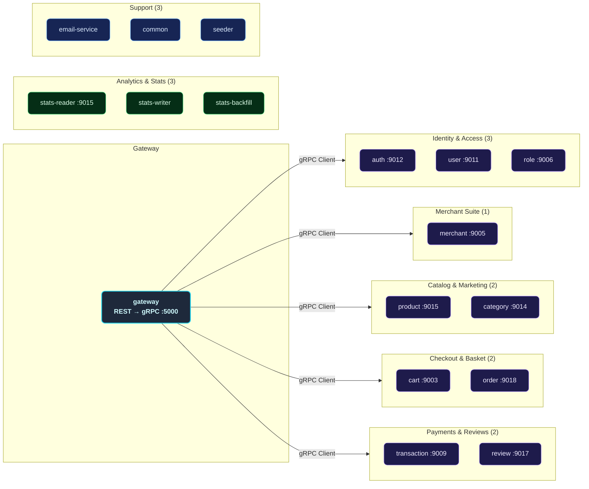
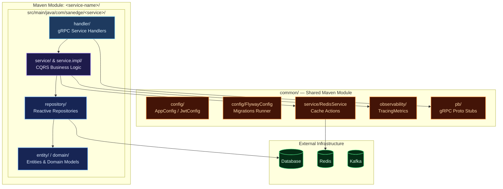
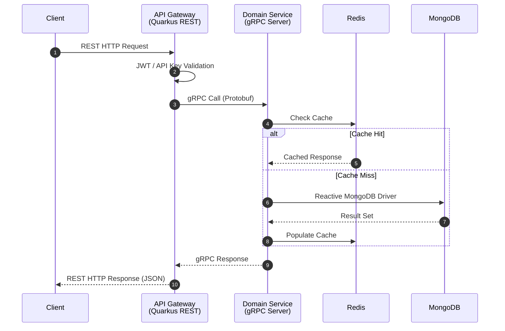
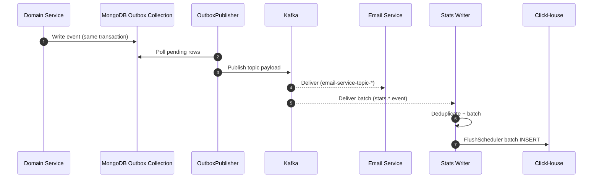
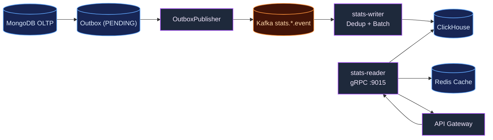
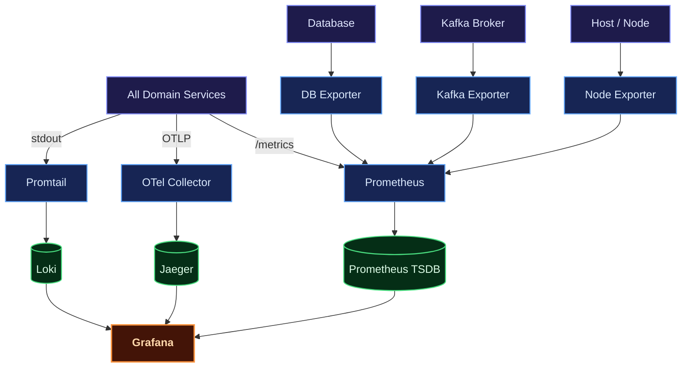
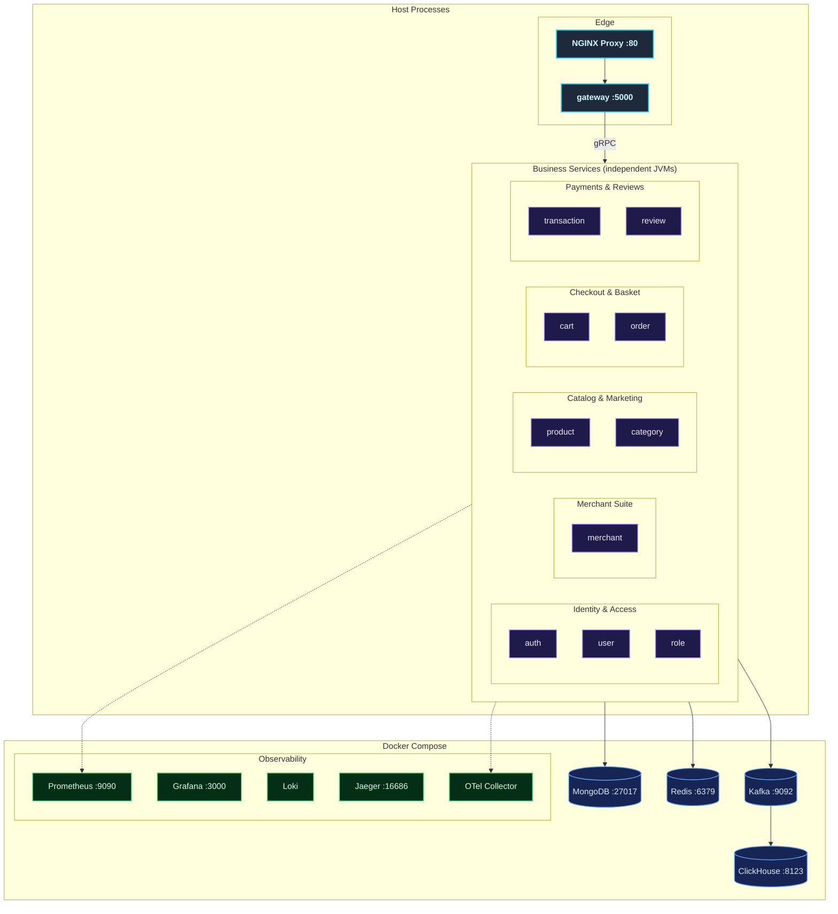

# Distributed Microservices — E-Commerce Platform (Java Quarkus, MongoDB + GraphQL)

A production-grade, highly resilient, and fully observable **microservices e-commerce backend** built in **Java 21** on the **Quarkus** reactive framework (v3.31.3). Designed around domain-driven service boundaries following Clean Architecture and CQRS principles, each service runs as an **independent JVM process** with its own gRPC server, MongoDB connection, and caching layer — true service-level isolation and independent deployability.

Each commerce domain — Users, Roles, Auth, Products, Categories, Cart, Orders, Shipping, Merchants, Reviews, Transactions, Banners, Sliders — lives in its own self-contained Maven module running as a **standalone microservice**. They communicate synchronously over high-performance **gRPC** and asynchronously through **Apache Kafka**, exposing a unified reactive entry point via a **REST API Gateway** powered by Quarkus RESTEasy Reactive + a GraphQL endpoint.

Beyond the business domains the platform ships a **ClickHouse analytics layer** (stats-reader, stats-writer, stats-backfill), a **transactional outbox** for lossless event publishing, and a full observability suite (Prometheus, Grafana, Loki, Jaeger, OpenTelemetry) with Kubernetes manifests delivered through **ArgoCD GitOps**.

---

## Key Features

| Domain | Capabilities |
| :--- | :--- |
| **Auth & Users** | Secure registration, multi-factor login, stateless JWT access/refresh token lifecycle, password reset workflows, OTP email verification, and a `/me` profile endpoint. |
| **Roles & RBAC** | Custom permission configuration, granular access control matrices, and sub-second permission evaluation cached via Redis. |
| **Catalog & Products** | Full CRUD for products and categories, promo banners, and home slider carousels. |
| **Cart & Commerce** | Add-to-cart, checkout workflows, order lifecycle management, order-item decomposition, and shipping address details. |
| **Merchants** | Merchant onboarding, profile details, business data registration, policies, and merchant awards. |
| **Transactions** | Central financial audit ledger collecting transaction and payment events, with global search filters and status tracking. |
| **Reviews** | Product ratings and detailed review submissions captured after purchase. |
| **Email Worker** | Kafka-driven worker dispatching OTPs, login alerts, merchant onboarding notices, and invoice emails over SMTP. |
| **ClickHouse Analytics** | Columnar BI layer fed asynchronously: stats-writer (Kafka→ClickHouse), stats-reader (gRPC→Redis cache), stats-backfill (MongoDB ×3→outbox→Kafka→ClickHouse). |
| **Transactional Outbox** | Events are written in the same transaction as the business write and relayed to Kafka by `OutboxPublisher`, so a broker outage never loses an event. |
| **Observability** | Metrics (Prometheus + Grafana), logs (Loki + Logback), distributed traces (Jaeger + OpenTelemetry), and exporters for Node, Kafka, and MongoDB. |
| **Deployment** | Docker Compose for local parity and auto-scaling Kubernetes manifests with HPAs, Kustomize, and ArgoCD App-of-Apps. |

---

## Architecture Overview

Every business service is an independent JVM process with its own gRPC boundary, MongoDB connection, and cache. A **Quarkus REST API Gateway** is the single edge router, translating client REST calls into fast gRPC calls through Quarkus gRPC clients.

### Core Architecture Principles

- **Service-Level Isolation**: Every microservice runs as its own JVM with its own gRPC server, MongoDB connection, and cache layer. No shared-memory coupling between services.
- **Clean Architecture & CQRS**: `Handler (gRPC) → Service (Command/Query) → Repository` keeps business logic clean and framework-agnostic.
- **Reactive Execution**: Quarkus reactive engine with Mutiny throughout, for high throughput at a minimal resource footprint.
- **Direct DB Connections**: Each service owns its reactive MongoDB driver connection (driver-level pooling) — no external connection proxy.
- **Event-Driven Resilience**: Kafka decouples side effects through the transactional outbox, so emails and analytics never block a business write.
- **CQRS & OLAP Split**: OLTP writes stay in MongoDB; heavy aggregations are served from ClickHouse populated asynchronously from Kafka.
- **OTel Telemetry**: OpenTelemetry middleware injects trace IDs across gRPC boundaries, so a request can be followed from the REST edge down to the database.

The same edge also exposes a **GraphQL endpoint** alongside the REST routes: a single typed query fetches a screen's worth of data in one round trip instead of several REST calls, at the cost of an extra contract to maintain and harder caching — HTTP-level cache keys do not map cleanly onto arbitrary GraphQL queries, so caching happens at the service layer instead.

```mermaid
graph TB
    classDef client fill:#0f172a,stroke:#38bdf8,color:#e0f2fe,stroke-width:2px,font-weight:bold
    classDef gateway fill:#1e293b,stroke:#22d3ee,color:#cffafe,stroke-width:2px,font-weight:bold
    classDef domain fill:#1e1b4b,stroke:#818cf8,color:#e0e7ff,stroke-width:1.5px
    classDef infra fill:#172554,stroke:#60a5fa,color:#dbeafe,stroke-width:1.5px
    classDef obs fill:#052e16,stroke:#4ade80,color:#dcfce7,stroke-width:1.5px
    classDef event fill:#431407,stroke:#fb923c,color:#fed7aa,stroke-width:1.5px
    classDef olap fill:#1e293b,stroke:#a855f7,color:#f3e8ff,stroke-width:1.5px

    Client["Client Applications<br/>(Web / Mobile / API)"]:::client

    subgraph APIGateway["API Gateway — NGINX + Quarkus REST"]
        direction LR
        REST["REST Router<br/>Port :5000"]:::gateway
        JWT["JWT / API Key<br/>Validation"]:::gateway
    end

    Client -->|"HTTP REST"| APIGateway

    subgraph BusinessServices["Microservices (Independent JVM Processes)"]
        direction TB
        subgraph IdentityAccess["Identity & Access"]
            AUTH["Auth Service<br/>gRPC :9012"]:::domain
            USER["User Service<br/>gRPC :9011"]:::domain
            ROLE["Role Service<br/>gRPC :9006"]:::domain
        end
        subgraph MerchantSuite["Merchant Suite"]
            MERCHANT["Merchant Service<br/>gRPC :9005"]:::domain
        end
        subgraph CatalogMarketing["Catalog & Marketing"]
            PRODUCT["Product Service<br/>gRPC :9015"]:::domain
            CATEGORY["Category Service<br/>gRPC :9014"]:::domain
        end
        subgraph CheckoutBasket["Checkout & Basket"]
            CART["Cart Service<br/>gRPC :9003"]:::domain
            ORDER["Order Service<br/>gRPC :9018"]:::domain
        end
        subgraph PaymentsReviews["Payments & Reviews"]
            TRANSACTION["Transaction Service<br/>gRPC :9009"]:::domain
            REVIEW["Review Service<br/>gRPC :9017"]:::domain
        end
    end

        REST -->|"gRPC Client"| IdentityAccess
    REST -->|"gRPC Client"| MerchantSuite
    REST -->|"gRPC Client"| CatalogMarketing
    REST -->|"gRPC Client"| CheckoutBasket
    REST -->|"gRPC Client"| PaymentsReviews

    subgraph OLAPEngine["OLAP & Analytics Layer"]
        direction TB
        WRITER["Stats Writer<br/>Kafka → ClickHouse"]:::olap
        READER["Stats Reader<br/>gRPC :9015 + Redis"]:::olap
        BACKFILL["Stats Backfill<br/>One-shot Loader"]:::olap
        CLICKHOUSE[("ClickHouse<br/>:8123")]:::infra
    end

    REST -->|"gRPC"| READER

    subgraph Infrastructure["Infrastructure Layer"]
        direction LR
        MONGO[("MongoDB ×3<br/>1 per bounded context<br/>:27017")]:::infra
        REDIS[("Redis<br/>Standalone Cache :6379")]:::infra
        KAFKA[("Kafka (KRaft)<br/>Event Bus :9092")]:::infra
    end

    AUTH -->|"MongoDB Driver"| MONGO
    USER -->|"MongoDB Driver"| MONGO
    ROLE -->|"MongoDB Driver"| MONGO
    MERCHANT -->|"MongoDB Driver"| MONGO
    PRODUCT -->|"MongoDB Driver"| MONGO
    CATEGORY -->|"MongoDB Driver"| MONGO
    CART -->|"MongoDB Driver"| MONGO
    ORDER -->|"MongoDB Driver"| MONGO
    TRANSACTION -->|"MongoDB Driver"| MONGO
    REVIEW -->|"MongoDB Driver"| MONGO
    BusinessServices -->|"Cache"| REDIS
    AUTH -->|"Invoices / Audit"| KAFKA
    MERCHANT -->|"Invoices / Audit"| KAFKA
    PRODUCT -->|"Invoices / Audit"| KAFKA
    CART -->|"Invoices / Audit"| KAFKA
    TRANSACTION -->|"Invoices / Audit"| KAFKA

    subgraph EventConsumers["Event-Driven Consumers"]
        EMAIL["Email Service<br/>SMTP Worker"]:::event
    end

    KAFKA -->|"email-service-topic-*"| EMAIL
    KAFKA -->|"stats.*.event"| WRITER
    WRITER -->|"Batch INSERT"| CLICKHOUSE
    READER -->|"Query"| CLICKHOUSE
    READER -->|"Cache"| REDIS
    BACKFILL -->|"OutboxPublisher"| KAFKA

    subgraph Observability["Observability Stack"]
        direction LR
        PROM["Prometheus"]:::obs
        LOKI["Loki"]:::obs
        JAEGER["Jaeger"]:::obs
        GRAFANA["Grafana"]:::obs
        OTEL["OTel Collector"]:::obs
        NODEX["Node Exporter"]:::obs
        KAFKAX["Kafka Exporter"]:::obs
        DBX["MongoDB Exporter"]:::obs
    end

    BusinessServices -.->|"/metrics"| PROM
    BusinessServices -.->|"OTLP"| OTEL
    OTEL -.-> JAEGER
    NODEX -.-> PROM
    KAFKAX -.-> PROM
    DBX -.-> PROM
    PROM -.-> GRAFANA
    LOKI -.-> GRAFANA
    JAEGER -.-> GRAFANA
```



---

## Service Catalog



The workspace is a root Maven parent POM with **10 business services** plus a REST gateway, a shared `common` library, three analytics workers, an email worker, and a seeder — all running as separate JVM processes.

---

## Internal Service Architecture

Every service follows the same internal layout, so a developer moving from one module to the next reads the same shape.



---

## Data & Event Flow

### Synchronous Flow (REST proxy, gRPC, cache read-through)

Client requests enter through NGINX, are validated by the gateway, forwarded over gRPC to the owning domain service, checked against Redis, and only fall through to the database on a cache miss.



### Asynchronous Flow (outbox → Kafka → consumers)

State-changing operations write an outbox document in the same transaction as the business write. `OutboxPublisher` relays pending records to Kafka, where the email worker and analytics consumers pick them up independently — consumers can lag or restart without blocking a business operation.



---

## ClickHouse Analytics Layer

Heavy aggregations — revenue, volume, and per-domain breakdowns — never touch the transactional store. They are served from ClickHouse, populated in near real time.



- **stats-writer** consumes domain event topics, deduplicates by `event_id`, batches, and flushes to ClickHouse via `ClickHouseBatchWriter`.
- **stats-reader** exposes gRPC analytics queries, caching hot aggregates in Redis.
- **stats-backfill** is a one-shot loader that replays historical MongoDB rows through outbox → Kafka → ClickHouse. Because it goes through the outbox it is **idempotent for free** — a re-run hits the unique `backfill:<domain>:<id>` constraint and inserts nothing.

---

## Observability Architecture



| Pillar | Tool | Purpose |
| :--- | :--- | :--- |
| **Metrics** | Prometheus + Grafana | Request error rates, gRPC latencies, pool states, and ClickHouse write latency/batch size/error rate from `StatsWriterMetrics`. |
| **Logging** | Loki + Logback | Centralized structured logs queryable by service with LogQL. |
| **Tracing** | OpenTelemetry + Jaeger | End-to-end traces from the REST edge across gRPC boundaries into the database. |

---

## Deployment Architectures

### Docker Compose (Local Development)

Infrastructure runs in containers; the Java services run as **independent JVM processes on the host**, each with its own gRPC server and database connection — closer to a real microservice deployment than stuffing everything into one compose file.



### Kubernetes (Production Clustering)

Manifests live in a project namespace with Kustomize overlays, NGINX pods behind a LoadBalancer, an HPA per scalable service, and ArgoCD **App-of-Apps** GitOps delivery. Sync waves are strictly ordered so database migrations complete before domain applications roll out.

---

## Technical Decisions & Trade-offs

### Technical Decisions & Trade-offs

**One service per aggregate, not per table**
Order, order-item, cart, product, and category are split because they change at different rates and have different read patterns — checkout writes heavily, the catalog reads heavily. Splitting per table instead would produce chatty joins across the network. The cost is that a single screen may need several gRPC calls, so the gateway has to batch and cache where it matters.

**Synchronous gRPC for stock and checkout, Kafka for notifications**
Stock checks and totals must be consistent at checkout, so they are synchronous. Emails, reviews-derived analytics, and merchant reports are side effects that can lag. The trade-off shows up under flash sales: synchronous stock validation concentrates load on the product service, which is exactly the service that also needs the highest read throughput.

**Transactional outbox over direct Kafka publishes**
Publishing directly to Kafka from a service means a crash between commit and publish silently loses an event. Writing to the outbox inside the same transaction removes that failure mode, and gives the backfill job idempotency for free. The cost is a relay loop that must itself be monitored for lag, plus an extra collection/table per publishing service.

**ClickHouse as a CQRS read model for order and merchant reporting**
Revenue by merchant, category price bands, and order volume over time are columnar workloads that would drag an OLTP store at scale. Moving them to ClickHouse keeps checkout fast. The cost is the same freshness gap: an order placed a second ago is not in the merchant's revenue chart yet.

---

## Technology Stack

| Category | Selected Technologies | Purpose |
| :--- | :--- | :--- |
| **Language** | Java 21 (Quarkus v3.31.3) | Reactive, non-blocking asynchronous execution. |
| **API Edge Gateway** | Quarkus RESTEasy Reactive + GraphQL | Gateway router and reverse proxy destination. |
| **RPC Inter-service** | Quarkus gRPC Client & Server | Contract-first synchronous communication. |
| **Database** | MongoDB (3 instances, one per bounded context) | Transactional document store. |
| **DB Migrations** | None — schemaless; the seeder loads reference data and Panache creates indexes on startup | Schema evolution. |
| **Connection Handling** | Reactive MongoDB driver pooling | Configurable pool sizing per service. |
| **Caching Tier** | Redis (Standalone) | In-memory cache per service and stats cache. |
| **Analytics DB** | ClickHouse | Columnar OLAP store for dashboards and reports. |
| **Messaging Stream** | Apache Kafka (KRaft) | Async event bus with DLQ support. |
| **Token Manager** | JWT | Stateless request authentication. |
| **Observability** | OpenTelemetry + Jaeger | Distributed telemetry pipeline and trace UI. |
| **Docker Engine** | Compose | Local infrastructure orchestration. |
| **Orchestrator** | Kubernetes + ArgoCD | Auto-scaling cluster and GitOps delivery. |

---

## Getting Started

### Prerequisites

- [Git](https://git-scm.com/)
- [JDK 21](https://adoptium.net/)
- [Maven](https://maven.apache.org/)
- [Docker](https://www.docker.com/) & [Docker Compose](https://docs.docker.com/compose/)
- [Hurl](https://hurl.dev/) (for the validation suites)

### 1. Clone the Workspace

```sh
git clone https://github.com/MamangRust/microservice-ecommerce-quarkus-mongodb-graphql.git
cd microservice-ecommerce-quarkus-mongodb-graphql
```

### 2. Prepare Environment Configurations

```sh
cp .env.example .env
cp deployments/local/docker.env.example deployments/local/docker.env
cp deployments/local/host.env.example deployments/local/host.env
```

### 3. Build the Maven Project

```sh
mvn -B clean install -DskipTests
```

### 4. Start Infrastructure & Launch Microservices

```sh
# Start infrastructure containers (MongoDB, Redis, Kafka, ClickHouse, observability)
docker-compose -f deployments/local/docker-compose.yml up -d

# Launch all Java microservices on the host
deployments/local/run-host-java.sh start
```

### 5. Run the Validation Suites

```sh
deployments/local/tests/checks/smoke.sh
BASE_URL=http://localhost:5000 deployments/local/tests/run-e2e.sh
BASE_URL=http://localhost:5000 deployments/local/tests/run-stats.sh
```

To stop everything:

```sh
deployments/local/run-host-java.sh stop
docker-compose -f deployments/local/docker-compose.yml down -v
```

### Port Map Registry

| Service | gRPC Port | HTTP Port | Description |
| :--- | :--- | :--- | :--- |
| **API Gateway** | — | `5000` | REST API entry point, proxies to gRPC |
| **Auth Service** | `9012` | `8092` | JWT authentication & registration |
| **User Service** | `9011` | `8091` | User profile management |
| **Role Service** | `9006` | `8086` | RBAC & permission management |
| **Merchant Service** | `9005` | `8085` | Merchant onboarding & profiling |
| **Product Service** | `9015` | `8095` | Product catalog CRUD |
| **Category Service** | `9014` | `8094` | Product categorization |
| **Cart Service** | `9003` | `8083` | Shopping cart operations |
| **Order Service** | `9018` | `8098` | Checkout & order flows |
| **Transaction Service** | `9009` | `8089` | Central audit register |
| **Review Service** | `9017` | `8097` | Ratings & feedback |
| **Stats Reader** | `9015` | `8096` | ClickHouse analytics queries |
| **Stats Writer** | — | `8095` | ClickHouse event consumer |
| **Email Service** | — | `8094` | Kafka-driven SMTP notifications |
| **NGINX / Grafana / Prometheus / Jaeger** | — | `80` / `3000` / `9090` / `16686` | Edge proxy and observability |
| **MongoDB** | — | `27017` | Transactional database |
| **ClickHouse** | — | `8123` | Analytics OLAP database |

---

## Source Code
[View on GitHub](https://github.com/MamangRust/microservice-ecommerce-quarkus-mongodb-graphql)

---

<p align="center">
  Built with Java 21, Quarkus, gRPC, Apache Kafka, and ClickHouse.
</p>
