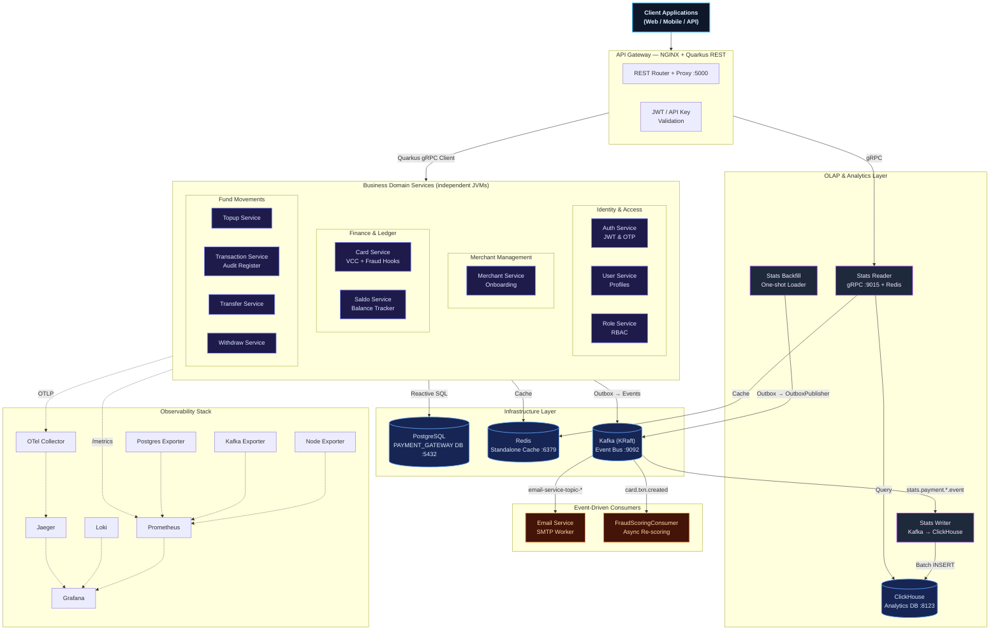
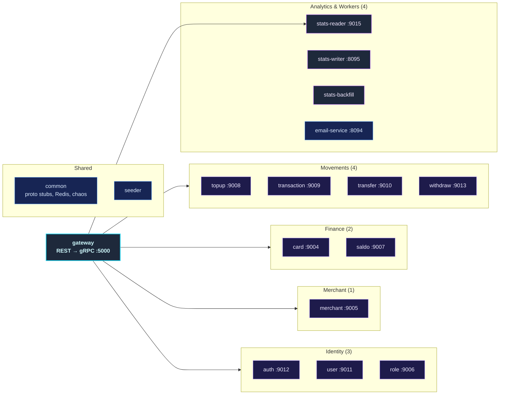
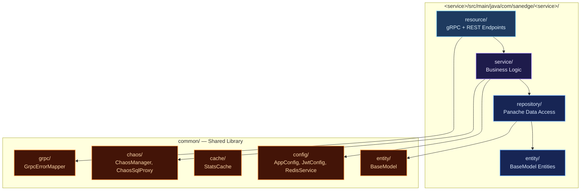
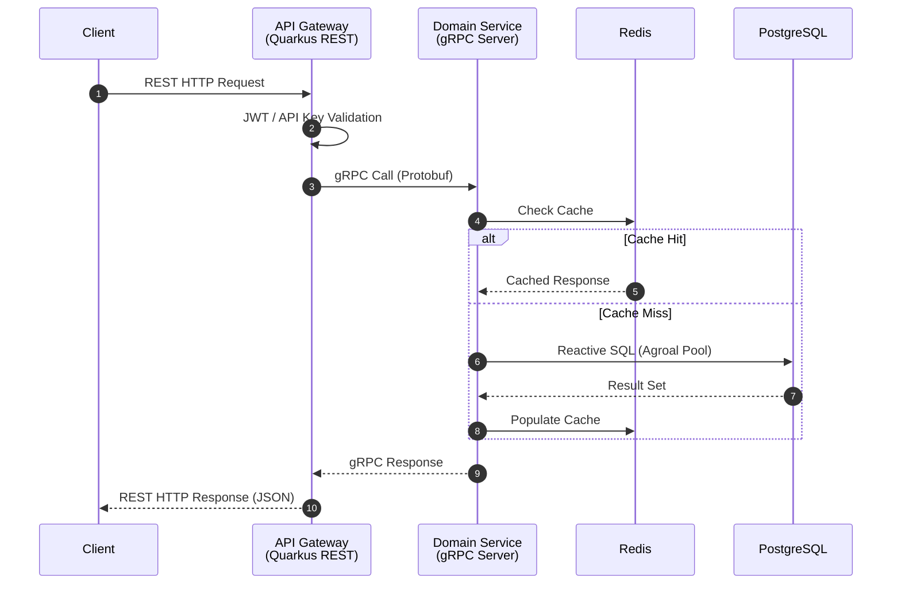
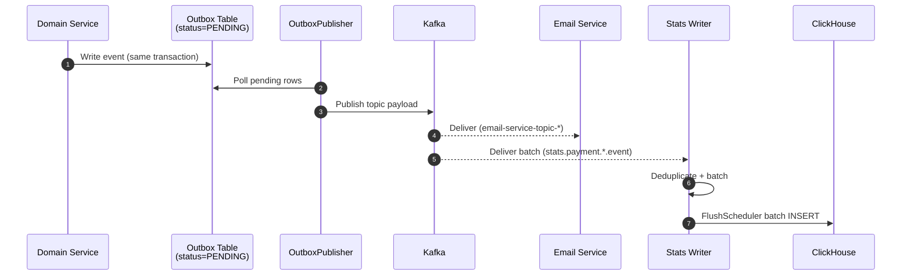
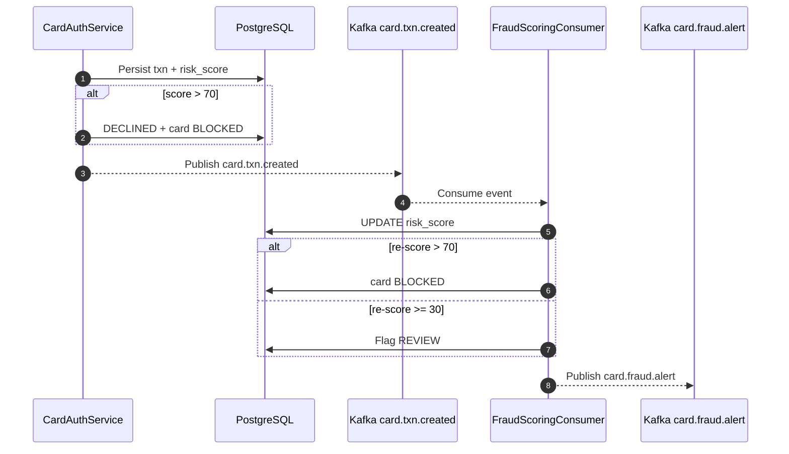
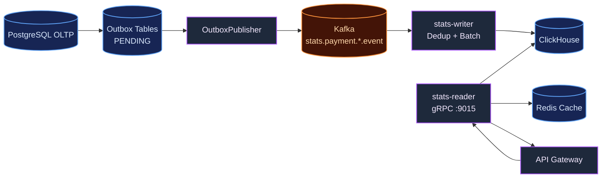
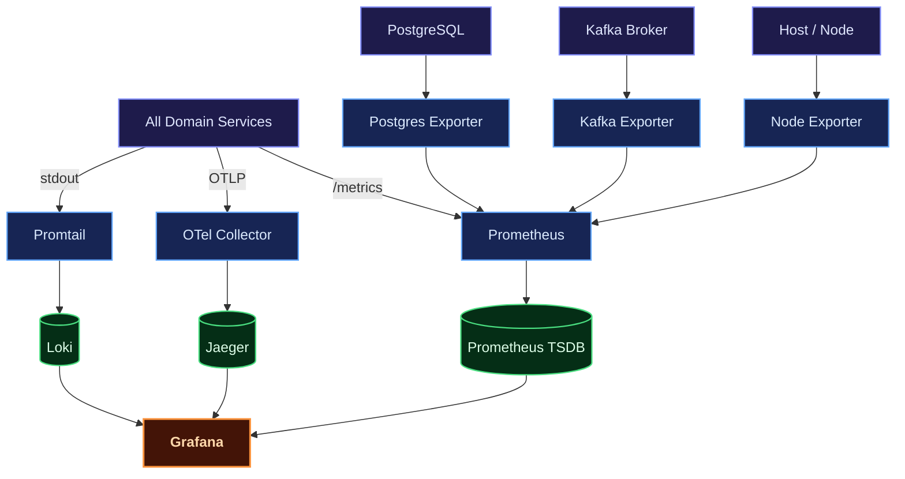
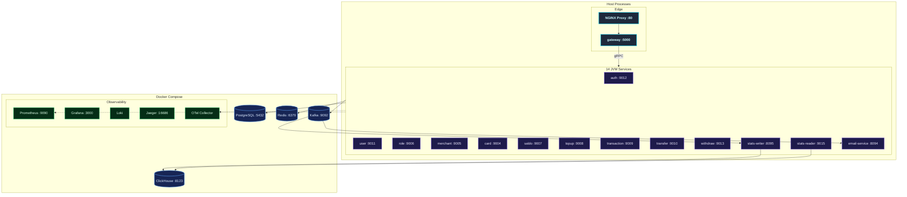

# Distributed Microservices Payment Gateway (Java Quarkus)

A production-grade, highly resilient, and fully observable **microservices payment gateway backend** built in **Java 21** on the **Quarkus** reactive framework (v3.31.3). Designed around domain-driven service boundaries following Clean Architecture and CQRS principles, each service runs as an **independent JVM process** with its own gRPC server, database migrations, and caching layer — true service-level isolation and independent deployability.

Each financial and identity domain — Users, Roles, Cards, Merchants, Saldo, Topups, Transactions, Transfers, Withdrawals — lives in its own self-contained Maven module running as a **standalone microservice**. Services talk synchronously over high-performance **gRPC** and asynchronously through **Apache Kafka**, exposing a unified reactive entry point via a **REST API Gateway** built on Quarkus RESTEasy Reactive.

Beyond the payment domains, the platform ships a **ClickHouse analytics layer** (stats-reader, stats-writer, stats-backfill), a **dual-path fraud scoring engine**, a **reactive chaos engineering engine** that hot-reloads failure policies, and a full observability suite (Prometheus, Grafana, Loki, Jaeger, OpenTelemetry) with Kubernetes manifests delivered through **ArgoCD GitOps**.

---

## Key Features

| Domain | Capabilities |
| :--- | :--- |
| **Auth & Users** | Secure registration, multi-factor login, stateless JWT access/refresh token lifecycle, password reset workflows, OTP email verification, and a `/me` profile endpoint. |
| **Roles & RBAC** | Custom permission configuration, granular access control matrices, and sub-second permission evaluation cached via Redis. |
| **Cards & VCC** | Virtual and debit card CRUD with soft delete, activation/suspension toggles, and multi-dimensional analytics (daily/monthly/yearly topup, withdraw, transfer). |
| **Merchants** | Merchant onboarding, profile details, business data registration, and performance/transaction reports with full soft-delete and restore. |
| **Saldo (Balance)** | High-throughput, thread-safe real-time balance calculation with optimistic concurrency locks. |
| **Topup** | Balance funding ledger supporting multiple payment methods, transaction logging, and soft-delete audit records. |
| **Transaction** | Central financial audit ledger, global search filters, status tracking, and monthly/yearly volume reports. |
| **Transfer** | Peer-to-peer card-to-card or user-to-user settlement with synchronized debit/credit and event-driven logging. |
| **Withdraw** | Settlement from user cards to external accounts/banks with daily limits and status pipelines. |
| **Fraud Scoring** | Dual-path detection: synchronous scoring during card authorization plus asynchronous re-scoring via Kafka with automatic card blocking and an audit trail. |
| **ClickHouse Analytics** | Columnar BI layer with a three-component pipeline: stats-writer (Kafka→ClickHouse), stats-reader (gRPC→Redis cache), stats-backfill (PostgreSQL→outbox→Kafka→ClickHouse). |
| **Email Worker** | Kafka-driven worker dispatching OTPs, login alerts, merchant onboarding notices, and transfer/topup invoices over SMTP. |
| **Chaos Engineering** | Built-in failure injection for HTTP latency/errors, SQL latency/deadlocks, CPU and memory pressure, and Kafka duplicates/delays — hot-reloaded from `chaos.yaml`. |
| **Observability** | Metrics (Prometheus + Grafana), logs (Loki + Logback), distributed traces (Jaeger + OpenTelemetry), and resource exporters for Node, Kafka, and Postgres. |
| **Deployment** | Docker Compose for local parity and auto-scaling Kubernetes manifests with HPAs, Kustomize, and ArgoCD App-of-Apps. |

---

## Architecture Overview

The platform implements a **distributed microservices architecture**. Every business service is an independent JVM process with its own gRPC boundary, connection pool, and Flyway migration history. A **Quarkus REST API Gateway** is the single edge router, translating client REST calls into fast gRPC calls through Quarkus gRPC clients.

### Core Architecture Principles

- **Service-Level Isolation**: Every microservice runs in its own JVM with its own gRPC server, connection pool, cache layer, and migrations. No shared-memory coupling between services.
- **Clean Architecture Layers**: `resource → service → repository → entity` inside each module, keeping business logic independent of framework and database details.
- **Reactive Execution**: Quarkus reactive engine with Mutiny throughout, for high throughput at a minimal resource footprint.
- **Direct DB Connections**: Each service owns its Agroal pool against PostgreSQL, with per-service `max-size` and `acquisition-timeout`.
- **CQRS & OLAP Split**: OLTP writes stay in PostgreSQL; heavy aggregations are served from ClickHouse populated asynchronously from Kafka.
- **Transactional Outbox**: Events are written to an outbox table inside the business transaction and relayed to Kafka, so a broker outage never loses a payment event.
- **OTel Telemetry**: OpenTelemetry middleware injects trace IDs across gRPC boundaries, so a request can be followed from the REST edge down to SQL.



---

## Service Catalog

The workspace is a root Maven parent POM with **17 modules**: a shared `common` library, a REST gateway, ten payment services, four telemetry/analytics workers, and a seeder.



---

## Internal Service Architecture

Every module follows the same internal layout, so a developer moving from `saldo` to `withdraw` reads the same shape.



---

## Data & Event Flow

### Synchronous Flow (REST proxy, gRPC, cache read-through)

Client requests enter through NGINX, are validated by the gateway, forwarded over gRPC to the owning domain service, checked against Redis, and only fall through to PostgreSQL on a cache miss.



### Asynchronous Flow (outbox → Kafka → consumers)

State-changing operations write an outbox row in the same transaction as the business write. `OutboxPublisher` relays pending rows to Kafka, where the email worker and analytics consumers pick them up independently — consumers can lag or restart without blocking a payment.



---

## Fraud Scoring Pipeline

Scoring runs on two paths. A **synchronous** check during card authorization is decisive — a high-risk transaction is declined and the card blocked before money moves. An **asynchronous** re-score consumes `card.txn.created`, recomputes the score with more context, and either blocks the card or flags the transaction for review, publishing to `card.fraud.alert`.



| Dimension | Condition | Points |
| :--- | :--- | :--- |
| **Amount** | `> 10M IDR` | +50 |
| | `> 5M IDR` | +30 |
| | `> 1M IDR` | +15 |
| **MCC Blacklist** | `7995`, `5967`, `7273`, `4829` | +40 |

Maximum score is **90** (50 amount + 40 MCC). `> 70` → BLOCKED, `>= 30` → REVIEW.

---

## ClickHouse Analytics Layer

Heavy aggregations — monthly and yearly volumes, payment-method breakdowns, topup/withdraw/transfer trends — never touch the OLTP ledger. They are served from ClickHouse, populated in near real time.



- **stats-writer** consumes domain event topics, deduplicates by `event_id`, batches, and flushes to ClickHouse via `ClickHouseBatchWriter`.
- **stats-reader** exposes gRPC analytics queries, caching hot aggregates in Redis.
- **stats-backfill** is a one-shot loader that replays historical PostgreSQL rows through outbox → Kafka → ClickHouse. Because it goes through the outbox it is **idempotent for free** — a re-run hits the unique `backfill:<domain>:<id>` constraint and inserts nothing.

---

## Chaos Engineering Platform

The platform carries its own **reactive chaos engine** to test resilience under failure, instead of trusting it on paper. `ChaosManager` watches `chaos.yaml` and hot-reloads policies every 5 seconds, so a policy can be toggled against a running system without a restart.

| Mechanism | What it injects |
| :--- | :--- |
| **HTTP Routing Chaos** | Latency hikes and HTTP errors (e.g. 429) at gateway entry points. |
| **Database SQL Chaos** | Transaction latency, lock-wait timeouts, and simulated deadlocks on matching tables via a dynamic proxy around the SQL client. |
| **Resource Stress Chaos** | CPU and memory pressure routines simulating container throttling or exhaustion. |
| **Kafka Chaos** | Duplicate and delayed message delivery across 19 policies (12 email topics + 5 domain topics), all disabled by default. |

---

## Kafka Event Architecture

Kafka (KRaft mode) is the asynchronous backbone. Email notifications use twelve dedicated topics — 6 paired producer/consumer, 6 consumer-only — covering registration, forgot password, OTP verification, saldo/topup/transaction/transfer/withdraw creation, and merchant onboarding and document status changes. Domain topics cover saldo lifecycle (`saldo-service-topic-create-saldo`), fraud scoring (`card.txn.created`), and the card audit trail (`card.fraud.alert`, `card.payment.posted`, `card.statement.generated` → `card_event_logs`).

Email topics support a **dead letter queue**: on exhausted retries the event is published to `<topic>.dlq` with an envelope carrying `original_topic`, `original_partition`, `original_offset`, `failure`, and `payload`. Manual offset commits ensure no message is lost.

---

## Observability Architecture



| Pillar | Tool | Purpose |
| :--- | :--- | :--- |
| **Metrics** | Prometheus + Grafana | Request error rates, gRPC latencies, pool states, and ClickHouse write latency/batch size/error rate from `StatsWriterMetrics`. |
| **Logging** | Loki + Logback | Centralized structured logs queryable by service with LogQL. |
| **Tracing** | OpenTelemetry + Jaeger | End-to-end traces from the REST edge across gRPC boundaries into SQL. |

---

## Deployment Architectures

### Docker Compose (Local Development)

Infrastructure runs in containers; the Java services run as **independent JVM processes on the host**, each with its own gRPC server and Agroal pool — closer to a real microservice deployment than stuffing fourteen services into one compose file.



### Kubernetes (Production Clustering)

Manifests live in the `payment-gateway` namespace with Kustomize overlays, NGINX pods behind a LoadBalancer, an HPA per scalable service, and ArgoCD **App-of-Apps** GitOps delivery. `build-image.sh` builds the Quarkus service images in batches of two, with `BATCH_SIZE`, `TAG`, `PUSH`, and `--dry-run` knobs.

---

## Technical Decisions & Trade-offs

**Real microservices instead of a modular monolith**
Fourteen independent JVMs mean fault containment — a runaway Saldo service cannot starve Auth — and per-service HPA, so card traffic scales without scaling withdrawals. The honest cost: fourteen deployables, fourteen sets of migrations, fourteen pools, and a much heavier local footprint. For a payment gateway the isolation of the ledger is worth that wiring bill; for a smaller domain this would be over-engineering.

**JVM processes on the host in Compose, containers in K8s**
Running services outside Compose gives fast startup and direct debugging during development, but it means two ways to run the same code, and local parity is only approximate. Containers are the only path where image configuration, health checks, and networking are actually exercised.

**Synchronous gRPC for authorization, Kafka for everything else**
Authorization must be decided now, so it stays on a typed synchronous call. Emails, analytics, and audit trails are side effects, so they flow through Kafka and can lag without blocking a payment. The price is the usual at-least-once tax — deduplication keys and idempotent consumers are mandatory, not optional.

**Transactional outbox over direct Kafka publishes**
Publishing directly to Kafka from a service means a crash between commit and publish silently loses a ledger event. Writing to the outbox inside the same transaction removes that failure mode — and also gives the backfill job idempotency for free. The cost is a relay loop (`OutboxPublisher`) that must itself be monitored for lag, plus an extra table per publishing service.

**Dual-path fraud scoring**
Synchronous scoring can block before settlement, which is what a payment system needs. Asynchronous re-scoring catches cases the synchronous path can't evaluate in time — extra context, cross-event patterns — and can block the card after the fact. The trade-off: a transaction may be approved and later flagged, so REVIEW state has to be a first-class flow rather than an error.

**ClickHouse as a CQRS read model**
Aggregations over millions of rows stay off the OLTP database. In exchange, the analytics view lags real time — a freshly settled transfer is not yet in the dashboard — and the pipeline adds a writer, a reader, a backfill job, and a second database to operate. Good for BI, wrong for "what is this account's balance right now", which always reads PostgreSQL.

**Reactive throughput versus debuggability**
Mutiny and non-blocking SQL keep resource usage low under high concurrency, but stack traces cross reactive boundaries and blocking calls hide easily. The team's answer is the chaos engine: inject latency and deadlocks deliberately rather than discovering them in production.

**A built-in chaos engine, hot-reloaded from a file**
Being able to turn on a failure policy on a running system is the difference between claiming resilience and demonstrating it. The cost is that chaos code ships into production builds and must be guarded by default-off policies.

---

## Technology Stack

| Category | Selected Technologies | Purpose |
| :--- | :--- | :--- |
| **Language** | Java 21 (Quarkus v3.31.3) | Reactive, non-blocking asynchronous execution. |
| **API Edge Gateway** | Quarkus RESTEasy Reactive | Gateway router and reverse proxy destination. |
| **RPC Inter-service** | Quarkus gRPC Client & Server | Contract-first synchronous communication. |
| **Database** | PostgreSQL v17 | ACID ledger persistence. |
| **DB Migrations** | Flyway | Versioned schema migrations on startup. |
| **Connection Pool** | Agroal | Per-service configurable pool sizing. |
| **Caching Tier** | Redis (Standalone) | In-memory cache per service and stats cache. |
| **Analytics DB** | ClickHouse | Columnar OLAP store for dashboards and reports. |
| **Messaging Stream** | Apache Kafka (KRaft) | Async event bus with DLQ support. |
| **Token Manager** | JWT | Stateless request authentication. |
| **Observability** | OpenTelemetry + Jaeger | Distributed telemetry pipeline and trace UI. |
| **Chaos** | Custom Quarkus engine | HTTP/SQL/resource/Kafka failure injection. |
| **Docker Engine** | Compose | Local infrastructure orchestration. |
| **Orchestrator** | Kubernetes + ArgoCD | Auto-scaling cluster and GitOps delivery. |

---

## Getting Started

### Prerequisites

- [Git](https://git-scm.com/)
- [JDK 21](https://adoptium.net/)
- [Maven](https://maven.apache.org/)
- [Docker](https://www.docker.com/) & [Docker Compose](https://docs.docker.com/compose/)
- [Hurl](https://hurl.dev/) (for the validation suites)

### 1. Clone the Workspace

```sh
git clone https://github.com/MamangRust/microservice-payment-gateway-quarkus.git
cd microservice-payment-gateway-quarkus
```

### 2. Prepare Environment Configurations

```sh
# Copy root variables
cp .env.example .env

# Copy local docker settings overrides
cp deployments/local/docker.env.example deployments/local/docker.env
cp deployments/local/host.env.example deployments/local/host.env
```

### 3. Build the Maven Project

```sh
mvn -B clean install -DskipTests
```

### 4. Start Infrastructure & Launch Microservices

```sh
# Start infrastructure containers only (Postgres, Redis, Kafka, ClickHouse, observability)
docker-compose -f deployments/local/docker-compose.yml up -d

# Build all modules
mvn -B clean install -DskipTests

# Launch all Java microservices on the host (wave-based startup)
deployments/local/run-host-java.sh start
```

### 5. Run the Validation Suites

```sh
# Health & resilience checks
deployments/local/tests/checks/smoke.sh
deployments/local/tests/checks/chaos-dependency-check.sh

# Functional end-to-end suites
BASE_URL=http://localhost:5000 deployments/local/tests/run-e2e.sh
BASE_URL=http://localhost:5000 deployments/local/tests/run-stats.sh
BASE_URL=http://localhost:5000 deployments/local/tests/run-fraud-scoring.sh
```

To stop everything:

```sh
deployments/local/run-host-java.sh stop
docker-compose -f deployments/local/docker-compose.yml down -v
```

### Port Map Registry

| Service | gRPC Port | HTTP Port |
| :--- | :--- | :--- |
| **API Gateway** | — | `5000` |
| **Auth Service** | `9012` | `8092` |
| **User Service** | `9011` | `8091` |
| **Role Service** | `9006` | `8086` |
| **Merchant Service** | `9005` | `8085` |
| **Card Service** | `9004` | `8084` |
| **Saldo Service** | `9007` | `8087` |
| **Topup Service** | `9008` | `8088` |
| **Transaction Service** | `9009` | `8089` |
| **Transfer Service** | `9010` | `8090` |
| **Withdraw Service** | `9013` | `8093` |
| **Stats Reader** | `9015` | `8096` |
| **Stats Writer** | — | `8095` |
| **Email Service** | — | `8094` |
| **NGINX / Grafana / Prometheus / Jaeger** | — | `80` / `3000` / `9090` / `16686` |

---

## Workspace Directory Tree

```
microservice-payment-gateway-quarkus/
├── pom.xml                         # Root Maven Parent POM
├── chaos.yaml                      # Chaos engineering policy config
├── common/                         # Shared library (proto stubs, Redis, config, chaos)
│   └── src/main/java/com/sanedge/common/
│       ├── config/                 #   AppConfig, JwtConfig, RedisService
│       ├── chaos/                  #   ChaosManager, ChaosSqlProxy, ChaosResourceSabotage
│       ├── cache/                  #   StatsCache (ClickHouse)
│       ├── grpc/                   #   GrpcErrorMapper
│       └── entity/                 #   BaseModel (Panache base)
├── gateway/                        # REST API Gateway (HTTP → gRPC proxy, :5000)
├── auth/                           # Auth Service — JWT & registration (:9012)
├── user/                           # User Service — profiles (:9011)
├── role/                           # Role Service — RBAC (:9006)
├── merchant/                       # Merchant Service — onboarding (:9005)
├── card/                           # Card Service — VCC, analytics, fraud hooks (:9004)
├── saldo/                          # Saldo Service — balance tracking (:9007)
├── topup/                          # Topup Service — balance funding (:9008)
├── transaction/                    # Transaction Service — audit ledger (:9009)
├── transfer/                       # Transfer Service — P2P transfers (:9010)
├── withdraw/                       # Withdraw Service — fund settlement (:9013)
├── email-service/                  # Email Service — Kafka SMTP worker (:8094)
├── stats-reader/                   # Stats Reader — ClickHouse gRPC queries (:9015)
├── stats-writer/                   # Stats Writer — Kafka→ClickHouse batch consumer (:8095)
├── stats-backfill/                 # Stats Backfill — one-shot PostgreSQL→outbox→Kafka→ClickHouse
├── seeder/                         # Seeder — DB seed data loader
├── deployments/
│   ├── local/                      #   Docker compose + local tooling
│   │   ├── docker-compose.yml      #     Local infra stack
│   │   ├── run-host-java.sh        #     Launch Java services on the host (start/stop)
│   │   ├── build-image.sh          #     Batched Docker image builder
│   │   └── tests/                  #     Hurl suites + health/resilience checks
│   └── kubernetes/                 #   Production K8s manifests (Kustomize + ArgoCD)
├── observability/                  # Grafana dashboards, Prometheus rules, Loki config
├── nginx/                          # Reverse-proxy NGINX rules
└── images/                         # Architecture diagrams & dashboard screenshots
```

---

## Source Code
[View on GitHub](https://github.com/MamangRust/microservice-payment-gateway-quarkus)

---

<p align="center">
  Built with Java 21, Quarkus, gRPC, Apache Kafka, and ClickHouse — with a chaos engine that proves the resilience claims.
</p>
