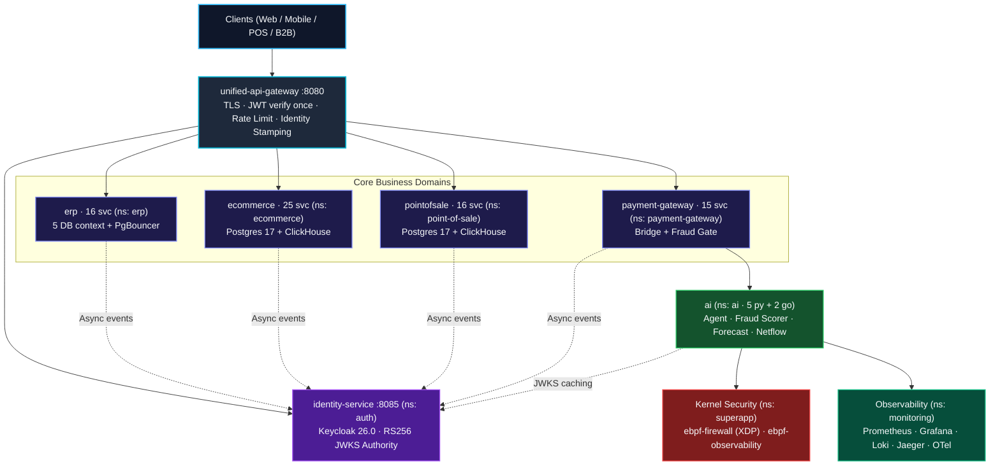
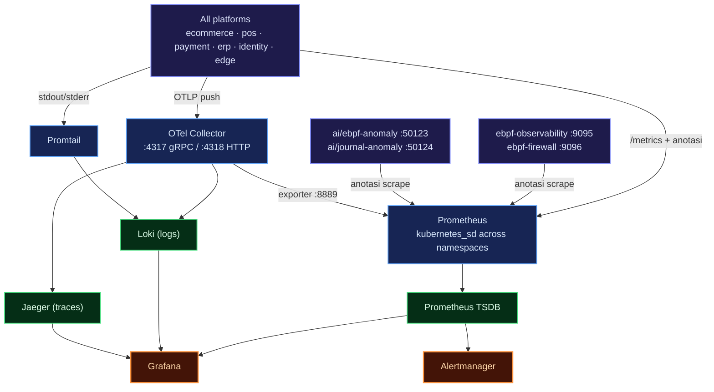

# Microservice Super App — Federated Go Domains with Kernel-Level Security

Backend **super-app** built as **a federation of independently deployable domains** — ERP, E-Commerce, Point of Sale (POS), Payment Gateway, Central Identity, AI/ML autonomous, and kernel-level security enforcement.

This is a learning project, not a production system. I built it to understand how platforms that each stand on their own can be wired together into a single product — without merging their code — and to practice patterns I had only read about in docs: outbox/inbox, cross-platform sagas, and kernel-level enforcement via eBPF. This write-up focuses on **architectural decisions and the price paid for them**, not on a feature list.


---

## Key Features

| Domain | Capabilities |
| :--- | :--- |
| **Unified Edge Gateway** | Single public entry point (`:8080`): TLS termination, JWT verification **once**, per-IP token-bucket rate limiting, identity header stamping, reverse proxy + REST→gRPC façade |
| **Central Identity** | `identity-service` (`:8085`, REST/chi) + **Keycloak 26.0** (realm `superapp`, RS256). Two paths: local registration/verification, token issuance via Keycloak. Dual-write with compensation |
| **ERP Platform** | 16 engines: finance, accounting, costing, inventory, sales, purchasing, CRM, HRIS, manufacturing, reporting, approval, subcontract, master-data |
| **E-Commerce Platform** | 25 modules: catalog, cart, order, order_item, merchant + 5 satellite contexts, review, banner, slider, shipping, transactions |
| **Point of Sale** | 16 modules: cashier, order, product, category, merchant, transactions, settlement |
| **Payment Gateway** | 15 modules: card/VCC, balance, topup, withdraw, transfer, merchant, ledger + **payment bridge** (orchestration + fraud gate) |
| **Event Backbone** | Kafka with a **Transactional Outbox** on the producer and **Inbox dedup** on the consumer, canonical camelCase envelope, trace context in headers, DLQ `outbox.dead` |
| **Saga Checkout** | Cross-platform stock via gRPC (`CheckStock`/`DeductStock`/`ReleaseStock`), compensation on `payment.failed`, TTL worker, order state machine compare-and-swap |
| **AI/ML Polyglot** | Go for transactions, Python for inference: `fraud-detector`, `embedder`, `forecaster`, `journal-anomaly`, `ebpf-anomaly` — **remote-first, fail-open** |
| **Agent Runtime** | `aiagent` (Go, Observe→Understand→Plan→Act→Verify loop) + `agentweb` (embedded React console, read-only REST/SSE) |
| **Kernel Security** | `ebpf-firewall` (XDP L3/L4 drop + kprobe L7 signal) and `ebpf-observability` (DaemonSet, ring buffer, 11 runtime Sigma rules) |
| **OLAP Analytics** | ClickHouse on every platform, fed by `stats-writer` (Kafka consumer + backfill) and served by `stats-reader` (aggregation gRPC) |
| **Persistence** | **database-per-bounded-context**: 5 PostgreSQL clusters in ERP, 6 in E-Commerce, 5 in POS, 3 in Payment Gateway — each behind its own PgBouncer |
| **Observability** | One **shared** stack in the `monitoring` namespace: OTel Collector (sink OTLP tunggal), Prometheus, Grafana, Loki, Jaeger, Alertmanager, node-exporter |
| **Deployment** | Local Docker Compose, Kustomize + production-style overlays, **Argo CD** (app-of-apps) per platform, HPA + PDB + NetworkPolicy |

---

## Architecture Principles

These six rules keep the federation coherent:

1. **Autonomous domains.** Every platform is fully sovereign: database, connection pools, cache, and migration pipelines are isolated. No cross-database joins, no shared physical schema, no direct DB access from other domains.
2. **Contract coupling over code sharing.** Code duplication at platform boundaries is preferred over tight coupling. Integration happens only through Protobuf contracts (gRPC), Kafka event envelopes, canonical identity headers, and the edge route map.
3. **Fail-open.** Kernel enforcement (XDP) and AI inference are designed to **fail open**: if a BPF map is empty or a scoring service is down, business transactions proceed with deterministic fallback rules.
4. **Say it as it is.** Each part's capabilities are continuously checked, not assumed. Telemetry distinguishes genuinely verified kernel signals (`KERNEL_EBPF`), local simulation (`SIMULATOR`), and limited fallback (`UNAVAILABLE`).
5. **Zero-trust edge stamping.** Identity verification stops at the edge. Incoming request headers are sanitized and rewritten with verified cryptographic claims — client-side spoofing of `x-user-id` becomes impossible.
6. **Isolated builds.** 94 Go modules with relative `replace` directives cannot coexist in one workspace; per-module builds (`GOWORK=off`) are a final decision, not an unresolved limitation.

---

## Architecture Overview



### Platform Inventory

| Platform | Stack | Active Modules | Storage | Namespace |
| :--- | :--- | :--- | :--- | :--- |
| **identity-service** | Go 1.26 (chi) | 1 core engine | PostgreSQL 17 + Keycloak 26 | `auth` |
| **unified-api-gateway** | Go 1.26 (chi) | 1 edge proxy | Redis 7 (rate limit) | `edge` |
| **erp** | Go 1.26 (chi/gRPC) | 16 engine | 5× PostgreSQL 17 + PgBouncer | `erp` |
| **ecommerce** | Go 1.26 (chi/gRPC) | 25 modules | PostgreSQL 17 + ClickHouse | `ecommerce` |
| **pointofsale** | Go 1.26 (chi/gRPC) | 16 modules | PostgreSQL 17 + ClickHouse | `point-of-sale` |
| **payment-gateway** | Go 1.26 (chi/gRPC) | 15 modules | PostgreSQL 17 + ClickHouse | `payment-gateway` |
| **ai** | Python 3.12 + Go | 7 services (5 py, 2 go) | Model on-disk + SQLite + vector | `ai` |
| **ebpf-firewall** | Go + C (eBPF CO-RE) | 1 daemon + sidecar | BPF maps (L3/L4/L7) | `superapp` |
| **ebpf-observability** | Go + C (eBPF CO-RE) | 1 DaemonSet | Kernel ring buffer + /proc | `superapp` |
| **observability** | Config / PromQL | Shared stack | TSDB + Loki + Jaeger | `monitoring` |

---

## Data Architecture

Every platform uses the same pattern — and that pattern is what lets the compiler enforce domain boundaries instead of relying on convention.

### Database per Bounded Context

This is the decision that saved the most debugging time. Instead of one big database with prefixed tables, each context has **its own PostgreSQL 17 cluster** with its own PgBouncer pooler:

| Platform | PostgreSQL Clusters | Pooler |
| :--- | :--- | :--- |
| **erp** | `erp_finance`, `erp_supply`, `erp_sales`, `erp_hr`, `erp_platform` | 1 PgBouncer per context |
| **ecommerce** | identity, merchant, catalog, sales, experience, email | PgBouncer per context + NetworkPolicy |
| **pointofsale** | `pos_identity`, `pos_merchant`, `pos_catalog`, `pos_sales`, `pos_email` | PgBouncer per context |
| **payment-gateway** | `pg_identity`, `pg_payment`, `pg_financial` | PgBouncer per context |

The important part: **there is no generic `DB_HOST`**. Each service declares its context once, and `pkg/database` resolves the env prefix per context. A service can only reach the cluster belonging to its context. **Cross-context schema coupling is not merely discouraged — it cannot be represented.** A wrong cluster prefix makes startup fail instead of silently connecting to the wrong database.

### Migration Without Collisions

Migrations run **via goose at boot**, but each platform has its own migration history so modules never overwrite each other's versions. There is also a `migrate-job` in Kubernetes with its own NetworkPolicy, so the Postgres → PgBouncer → migrate → workload ordering can be controlled via Argo CD sync-waves.

### OLAP Without Touching the Transactional Tier

Analytical queries never load the transactional database. Each platform has **ClickHouse** fed by `stats_writer` (a Kafka consumer with bootstrap backfill) and served by `stats_reader` — an aggregation gRPC service that returns monthly/yearly volume, payment method breakdowns, transaction success rates, best-selling products, and even cashier performance.

### Redis

A Redis 7 cluster is used for token blacklists, sessions, read-through cache, distributed locks, and edge rate-limit counters. Each service has its own cache telemetry, so per-domain hit ratios can be read directly in Grafana.

---

## Event Backbone, Outbox, and Deduplication

Cross-platform asynchronous integration goes through Kafka, with the same contract on every platform.

### Canonical Envelope

```json
{
  "eventId": "…",
  "eventType": "PAYMENT_COMPLETED",
  "timestamp": "…",
  "source": "payment-gateway",
  "correlationId": "…",
  "payload": { }
}
```

Event type constants are shared across all platforms (`pkg/events`): `ORDER_PAYMENT_REQUESTED`, `PAYMENT_COMPLETED`, `PAYMENT_FAILED`, `USER_REGISTERED`, `INVENTORY_STOCK_SYNCED`, `ORDER_STATUS_UPDATED`, `JOURNAL_ENTRY_CREATED`, `JOURNAL_ENTRY_REQUESTED`, `ERP_DATA_SYNCED`, `ORDER_BASKET_UPDATED`. Topic names use the dotted form: `order.payment.requested`, `payment.completed`, `payment.failed`, `user.registered`, `accounting.journal.posted`, `accounting.journal.finding`, `ebpf.netflow`.

### Outbox → Kafka → Inbox

Producers **never dual-write**. State changes and events are written in **a single transaction** to the `outbox_events` table; a separate relay publishes them to Kafka. Consumers deduplicate via the `consumer_inbox` table (`pkg/outbox.PostgresInbox`), so *at-least-once* delivery never turns into duplicate effects.

Trace context travels in Kafka headers (`traceparent`/`tracestate`) via `SendMessageWithHeaders`, and saga-path consumers extract that trace to start a `consume <topic>` span — so a single trace can be followed from the edge HTTP request all the way to a ledger row.

Relay failures never vanish silently: DLQ `outbox.dead` with the `outbox_dead_events_total` metric (erp/identity/gateway) or its OTLP-native equivalent `outbox_events_dead` (ecommerce/pointofsale).

### Verified Event Paths

This is not an aspirational diagram — the following paths are verified end-to-end:

- `user.registered` → identity-service publish → `erp/crm` consume
- `order.payment.requested` → ecommerce/order publish → payment bridge consume
- `payment.completed` / `payment.failed` → bridge publish → ecommerce/order **and** erp/accounting consume
- `accounting.journal.entry` → erp/accounting publish → bridge consume
- `accounting.journal.posted` → erp/accounting publish → `ai/journal-anomaly` score → emit `accounting.journal.finding`
- `ebpf.netflow` → ebpf-observability publish → `ai/ebpf-anomaly` consume (shadow mode)

---

## Cross-Domain Transaction: Saga Checkout

Checkout touches the cart, shipping, order, ERP stock, and payment gateway as separate calls. Nothing wraps them in a single atomic transaction — and that is a deliberate choice.


What makes this safe:

- **Order state machine compare-and-swap.** Transitions from `pending` to `PAID`/`FAILED` are CAS, so two racing consumers never produce two truths. `CANCELLED` is accepted in the schema for compatibility, but the failure terminal status is normalized to `FAILED` so it converges with payment consumers.
- **TTL worker.** Orders left `pending` beyond `PAYMENT_TTL` are automatically failed and their stock released — preventing stranded stock if a payment event is lost.
- **Late payment reinstatement.** A payment arriving after the TTL does not waste money: the order is reinstated with the guard "a PAID order is never released".
- **Explicit compensation.** `payment.failed` triggers `ReleaseStock` against ERP; consistency is restored through action, not through a distributed transaction rollback.

---

## AI/ML: Shadow by Default

The AI layer is deliberately split by responsibility, because it is very easy for those concerns to blur:

| Responsibility | Service | Language | State |
| :--- | :--- | :--- | :--- |
| Reasoning & task orchestration | `aiagent` | Go | In-memory |
| Operator console / gateway | `agentweb` | Go + React | Stateless |
| Prediction & scoring | `embedder`, `forecaster`, `fraud-detector` | Python | Model on-disk |
| Shadow anomaly detection | `journal-anomaly`, `ebpf-anomaly` | Python | SQLite |


The most important decision is **shadow by default**. Anomaly detectors *observe* — consume from Kafka, write findings, emit metrics — but never issue financial commands and never block payments.

The integration is **remote-first, fail-open**:

- **Fraud** — one source of scores. The bridge in payment-gateway calls `ai/fraud-detector` via the `ScoreTransaction` gRPC, with local rules + Redis velocity as fallback. The old fraud adapter inside payment-gateway was removed so that two models can never disagree.
- **Semantic search** — ecommerce uses pgvector + HNSW index + hybrid search (RRF) with a composite `embedder`: remote embeddings when available, deterministic local hashed embeddings when not.
- **Demand forecasting** — `erp/purchasing` runs a planner that is **OFF by default**; when enabled, forecast results become draft purchase requests (with dedup so they don't pile up).
- **Journal anomaly** — `ai/journal-anomaly` consumes `accounting.journal.posted` and emits findings; the ERP side consumes those findings only when `JOURNAL_FINDINGS_ENABLED` is set. OFF by default.
- **Netflow anomaly** — the netflow publisher in ebpf-observability is off when brokers are empty; so it is genuinely *zero-risk* until enabled.

The bridge's metric contributions (`fraud.scores` → `golang_app_fraud_scores_total`, `payments.processed`, check duration) are wired into the fraud path nil-safely, so fraud charts stay honestly empty when the bridge is not running — rather than looking "already checked" when it isn't.

---

## Kernel-Level Security

This is the part usually missing from a super-app backend: enforcement and telemetry **inside the kernel**, without changing application code and without an SDK.

### ebpf-firewall — XDP Enforcement

Policy is enforced at the earliest point in the network stack — the **XDP hook**, before the kernel allocates a socket buffer. A second eBPF program watches outbound connection attempts via **kprobes** (`tcp_v4_connect`/`tcp_v6_connect`) and emits the canonical `runtime.endpoint.access` signal.

Two things make it more than a toy firewall:

- **Fail-open by construction.** Every enforcement stage defaults to *passing* traffic. A bad config, an empty map, or a partially loaded program degrades to *allow* — never to a blackhole.
- **Two control planes, one data plane.** Administrative intent written in **nftables** or **iptables** is reconciled into BPF maps by the daemon. Teams keep using familiar tools, while enforcement stays in XDP.

### ebpf-observability — Telemetry & Sigma Detection

A CO-RE agent based on `cilium/ebpf` tracks TCP connections (connect/established/close) and sends events to userspace via a **ring buffer**. Its metrics include `ebpf_tcp_connections_total{dport,family}`, `ebpf_tcp_connections_by_state_total`, and the `ebpf_tcp_connect_latency_seconds` histogram.

What's interesting: this agent also runs a **Sigma-subset rule engine**. The canonical ruleset contains **11 rules** in `detections/sigma/` — unclassified egress, host namespace exfiltration, reverse shell, crypto miner, container escape (`setns`/`unshare`), honeypot probing, and endpoint access with unexpected protocols. The ruleset is loaded via ConfigMap, and every hit emits `ebpf_rule_hits_total{rule_id}`.

Two limitations are openly acknowledged: sampling uses a **duty cycle** (default 10 seconds on / 10 seconds off), so its metrics are *sample-based* and its blind spots are measurable via `ebpf_sampling_gated_total`; and this is **not an IDS/EDR** — its labels are deliberately limited to `rule_id`.

Firewall and observability ultimately merge into **one detection pipeline**: firewall signals are POSTed to ebpf-observability's `/ingest`, evaluated by the same Sigma engine, then re-emitted with `rule_ids`. One pipeline, not two detectors that could reach different conclusions.

---

## Unified Observability

All platforms share **one stack** in the `monitoring` namespace. Before consolidation, each platform had its own stack (or none at all), so metrics and traces from platforms without a stack became *orphans*.



| Pillar | Tool | Role |
| :--- | :--- | :--- |
| **Metrics** | OpenTelemetry → Prometheus + Grafana | Application metrics (`golang_app_*`) and infra metrics (`node-exporter`) |
| **Logging** | Zap JSON → Loki | Structured logs, queried via LogQL |
| **Tracing** | OTel → Jaeger | Traces from the edge down to database queries |
| **Alerting** | Alertmanager | Default receiver `null` — populated when on-call integration is added |

Two connection mechanisms are used by platforms: **OTLP push** to `otel-collector-service.monitoring:4317` (point the exporter there), or **direct scrape** of `/metrics` with the `prometheus.io/scrape="true"` annotation on the Service. The latter is used by security and AI metrics so they don't become orphans, together with an additive `allow-shared-observability` NetworkPolicy per namespace to open ingress scraping from `monitoring` and OTLP egress to `monitoring:4317`.

Dashboards are grouped into folders in Grafana. An easy-to-miss detail: the Grafana folder must go in `items[].path` on the Deployment, not as a ConfigMap key — because keys may not contain slashes; without an initContainer that dereferences symlinks, the Grafana provider sees **0 dashboards** even though the files exist.

### Dashboards Used Daily

**Super App — Overview:** request rate, total requests, p95/p99 latency, and status codes per service on a single screen.


**Cluster & Nodes:** CPU, memory, load average, filesystem, and network per node from `node-exporter` across namespaces.


**Databases — PostgreSQL:** instances up, active backends per `datname`, database size, cache hit ratio, and locks.


**AI Platform:** the `ebpf-anomaly` and `journal-anomaly` Python processes — CPU, RSS, GC, open FDs, and service health checks.


---

## Identity & Trust Model

`identity-service` is the only service allowed to be the *token issuer*, because it alone combines the local `identity_db` with the Keycloak realm's Admin REST API.

- **Two auth paths.** Registration and email verification go through identity-service (bcrypt + verification codes); token issuance goes through Keycloak OIDC (RS256). The issued tokens are RS256 JWTs signed by Keycloak.
- **Stateless verification.** Every other service validates tokens against the realm's **JWKS** — no shared secret, no session, no callback to identity-service on the hot path. The gateway caches JWKS per `kid`.
- **Dual-write with compensation.** The user is created in Keycloak *first*, then mirrored locally; if the local insert fails, the Keycloak user is deleted as compensation.
- **Edge stamping.** The gateway rewrites `x-user-id`, `x-roles`, `x-tenant-id`, `x-merchant-id` with verified claims. Services behind the gateway don't need to re-derive *who is calling*.

One security compromise is deliberately quarantined: `hs256` mode is available locally only and **hard-locked by `APP_ENV`**. Production uses `jwks`, no other path exists.

---

## Technical Decisions & Trade-offs

**Autonomous domains with their own databases, not one shared cluster**
Four platforms are split into dozens of modules, each context with its own PostgreSQL cluster and PgBouncer. The effect is that cross-context coupling becomes unwritable, and a context changing its schema never surprises another context. The price is real: dozens of poolers to operate, migrations maintained per context, and queries that are "just one join" must be solved via gRPC or events. At this scale, that isolation is what keeps the system reason-able.

**Kafka plus outbox/inbox, not cross-platform synchronous calls**
Flows such as payment requests, payment settlement, and accounting journals run as events on one bus, so a slow consumer never blocks checkout. The trade-off is *eventual consistency* everywhere: consumers must be idempotent, and debugging means correlating events instead of reading a single stack trace. For money moving across platforms, a durable log beats tight synchronous coupling.

**Saga with explicit compensation, not distributed transactions**
Checkout touches the cart, shipping, order, stock, and payment without a single atomic transaction wrapping them. The order state machine CAS plus TTL worker plus `ReleaseStock` make a half-finished checkout *visible and recoverable* rather than silently lost. It is simpler to operate than a full saga engine — but the reconciliation burden shifts to the data model, so quality depends on state machine discipline.

**Fail-open AI and shadow by default**
Models are never on the critical path. The fraud scorer is called remote-first with local rule fallback; if the AI service is down, payments still proceed under deterministic rules. Anomaly detectors only observe. The consequence: a failed score is not shown as "safe" but as `UNAVAILABLE` — deliberately so, because an empty panel that looks "already checked" is far more dangerous than an honest failure.

**Read-only agent console**
`agentweb` exposes operational charts (Prometheus, with a PromQL whitelist **on the server side** — the client never sends queries) and business charts (POS/payment from ClickHouse, behind a JWT using a Keycloak service token via client-credentials). Everything is GET and read-only; no mutation can be triggered from the console. Capability limits are reported as-is — a dead source yields `error` + `UNAVAILABLE`, not an empty panel.

**Kernel-level security enforcement, fail-open**
XDP gives packet rejection at the cheapest point and kprobes give connection visibility that a userspace agent cannot provide. The choice is deliberately fail-open: a bad config or empty map degrades to *allow*, never to a blackhole, because a misconfigured firewall can take down the whole system more effectively than an attack. Its limits are stated too: duty-cycle sampling means metrics are sample-based, and this is not an IDS/EDR — labels are limited to `rule_id`.

**Per-module workspace builds, not one giant workspace**
94 Go modules with relative `replace` directives that collide when loaded simultaneously. The root `go.work` is left empty and each module is built with `GOWORK=off` — the same as CI does. This adds a small step to every build command, traded for deterministic builds that don't interfere across platforms.

---

## Deployment

### Local

```sh
# Supporting infrastructure (PostgreSQL, PgBouncer, Redis, Kafka)
cd service/erp
docker compose -f deployments/local/docker-compose.infra.yml up -d

# Identity + Keycloak (superapp realm auto-imported at boot)
cd service/identity-service
docker compose -f deployments/local/docker-compose.yml up -d

# Edge gateway + platforms
cd service/unified-api-gateway && docker compose -f deployments/local/docker-compose.yml up -d
cd service/ecommerce && docker compose -f deployments/local/docker-compose.yml up -d
```

### Kubernetes

Kustomize manifests (base + `overlays/production`) with per-platform local network aliases and Argo CD sync-waves; `default-deny-all` NetworkPolicy plus per-service egress allow-lists. Env for cross-platform paths uses in-cluster FQDNs, for example `ERP_INVENTORY_ADDR`, `FRAUD_GRPC_ADDR=fraud-detector.ai.svc.cluster.local:50120`, and `FORECAST_GRPC_ADDR=forecast.ai.svc.cluster.local:50122`.

### Smoke Test

```sh
BASE_URL=http://127.0.0.1:8080 ./tests/run.sh
BASE_URL=http://127.0.0.1:8080 ./tests/run.sh journey
```

The edge-level suites live in `tests/hurl/` (health, auth-reject) and `tests/journey/` (register then login), with schema-v1 event fixtures in `tests/fixtures/`.

---

## Port Map Registry

| Category | Component | Host Port | Protocol |
| :--- | :--- | :--- | :--- |
| **Edge & Identity** | unified-api-gateway | `8080` | HTTP / REST |
| | identity-service | `8085` | HTTP / REST |
| | Keycloak 26.0 | `8081` / `9000` | HTTP / Management |
| **Platform** | erp apigateway | `5100` | HTTP / REST |
| | ecommerce apigateway | `8000` | HTTP / REST |
| | pos apigateway | `5000` | HTTP / REST |
| | payment apigateway | `8005` | HTTP / REST |
| **Databases** | PostgreSQL (internal) | — | TCP |
| | Context PgBouncer | `6432`–`6436` | TCP pool |
| | ClickHouse OLAP | `9000` / `8123` | Native / HTTP |
| | Redis | `6379`–`6389` | RESP |
| **Messaging** | Kafka broker | `29092` | TCP |
| **AI** | aiagent / agentweb | `5011` / `5016` | gRPC / HTTP+SSE |
| | fraud-detector / embedder / forecaster | `50120`–`50122` | gRPC |
| | ebpf-anomaly / journal-anomaly | `50123` / `50124` | HTTP metrics |
| **Kernel Security** | ebpf-firewall exporter / signal | `9096` / `9097` | HTTP |
| | ebpf-observability | `9095` | HTTP metrics + ingest |
| **Observability** | OTel Collector | `4317` / `4318` | gRPC / HTTP OTLP |
| | Prometheus / Grafana / Loki / Jaeger | `9090` / `3000` / `3100` / `16686` | HTTP |

---

## Verification

The claims above can be re-checked — this is what the evidence looks like:

| Check | Result |
| :--- | :--- |
| Go modules (with `go.work` per platform) | 94 modules, per-module build with `GOWORK=off` |
| Unit tests | 333 `_test.go` files + 13 AI Python tests |
| Sigma rules | 11 canonical rules in `detections/sigma/` |
| Saga integration tests | order saga + TTL worker (testcontainers), bridge E2E (Kafka + real Postgres inbox + fake card/merchant/transaction) |
| Hurl edge suite | `tests/hurl/` + `tests/journey/` |
| Deployment | Kustomize base + production overlay, cross-namespace NetworkPolicy |

A few things are still outstanding, and I'm writing them plainly here:

- Deployments for the payment bridge once fell behind the code.
- Some platforms don't yet have Argo CD GitOps on par with the others.
- The `inventory.stock.synced` path is not yet tested end-to-end like the payment path.
- Netflow to AI anomaly is wired up, but deliberately still opt-in (empty brokers means off).

---

## Technology Stack

| Category | Technology | Role |
| :--- | :--- | :--- |
| **Languages** | Go 1.26.x, Python 3.12, C (Clang 18) | Core services, AI/ML inference, eBPF probes |
| **RPC & Contracts** | gRPC, Protobuf (buf CLI) | Strongly-typed cross-service contracts |
| **HTTP Edge** | go-chi/chi v5, Echo | REST gateway and ingress routing |
| **Identity & IAM** | Keycloak 26.0, RS256 JWT, JWKS | OIDC authentication, token issuance, RBAC |
| **Database** | PostgreSQL 17, ClickHouse 24.x | OLTP persistence, OLAP analytics |
| **Connection Pool** | PgBouncer 1.23+ | Per-context pooling |
| **Cache** | Redis 7.4 | Session, locks, rate limit, read-through |
| **Event Streaming** | Apache Kafka 3.8+ (IBM Sarama) | Outbox event bus, asynchronous pipelines |
| **Migrations** | goose | Per-platform migrations at boot |
| **Kernel Security** | eBPF (cilium/ebpf), XDP | In-kernel packet filtering, process execution detection |
| **Detection Engine** | Sigma-subset AST compiler | 11 YAML-based detection rules |
| **Observability** | OpenTelemetry, Prometheus, Grafana, Loki, Jaeger | Traces, metrics, logs, alerting |
| **Orchestration** | Docker Compose, Kubernetes, Argo CD, Kustomize | Local through production GitOps |

---

## Workspace Structure

```
microservice-super-app-baru/
├── go.work                        # Deliberately empty — per-module build
├── .golangci.yml                  # Unified linter configuration
├── tests/                         # Edge-level E2E suite
│   ├── hurl/                      # Gateway boundary assertions
│   └── journey/                   # Cross-domain integration journey
└── service/
    ├── identity-service/          # Identity authority (Go/chi + Keycloak)
    ├── unified-api-gateway/       # Single ingress gateway (Go/chi)
    ├── erp/                       # ERP platform (16 modules, 5 DB contexts)
    ├── ecommerce/                 # E-Commerce platform (25 modules + ClickHouse)
    ├── pointofsale/               # POS platform (16 modules + ClickHouse)
    ├── payment-gateway/           # Payment platform (15 modules + bridge)
    ├── ai/                        # AI subsystem (Go agent + 5 Python services)
    ├── ebpf-firewall/             # XDP firewall + kprobe connection signal
    ├── ebpf-observability/        # Kernel telemetry + Sigma detection engine
    ├── detections/sigma/          # 11 detection rules
    └── observability/             # Shared monitoring stack (ns: monitoring)
```

---

## Closing Notes

What most determines the quality of this system is not the number of modules, but **what is stated plainly**: domain boundaries the compiler won't let you violate, identical event contracts on every platform, fail-open and documented failure modes, and unfinished items written openly in the platform READMEs.

In a federation of domains like this, honesty about what can and cannot be done is not a documentation nicety — it is part of the architecture itself.

---

<p align="center">
  <b>Sovereign Domains · Contract-Coupled · Fail-Open Resilience · Kernel-Enforced Security</b>
</p>
