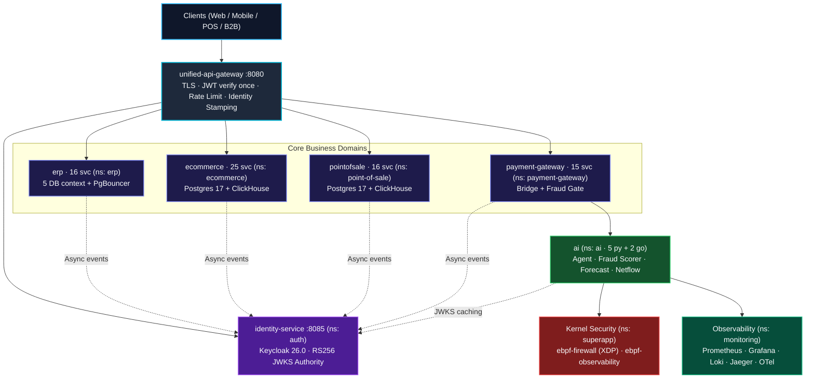
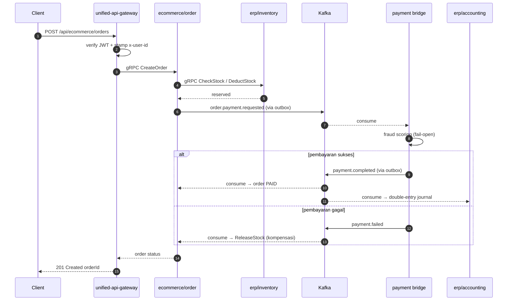
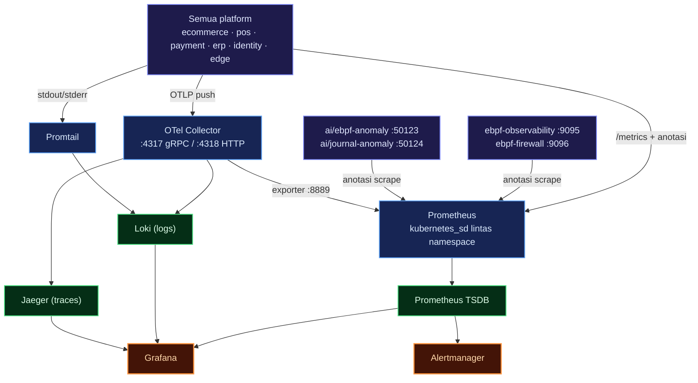

# Microservice Super App — Federated Go Domains with Kernel-Level Security

Backend **super-app** yang dibangun sebagai **federasi domain yang bisa dideploy sendiri-sendiri** — ERP, E-Commerce, Point of Sale (POS), Payment Gateway, Central Identity, AI/ML otonom, dan enforcement keamanan di level kernel.

Ini proyek belajar, bukan sistem produksi. Saya membangunnya untuk memahami bagaimana platform-platform yang masing-masing berdiri sendiri bisa disambungkan menjadi satu produk — tanpa menyatukan kodenya — dan untuk mempraktikkan pola yang biasanya cuma saya baca di dokumen: outbox/inbox, saga lintas platform, serta enforcement di level kernel lewat eBPF. Tulisan ini fokus pada **keputusan arsitektur dan harga yang dibayar**, bukan pada daftar fitur.


---

## Key Features

| Domain | Kapabilitas |
| :--- | :--- |
| **Unified Edge Gateway** | Satu pintu masuk publik (`:8080`): terminasi TLS, verifikasi JWT **sekali**, rate limit token-bucket per IP, stamping header identitas, reverse proxy + REST→gRPC façade |
| **Central Identity** | `identity-service` (`:8085`, REST/chi) + **Keycloak 26.0** (realm `superapp`, RS256). Dua jalur: registrasi/verifikasi lokal, penerbitan token lewat Keycloak. Dual-write dengan kompensasi |
| **ERP Platform** | 16 engine: finance, accounting, costing, inventory, sales, purchasing, CRM, HRIS, manufacturing, reporting, approval, subcontract, master-data |
| **E-Commerce Platform** | 25 modul: katalog, cart, order, order_item, merchant + 5 konteks satelit, review, banner, slider, shipping, transaksi |
| **Point of Sale** | 16 modul: cashier, order, product, category, merchant, transaksi, settlement |
| **Payment Gateway** | 15 modul: card/VCC, saldo, topup, withdraw, transfer, merchant, ledger + **payment bridge** (orkestrasi + fraud gate) |
| **Event Backbone** | Kafka dengan **Transactional Outbox** di producer dan **Inbox dedup** di consumer, envelope kanonik camelCase, trace context di header, DLQ `outbox.dead` |
| **Saga Checkout** | Stok lintas platform via gRPC (`CheckStock`/`DeductStock`/`ReleaseStock`), kompensasi saat `payment.failed`, TTL worker, order state machine compare-and-swap |
| **AI/ML Polyglot** | Go untuk transaksi, Python untuk inferensi: `fraud-detector`, `embedder`, `forecaster`, `journal-anomaly`, `ebpf-anomaly` — **remote-first, fail-open** |
| **Agent Runtime** | `aiagent` (Go, siklus Observe→Understand→Plan→Act→Verify) + `agentweb` (console React embed, REST/SSE read-only) |
| **Kernel Security** | `ebpf-firewall` (XDP L3/L4 drop + kprobe L7 signal) dan `ebpf-observability` (DaemonSet, ring buffer, 11 Sigma rule runtime) |
| **OLAP Analytics** | ClickHouse di setiap platform, diisi `stats-writer` (consumer Kafka + backfill) dan dilayani `stats-reader` (gRPC agregasi) |
| **Persistensi** | **database-per-bounded-context**: 5 cluster PostgreSQL di ERP, 6 di E-Commerce, 5 di POS, 3 di Payment Gateway — masing-masing di depan PgBouncer sendiri |
| **Observability** | Satu stack **shared** di namespace `monitoring`: OTel Collector (sink OTLP tunggal), Prometheus, Grafana, Loki, Jaeger, Alertmanager, node-exporter |
| **Deployment** | Docker Compose lokal, Kustomize + overlay ala-produksi, **Argo CD** (app-of-apps) per platform, HPA + PDB + NetworkPolicy |

---

## Prinsip Arsitektur

Enam aturan ini yang membuat federasi tetap koheren:

1. **Domain otonom.** Setiap platform berdaulat penuh: database, pool koneksi, cache, dan pipeline migrasi terisolasi. Tidak ada join lintas database, tidak ada skema fisik bersama, tidak ada akses DB langsung dari domain lain.
2. **Contract coupling di atas code sharing.** Duplikasi kode di batas platform lebih dipilih daripada coupling ketat. Integrasi hanya lewat kontrak Protobuf (gRPC), envelope event Kafka, header identitas kanonik, dan peta rute edge.
3. **Fail-open.** Enforcement kernel (XDP) dan inferensi AI dirancang **lolos-rusak**: kalau BPF map kosong atau service scoring mati, transaksi bisnis jalan dengan aturan fallback deterministik.
4. **Bilang apa adanya.** Kemampuan tiap bagian dicek terus-menerus, bukan diasumsikan. Telemetri membedakan sinyal kernel yang benar-benar terverifikasi (`KERNEL_EBPF`), simulasi lokal (`SIMULATOR`), dan fallback terbatas (`UNAVAILABLE`).
5. **Zero-trust edge stamping.** Verifikasi identitas berhenti di edge. Header request yang masuk disanitasi dan ditulis ulang dengan claim kriptografis terverifikasi — pemalsuan `x-user-id` dari klien menjadi mustahil.
6. **Build terisolasi.** 94 modul Go dengan `replace` relatif tidak bisa hidup dalam satu workspace; build per-modul (`GOWORK=off`) adalah keputusan final, bukan keterbatasan yang belum diselesaikan.

---

## Arsitektur Overview



### Inventaris Platform

| Platform | Stack | Modul Aktif | Storage | Namespace |
| :--- | :--- | :--- | :--- | :--- |
| **identity-service** | Go 1.26 (chi) | 1 engine inti | PostgreSQL 17 + Keycloak 26 | `auth` |
| **unified-api-gateway** | Go 1.26 (chi) | 1 edge proxy | Redis 7 (rate limit) | `edge` |
| **erp** | Go 1.26 (chi/gRPC) | 16 engine | 5× PostgreSQL 17 + PgBouncer | `erp` |
| **ecommerce** | Go 1.26 (chi/gRPC) | 25 modul | PostgreSQL 17 + ClickHouse | `ecommerce` |
| **pointofsale** | Go 1.26 (chi/gRPC) | 16 modul | PostgreSQL 17 + ClickHouse | `point-of-sale` |
| **payment-gateway** | Go 1.26 (chi/gRPC) | 15 modul | PostgreSQL 17 + ClickHouse | `payment-gateway` |
| **ai** | Python 3.12 + Go | 7 service (5 py, 2 go) | Model on-disk + SQLite + vector | `ai` |
| **ebpf-firewall** | Go + C (eBPF CO-RE) | 1 daemon + sidecar | BPF maps (L3/L4/L7) | `superapp` |
| **ebpf-observability** | Go + C (eBPF CO-RE) | 1 DaemonSet | Kernel ring buffer + /proc | `superapp` |
| **observability** | Config / PromQL | Stack bersama | TSDB + Loki + Jaeger | `monitoring` |

---

## Data Architecture

Semua platform memakai pola yang sama — dan pola itulah yang membuat batas domain bisa ditegakkan compiler, bukan sekadar konvensi.

### Database per Bounded Context

Ini keputusan yang paling banyak menghemat waktu debugging. Bukannya satu database besar dengan tabel ber-prefix, setiap konteks punya **cluster PostgreSQL 17 sendiri** dengan pooler PgBouncer sendiri:

| Platform | Cluster PostgreSQL | Pooler |
| :--- | :--- | :--- |
| **erp** | `erp_finance`, `erp_supply`, `erp_sales`, `erp_hr`, `erp_platform` | 1 PgBouncer per konteks |
| **ecommerce** | identity, merchant, catalog, sales, experience, email | PgBouncer per konteks + NetworkPolicy |
| **pointofsale** | `pos_identity`, `pos_merchant`, `pos_catalog`, `pos_sales`, `pos_email` | PgBouncer per konteks |
| **payment-gateway** | `pg_identity`, `pg_payment`, `pg_financial` | PgBouncer per konteks |

Yang penting di sini: **tidak ada `DB_HOST` generik**. Setiap service mendeklarasikan konteksnya sekali, dan `pkg/database` me-resolve prefix env per konteks. Service hanya bisa menjangkau cluster milik konteksnya. **Cross-context schema coupling bukan cuma didorong untuk tidak dilakukan — ia tidak bisa direpresentasikan.** Prefix cluster yang salah membuat startup gagal, bukan diam-diam tersambung ke database yang salah.

### Migrasi Tanpa Tabrakan

Migrasi dijalankan **goose saat boot**, tapi tiap platform punya riwayat migrasi terpisah sehingga modul tidak pernah saling menimpa versi. Ada juga `migrate-job` di Kubernetes dengan NetworkPolicy sendiri, jadi urutan Postgres → PgBouncer → migrate → workload bisa diatur lewat sync-wave Argo CD.

### OLAP Tanpa Menyentuh Tier Transaksional

Query analitik tidak pernah membebani database transaksional. Setiap platform punya **ClickHouse** yang diisi oleh `stats_writer` (consumer Kafka dengan backfill bootstrap) dan dilayani `stats_reader` — service gRPC agregasi yang mengembalikan volume bulanan/tahunan, breakdown metode pembayaran, tingkat keberhasilan transaksi, produk terlaris, sampai performa kasir.

### Redis

Cluster Redis 7 dipakai untuk blacklist token, session, read-through cache, distributed lock, dan counter rate limit di edge. Tiap service punya telemetri cache-nya sendiri, jadi hit ratio per domain bisa dibaca langsung di Grafana.

---

## Event Backbone, Outbox, dan Deduplication

Integrasi asinkron lintas platform lewat Kafka, dengan kontrak yang sama di semua platform.

### Envelope Kanonik

```json
{
  "eventId": "…",
  "eventType": "PAYMENT_COMPLETED",
  "timestamp": "…",
  "source": "payment-gateway",
  "correlationId": "…",
  "payload": { }
}
```

Konstanta tipe event disamakan di semua platform (`pkg/events`): `ORDER_PAYMENT_REQUESTED`, `PAYMENT_COMPLETED`, `PAYMENT_FAILED`, `USER_REGISTERED`, `INVENTORY_STOCK_SYNCED`, `ORDER_STATUS_UPDATED`, `JOURNAL_ENTRY_CREATED`, `JOURNAL_ENTRY_REQUESTED`, `ERP_DATA_SYNCED`, `ORDER_BASKET_UPDATED`. Nama topik memakai bentuk dotted: `order.payment.requested`, `payment.completed`, `payment.failed`, `user.registered`, `accounting.journal.posted`, `accounting.journal.finding`, `ebpf.netflow`.

### Outbox → Kafka → Inbox

Producer **tidak pernah dual-write**. Perubahan state dan event ditulis dalam **satu transaksi** ke tabel `outbox_events`; relay terpisah mempublikasikannya ke Kafka. Consumer men-dedup lewat tabel `consumer_inbox` (`pkg/outbox.PostgresInbox`), sehingga pengiriman *at-least-once* tidak pernah menjadi efek ganda.

Trace context ikut di header Kafka (`traceparent`/`tracestate`) lewat `SendMessageWithHeaders`, dan consumer jalur saga mengekstrak trace itu untuk memulai span `consume <topic>` — jadi satu trace bisa ditelusuri dari HTTP request di edge sampai baris di ledger.

Kegagalan relay tidak hilang diam-diam: DLQ `outbox.dead` dengan metrik `outbox_dead_events_total` (erp/identity/gateway) atau padanan OTLP-native `outbox_events_dead` (ecommerce/pointofsale).

### Jalur Event yang Terverifikasi

Ini bukan diagram aspirasional — jalur berikut sudah diverifikasi end-to-end:

- `user.registered` → identity-service publish → `erp/crm` consume
- `order.payment.requested` → ecommerce/order publish → payment bridge consume
- `payment.completed` / `payment.failed` → bridge publish → ecommerce/order **dan** erp/accounting consume
- `accounting.journal.entry` → erp/accounting publish → bridge consume
- `accounting.journal.posted` → erp/accounting publish → `ai/journal-anomaly` score → emit `accounting.journal.finding`
- `ebpf.netflow` → ebpf-observability publish → `ai/ebpf-anomaly` consume (shadow mode)

---

## Cross-Domain Transaction: Saga Checkout

Checkout menyentuh cart, shipping, order, stok ERP, dan payment gateway sebagai panggilan terpisah. Tidak ada yang membungkusnya dalam satu transaksi atomik — dan itu memang pilihan sadar.



Yang membuat ini aman:

- **Order state machine compare-and-swap.** Transisi dari `pending` ke `PAID`/`FAILED` bersifat CAS, jadi dua consumer yang balapan tidak pernah menghasilkan dua kebenaran. `CANCELLED` diterima di schema untuk kompatibilitas, tapi status terminal kegagalan disamakan ke `FAILED` supaya konvergen dengan consumer pembayaran.
- **TTL worker.** Order yang `pending` melebihi `PAYMENT_TTL` di-fail-kan otomatis dan stoknya di-release — mencegah stok menggantung kalau event pembayaran hilang.
- **Reinstatement pembayaran telat.** Pembayaran yang datang setelah TTL tidak membuang uang: order di-reinstate dengan guard "PAID tidak pernah di-release".
- **Kompensasi eksplisit.** `payment.failed` memicu `ReleaseStock` ke ERP; konsistensi dipulihkan lewat aksi, bukan lewat rollback distributed transaction.

---

## AI/ML: Shadow by Default

Layer AI sengaja dipisah menurut tanggung jawab, karena mudah sekali tercampur:

| Tanggung jawab | Service | Bahasa | State |
| :--- | :--- | :--- | :--- |
| Reasoning & orkestrasi task | `aiagent` | Go | In-memory |
| Console operator / gateway | `agentweb` | Go + React | Stateless |
| Prediksi & scoring | `embedder`, `forecaster`, `fraud-detector` | Python | Model on-disk |
| Shadow anomaly detection | `journal-anomaly`, `ebpf-anomaly` | Python | SQLite |


Keputusan terpentingnya adalah **shadow by default**. Detektor anomali *mengamati* — consume dari Kafka, menulis temuan, mengemit metrik — tapi tidak pernah mengirim perintah finansial dan tidak pernah memblokir pembayaran.

Integrasinya **remote-first, fail-open**:

- **Fraud** — satu sumber skor. Bridge di payment-gateway memanggil `ai/fraud-detector` via gRPC `ScoreTransaction`, dengan rules lokal + Redis velocity sebagai fallback. Adapter fraud lama di dalam payment-gateway dihapus supaya tidak ada dua model yang bisa berbeda pendapat.
- **Semantic search** — ecommerce memakai pgvector + indeks HNSW + hybrid search (RRF) dengan `embedder` composite: embedding remote kalau tersedia, hashed deterministik lokal kalau tidak.
- **Demand forecasting** — `erp/purchasing` menjalankan planner yang **default OFF**; saat dinyalakan, hasil forecast menjadi draf purchase request (dengan dedup supaya tidak menumpuk).
- **Journal anomaly** — `ai/journal-anomaly` mengonsumsi `accounting.journal.posted` dan mengemit finding; sisi ERP mengonsumsi finding itu hanya bila `JOURNAL_FINDINGS_ENABLED` diset. Default OFF.
- **Netflow anomaly** — publisher netflow di ebpf-observability off kalau brokers kosong; jadi ia benar-benar *zero-risk* sampai dinyalakan.

Kontribusi metrik dari bridge (`fraud.scores` → `golang_app_fraud_scores_total`, `payments.processed`, durasi check) diwire ke jalur fraud secara nil-safe, jadi grafik fraud tetap kosong dengan jujur kalau bridge tidak berjalan — bukan terlihat "sudah dicek" padahal tidak.

---

## Kernel-Level Security

Ini bagian yang biasanya tidak ada di backend super-app: enforcement dan telemetri **di dalam kernel**, tanpa mengubah kode aplikasi dan tanpa SDK.

### ebpf-firewall — XDP Enforcement

Policy ditegakkan di titik paling awal network stack — **hook XDP**, sebelum kernel mengalokasikan socket buffer. Program eBPF kedua mengawasi percobaan koneksi keluar lewat **kprobe** (`tcp_v4_connect`/`tcp_v6_connect`) dan mengemit sinyal kanonik `runtime.endpoint.access`.

Dua hal yang membuatnya lebih dari firewall mainan:

- **Fail-open secara konstruksi.** Setiap tahap enforcement default-nya *meloloskan* trafik. Config salah, map kosong, atau program yang baru ter-load sebagian akan menurun menjadi *allow* — tidak pernah menjadi blackhole.
- **Dua control plane, satu data plane.** Intent administratif yang ditulis di **nftables** atau **iptables** direkonsiliasi ke BPF map oleh daemon. Tim tetap memakai tool yang sudah dikenal, sementara enforcement-nya tetap di XDP.

### ebpf-observability — Telemetri & Deteksi Sigma

Agen CO-RE berbasis `cilium/ebpf` melacak koneksi TCP (connect/established/close) dan mengirim event ke userspace lewat **ring buffer**. Metriknya antara lain `ebpf_tcp_connections_total{dport,family}`, `ebpf_tcp_connections_by_state_total`, dan histogram `ebpf_tcp_connect_latency_seconds`.

Yang menarik: agent ini juga menjalankan **engine rules Sigma-subset**. Ruleset kanonik berisi **11 rule** di `detections/sigma/` — egress tak terklasifikasi, eksfiltrasi namespace host, reverse shell, crypto miner, container escape (`setns`/`unshare`), probe honeypot, dan akses endpoint dengan protokol tak terduga. Ruleset dimuat via ConfigMap, dan setiap hit mengemit `ebpf_rule_hits_total{rule_id}`.

Dua batasan yang diakui terbuka: sampling memakai **duty cycle** (default 10 detik on / 10 detik off), jadi metriknya *sample-based* dan blind spot-nya terukur lewat `ebpf_sampling_gated_total`; dan ini **bukan IDS/EDR** — labelnya sengaja dibatasi ke `rule_id`.

Firewall dan observability akhirnya menyatu di **satu pipeline deteksi**: sinyal dari firewall di-POST ke `/ingest` milik ebpf-observability, dievaluasi engine Sigma yang sama, lalu di-emit ulang dengan `rule_ids`. Satu pipeline, bukan dua detektor yang bisa berbeda kesimpulan.

---

## Unified Observability

Semua platform berbagi **satu stack** di namespace `monitoring`. Sebelum konsolidasi, tiap platform punya stack sendiri (atau tidak punya sama sekali), sehingga metrik dan trace platform yang tidak punya stack menjadi *orphan*.



| Pilar | Tool | Peran |
| :--- | :--- | :--- |
| **Metrics** | OpenTelemetry → Prometheus + Grafana | Metrik aplikasi (`golang_app_*`) dan infra (`node-exporter`) |
| **Logging** | Zap JSON → Loki | Log terstruktur, dikueri via LogQL |
| **Tracing** | OTel → Jaeger | Trace dari edge sampai query database |
| **Alerting** | Alertmanager | Receiver default `null` — diisi saat integrasi on-call |

Dua mekanisme koneksi yang dipakai platform: **OTLP push** ke `otel-collector-service.monitoring:4317` (arahkan exporter ke sana), atau **scrape langsung** ke `/metrics` dengan anotasi `prometheus.io/scrape="true"` pada Service. Yang kedua ini yang dipakai metrik keamanan dan AI supaya tidak jadi orphan, lengkap dengan NetworkPolicy aditif `allow-shared-observability` per namespace untuk membuka ingress scrape dari `monitoring` dan egress OTLP ke `monitoring:4317`.

Dashboard dikelompokkan dalam folder di Grafana. Detail yang mudah terlewat: folder Grafana harus diletakkan di `items[].path` pada Deployment, bukan sebagai key ConfigMap — karena key tidak boleh mengandung garis miring; tanpa initContainer yang men-dereference symlink, provider Grafana akan melihat **0 dashboard** meski file-nya ada.

### Dashboard yang Dipakai Sehari-hari

**Super App — Overview:** request rate, total request, p95/p99 latency, dan status code per service dari satu layar.


**Cluster & Nodes:** CPU, memori, load average, filesystem, dan network per node dari `node-exporter` lintas namespace.


**Databases — PostgreSQL:** instance hidup, backends aktif per `datname`, ukuran database, cache hit ratio, dan lock.


**AI Platform:** proses Python `ebpf-anomaly` dan `journal-anomaly` — CPU, RSS, GC, open FDs, dan health check service.


---

## Identity & Trust Model

`identity-service` adalah satu-satunya service yang boleh menjadi *token issuer*, karena hanya ia yang mengkombinasikan `identity_db` lokal dengan Admin REST API realm Keycloak.

- **Dua jalur auth.** Registrasi dan verifikasi email lewat identity-service (bcrypt + kode verifikasi); penerbitan token lewat Keycloak OIDC (RS256). Token yang dikeluarkan adalah JWT RS256 yang ditandatangani Keycloak.
- **Verifikasi stateless.** Setiap service lain memvalidasi token terhadap **JWKS** realm — tanpa shared secret, tanpa session, tanpa callback ke identity-service di hot path. Gateway menyimpan cache JWKS per `kid`.
- **Dual-write dengan kompensasi.** User dibuat di Keycloak *lebih dulu*, lalu dicerminkan ke lokal; kalau insert lokal gagal, user Keycloak dihapus sebagai kompensasi.
- **Stamping di edge.** Gateway menulis ulang `x-user-id`, `x-roles`, `x-tenant-id`, `x-merchant-id` dengan claim yang sudah diverifikasi. Service di belakang gateway tidak perlu menurunkan ulang *siapa yang memanggil*.

Ada satu kompromi keamanan yang dikarantina dengan sengaja: mode `hs256` tersedia untuk lokal saja dan **dikunci keras oleh `APP_ENV`**. Produksi memakai `jwks`, tidak ada jalur lain.

---

## Technical Decisions & Trade-offs

**Domain otonom dengan database masing-masing, bukan satu cluster bersama**
Empat platform dipecah menjadi puluhan modul, tiap konteks punya cluster PostgreSQL dan PgBouncer-nya sendiri. Efeknya cross-context coupling jadi tidak bisa dituliskan, dan satu konteks yang berubah skema tidak pernah mengejutkan konteks lain. Harganya nyata: puluhan pooler untuk dioperasikan, migrasi harus dijaga per konteks, dan query yang "sekali join saja" harus diselesaikan lewat gRPC atau event. Di skala ini, isolasi itu yang menjaga sistem tetap bisa dinalar.

**Kafka plus outbox/inbox, bukan panggilan sinkron lintas platform**
Alur seperti permintaan pembayaran, penyelesaian pembayaran, dan jurnal akuntansi berjalan sebagai event di satu bus, jadi consumer yang lambat tidak pernah memblokir checkout. Imbalannya *eventual consistency* di mana-mana: consumer wajib idempoten, dan debugging berarti mengkorelasikan event alih-alih membaca satu stack trace. Untuk uang yang bergerak lintas platform, log yang tahan lama lebih baik daripada coupling sinkron yang ketat.

**Saga dengan kompensasi eksplisit, bukan transaksi terdistribusi**
Checkout menyentuh cart, shipping, order, stok, dan pembayaran tanpa satu pun transaksi atomik yang membungkusnya. Order state machine CAS plus TTL worker plus `ReleaseStock` membuat checkout yang setengah jalan jadi *terlihat dan bisa dipulihkan*, bukan hilang diam-diam. Lebih sederhana dioperasikan daripada saga engine penuh — tapi tanggung jawab rekonsiliasi berpindah ke model data, jadi kualitasnya bergantung pada disiplin state machine.

**AI fail-open dan shadow by default**
Model tidak pernah berada di jalur kritis. Fraud scorer dipanggil remote-first dengan fallback rules lokal; kalau service AI mati, pembayaran tetap berjalan dengan aturan deterministik. Detektor anomali hanya mengamati. Konsekuensinya: skor yang gagal tidak terlihat sebagai "aman", melainkan sebagai `UNAVAILABLE` — dan itu disengaja, karena panel kosong yang terlihat seperti "sudah dicek" jauh lebih berbahaya daripada kegagalan yang jujur.

**Console agent read-only**
`agentweb` mengekspos grafik operasional (Prometheus, dengan whitelist PromQL **di sisi server** — klien tidak pernah mengirim query) dan grafik bisnis (POS/payment dari ClickHouse, di belakang JWT memakai token service Keycloak dengan client-credentials). Semuanya GET dan read-only; tidak ada mutasi yang bisa dipicu dari console. Batas kemampuan dilaporkan apa adanya — sumber yang mati menghasilkan `error` + `UNAVAILABLE`, bukan panel kosong.

**Enforcement keamanan di kernel, fail-open**
XDP memberi penolakan paket di titik paling murah dan kprobe memberi visibilitas koneksi yang tidak bisa diberikan agent userspace. Pilihannya sengaja fail-open: config salah atau map kosong menurun ke *allow*, tidak pernah ke blackhole, karena firewall yang salah bisa mematikan seluruh sistem lebih efektif daripada serangan. Batasannya juga dinyatakan: sampling duty-cycle berarti metrik bersifat sample-based, dan ini bukan IDS/EDR — labelnya dibatasi ke `rule_id`.

**Workspace build per-modul, bukan satu workspace raksasa**
94 modul Go dengan `replace` relatif yang bertabrakan bila dimuat serentak. `go.work` root dibiarkan kosong dan setiap modul dibuild dengan `GOWORK=off` — sama seperti yang dilakukan CI. Ini menambah langkah kecil di setiap perintah build, ditukar dengan build yang deterministik dan tidak saling mengganggu antar platform.

---

## Deployment

### Lokal

```sh
# Infrastruktur pendukung (PostgreSQL, PgBouncer, Redis, Kafka)
cd service/erp
docker compose -f deployments/local/docker-compose.infra.yml up -d

# Identity + Keycloak (realm superapp diimpor otomatis saat boot)
cd service/identity-service
docker compose -f deployments/local/docker-compose.yml up -d

# Edge gateway + platform
cd service/unified-api-gateway && docker compose -f deployments/local/docker-compose.yml up -d
cd service/ecommerce && docker compose -f deployments/local/docker-compose.yml up -d
```

### Kubernetes

Manifest Kustomize (base + `overlays/production`) dengan alias jaringan lokal per platform dan sync-wave Argo CD; `default-deny-all` NetworkPolicy plus allow-list egress per service. Env untuk jalur lintas platform memakai FQDN in-cluster, misalnya `ERP_INVENTORY_ADDR`, `FRAUD_GRPC_ADDR=fraud-detector.ai.svc.cluster.local:50120`, dan `FORECAST_GRPC_ADDR=forecast.ai.svc.cluster.local:50122`.

### Smoke Test

```sh
BASE_URL=http://127.0.0.1:8080 ./tests/run.sh
BASE_URL=http://127.0.0.1:8080 ./tests/run.sh journey
```

Suite tingkat edge ada di `tests/hurl/` (health, auth-reject) dan `tests/journey/` (register lalu login), dengan fixture event schema-v1 di `tests/fixtures/`.

---

## Port Map Registry

| Kategori | Komponen | Host Port | Protokol |
| :--- | :--- | :--- | :--- |
| **Edge & Identity** | unified-api-gateway | `8080` | HTTP / REST |
| | identity-service | `8085` | HTTP / REST |
| | Keycloak 26.0 | `8081` / `9000` | HTTP / Management |
| **Platform** | erp apigateway | `5100` | HTTP / REST |
| | ecommerce apigateway | `8000` | HTTP / REST |
| | pos apigateway | `5000` | HTTP / REST |
| | payment apigateway | `8005` | HTTP / REST |
| **Databases** | PostgreSQL (internal) | — | TCP |
| | PgBouncer konteks | `6432`–`6436` | TCP pool |
| | ClickHouse OLAP | `9000` / `8123` | Native / HTTP |
| | Redis | `6379`–`6389` | RESP |
| **Messaging** | Kafka broker | `29092` | TCP |
| **AI** | aiagent / agentweb | `5011` / `5016` | gRPC / HTTP+SSE |
| | fraud-detector / embedder / forecaster | `50120`–`50122` | gRPC |
| | ebpf-anomaly / journal-anomaly | `50123` / `50124` | HTTP metrics |
| **Kernel Security** | ebpf-firewall exporter / signal | `9096` / `9097` | HTTP |
| | ebpf-observability | `9095` | HTTP metrics + ingest |
| **Observability** | OTel Collector | `4317` / `4318` | gRPC / HTTP OTLP |
| | Prometheus / Grafana / Loki / Jaeger | `9090` / `3000` / `3100` / `16686` | HTTP |

---

## Verifikasi

Klaim di atas bisa diperiksa ulang — inilah bentuk buktinya:

| Pemeriksaan | Hasil |
| :--- | :--- |
| Modul Go (dengan `go.work` per platform) | 94 modul, build per-modul `GOWORK=off` |
| Unit test | 333 file `_test.go` + 13 test Python AI |
| Sigma rule | 11 rule kanonik di `detections/sigma/` |
| Integration test saga | order saga + TTL worker (testcontainers), bridge E2E (Kafka + inbox Postgres nyata + fake card/merchant/transaction) |
| Hurl edge suite | `tests/hurl/` + `tests/journey/` |
| Deployment | Kustomize base + overlay produksi, NetworkPolicy lintas namespace |

Beberapa hal masih tertinggal, dan saya tulis apa adanya di sini:

- Deployments untuk payment bridge sempat ketinggalan dari kodenya.
- Sebagian platform belum punya GitOps Argo CD yang sejajar dengan yang lain.
- Jalur `inventory.stock.synced` belum diuji end-to-end seperti jalur pembayaran.
- Netflow ke AI anomaly sudah tersambung, tapi sengaja masih opt-in (brokers kosong berarti off).

---

## Technology Stack

| Kategori | Teknologi | Peran |
| :--- | :--- | :--- |
| **Bahasa** | Go 1.26.x, Python 3.12, C (Clang 18) | Service inti, inferensi AI/ML, probe eBPF |
| **RPC & Kontrak** | gRPC, Protobuf (buf CLI) | Kontrak lintas service yang strongly-typed |
| **HTTP Edge** | go-chi/chi v5, Echo | Gateway REST dan routing ingress |
| **Identity & IAM** | Keycloak 26.0, RS256 JWT, JWKS | Autentikasi OIDC, penerbitan token, RBAC |
| **Database** | PostgreSQL 17, ClickHouse 24.x | Persistensi OLTP, analitik OLAP |
| **Connection Pool** | PgBouncer 1.23+ | Pooling per konteks |
| **Cache** | Redis 7.4 | Session, lock, rate limit, read-through |
| **Event Streaming** | Apache Kafka 3.8+ (IBM Sarama) | Outbox event bus, pipeline asinkron |
| **Migrasi** | goose | Migrasi per platform saat boot |
| **Kernel Security** | eBPF (cilium/ebpf), XDP | Filtering paket in-kernel, deteksi eksekusi proses |
| **Detection Engine** | Sigma-subset AST compiler | 11 rule deteksi berbasis YAML |
| **Observability** | OpenTelemetry, Prometheus, Grafana, Loki, Jaeger | Trace, metrik, log, alerting |
| **Orchestrasi** | Docker Compose, Kubernetes, Argo CD, Kustomize | Lokal sampai GitOps produksi |

---

## Struktur Workspace

```
microservice-super-app-baru/
├── go.work                        # Sengaja kosong — build per modul
├── .golangci.yml                  # Konfigurasi linter terpadu
├── tests/                         # Suite E2E tingkat edge
│   ├── hurl/                      # Assertion batas gateway
│   └── journey/                   # Perjalanan integrasi lintas domain
└── service/
    ├── identity-service/          # Otoritas identitas (Go/chi + Keycloak)
    ├── unified-api-gateway/       # Gateway ingress tunggal (Go/chi)
    ├── erp/                       # Platform ERP (16 modul, 5 konteks DB)
    ├── ecommerce/                 # Platform E-Commerce (25 modul + ClickHouse)
    ├── pointofsale/               # Platform POS (16 modul + ClickHouse)
    ├── payment-gateway/           # Platform payment (15 modul + bridge)
    ├── ai/                        # Subsystem AI (agent Go + 5 service Python)
    ├── ebpf-firewall/             # XDP firewall + kprobe connection signal
    ├── ebpf-observability/        # Telemetri kernel + Sigma detection engine
    ├── detections/sigma/          # 11 rule deteksi
    └── observability/             # Stack monitoring bersama (ns: monitoring)
```

---

## Catatan Penutup

Yang paling menentukan kualitas sistem ini bukan jumlah modulnya, melainkan **apa yang ditulis terang-terangan**: batas domain yang tidak bisa dilanggar compiler, kontrak event yang sama di semua platform, mode kegagalan yang fail-open dan terdokumentasi, serta hal-hal yang belum selesai yang ditulis terbuka di README platform.

Di federasi domain seperti ini, jujur soal apa yang bisa dan tidak bisa dilakukan bukan pelengkap dokumentasi — ia bagian dari arsitekturnya sendiri.

---

<p align="center">
  <b>Domain Berdaulat · Contract-Coupled · Fail-Open Resilience · Kernel-Enforced Security</b>
</p>
