# Microservice Superapp — Unified Vert.x Ecosystem

A production-grade reference implementation of a multi-platform commerce superapp: **E-Commerce**, **Point of Sale**, **Payment Gateway**, and a **Quarkus-based ERP**, unified behind a single API gateway and integrated through a shared Apache Kafka event backbone.

The project is built as an end-to-end study in reactive JVM architecture — non-blocking I/O throughout, CQRS at the service level, transactional outbox for reliable event publication, and kernel-level (eBPF) runtime observability that requires zero application instrumentation.

---

## Status snapshot

| Dimension | Status | Evidence |
|---|---|---|
| Unit tests (4 platforms) | **2,252 passing**, 0 failures, 0 errors | Surefire reports: E-Commerce 284 · POS 749 · Payment 1,182 · ERP 37 |
| Cross-platform E2E (Hurl) | **28/28 requests** | `e2e-tests/e2e-cross-platform.hurl` |
| Cross-platform E2E (Java) | **24/24** | `e2e-tests/src/test/java/e2e/` |
| ERP endpoint sweep | **66/66 GET**, **159/159 writes** | `tools/sweep/erp_gen.py`, `erp_write_sweep.py` |
| Endpoint coverage | P0–P2 + core P3 complete | `FULL_ENDPOINT_GAP_BREAKDOWN.md` |
| Payment wiring | Verified at runtime (v22) | `PLANNING_WIRE_PAYMENTGATEWAY.md` |
| Architecture decisions | 8 ADRs | `docs/architecture/adr/` |
| Runbooks | 4 operational runbooks | `docs/runbook/` |
| eBPF runtime security | Both components verified | `docs/security/security-observability.md` |

> **Snapshot date: 9 August 2026.** Figures in this table were re-measured from the repository's test reports and are labelled with the date of the run they came from. Nothing in this document is a projected result.

---

## Table of contents

1. [System overview](#1-system-overview)
2. [Platform inventory](#2-platform-inventory)
3. [Data architecture](#3-data-architecture)
4. [Service and port reference](#4-service-and-port-reference)
5. [Kubernetes topology](#5-kubernetes-topology)
6. [Request lifecycle](#6-request-lifecycle)
7. [Authentication and authorization](#7-authentication-and-authorization)
8. [Event streaming topology](#8-event-streaming-topology)
9. [Cross-platform payment flow](#9-cross-platform-payment-flow)
10. [ERP integration architecture](#10-erp-integration-architecture)
11. [Runtime configuration](#11-runtime-configuration)
12. [Getting started](#12-getting-started)
13. [Configuration reference](#13-configuration-reference)
14. [CI/CD pipeline](#14-cicd-pipeline)
15. [Observability stack](#15-observability-stack)
16. [Security architecture](#16-security-architecture)
17. [Technology stack](#17-technology-stack)
18. [Repository layout](#18-repository-layout)
19. [Verification status](#19-verification-status)
20. [Roadmap](#20-roadmap)
21. [API reference](#21-api-reference)
22. [Service internals](#22-service-internals)
23. [Data and event flows](#23-data-and-event-flows)
24. [Troubleshooting](#24-troubleshooting)
25. [Contributing, license, and further reading](#25-contributing-license-and-further-reading)

---

## 1. System overview

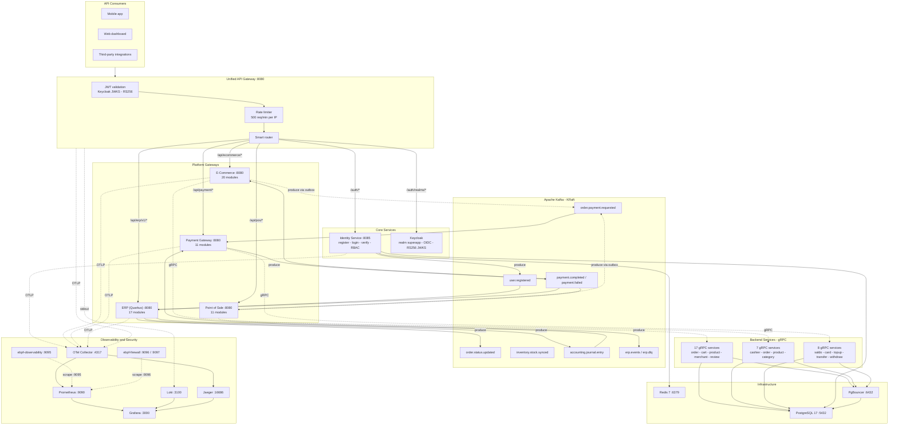

### Legend

| Notation | Meaning |
|---|---|
| Solid arrow | Active connection, verified at runtime |
| Dotted arrow | Connection defined but not yet exercised end-to-end |
| `T1`–`T7` | Kafka topics; the full catalog is in [section 8](#8-event-streaming-topology) |

### Design principles

| # | Principle | Implementation |
|---|---|---|
| 1 | **Single entry point** | One gateway owns authentication, rate limiting, routing, and tracing for every platform. |
| 2 | **Events over coupling** | Cross-platform state changes travel as versioned Kafka events; services never call each other synchronously across platform boundaries. |
| 3 | **No blocking I/O on the event loop** | Raw reactive SQL (`vertx-pg-client`), reactive HTTP client, and a worker-thread JWKS fetch in the gateway. |
| 4 | **Reliable publication** | Producers use a transactional outbox (DB trigger + relay with leases); consumers use claim + lease + fencing for idempotency. |
| 5 | **Defense in depth** | Transport, edge, network, kernel, and application layers each enforce policy independently. |
| 6 | **Observability without instrumentation** | eBPF agents observe process execution, container escape, and network activity at the kernel level. |

---

## 2. Platform inventory

### E-Commerce — 20 modules

| Category | Modules |
|---|---|
| Catalog | `product`, `category`, `banner`, `slider` |
| Merchant | `merchant`, `merchant_award`, `merchant_business`, `merchant_detail`, `merchant_policy` |
| Commerce | `cart`, `order`, `order_item`, `shipping_address`, `transaction` |
| Review | `review`, `review_detail` |
| Infrastructure | `email`, `apigateway`, `common`, `db-migration` |

### Point of Sale — 11 modules

| Category | Modules |
|---|---|
| POS core | `cashier`, `order`, `order_item`, `transaction`, `product`, `category`, `merchant` |
| Infrastructure | `email`, `apigateway`, `common`, `db-migration` |

### Payment Gateway — 11 modules

| Category | Modules |
|---|---|
| Card suite | `card` — credit accounts, billing statements, rewards, fraud detection, authorisation transactions |
| Fund movement | `saldo`, `topup`, `transfer`, `withdraw`, `transaction` |
| Infrastructure | `email`, `apigateway`, `common`, `merchant` |

### ERP (Quarkus) — 17 Maven modules + dashboard

| Category | Modules |
|---|---|
| Finance | `erp-accounting`, `erp-finance`, `erp-costing` |
| Operations | `erp-inventory`, `erp-purchasing`, `erp-manufacturing`, `erp-subcontracting`, `erp-approval` |
| Sales / CRM / HR | `erp-sales`, `erp-crm`, `erp-hris` (PPh 21, BPJS) |
| Core | `erp-master-data`, `erp-shared`, `erp-api-gateway` |
| Support | `erp-reporting`, `erp-integration`, `erp-ai-bridge` |
| Frontend | `erp-dashboard` (React / Vite) |

### Supporting services

| Service | Purpose |
|---|---|
| `unified-api-gateway` | Single public entry point; JWT validation, rate limiting, routing, ERP health aggregation |
| `identity-service` | Registration, e-mail verification, refresh tokens, RBAC role management |
| `cross-platform-events` | Shared, typed Kafka event schemas consumed by all platforms |
| `k8s-audit-collector` | Webhook receiver for Kubernetes API audit events (normalisation + redaction) |
| `ebpf-observability` | Kernel-level runtime detection and TCP telemetry agent (Go, CO-RE) |
| `ebpf-firewall` | XDP-based endpoint firewall and iptables/nftables control plane (Go, CO-RE) |

---

## 3. Data architecture

**PostgreSQL 17**, accessed through **PgBouncer** (`:6432`) with transaction pooling. Schema evolution is managed by Flyway using three isolated migration zones so that modules sharing one database never contend on the history table:

| Zone | History table | Scope |
|---|---|---|
| 1 | `flyway_schema_history` | E-Commerce + POS + Payment Gateway (database `PAYMENT_GATEWAY`) |
| 2 | `flyway_identity_schema_history` | Identity Service, isolated from Zone 1 |
| 3 | Quarkus-native Flyway | ERP database (`example_quarkus`) |

| Database | Consumed by | Core tables |
|---|---|---|
| `PAYMENT_GATEWAY` | E-Commerce · POS · Payment · Identity | `roles`, `users`, `user_roles`, `refresh_tokens`, `merchants`, `categories`, `products`, `orders`, `order_items`, `cashiers`, `carts`, `banners`, `sliders`, `reviews`, `shipping_addresses`, `cards`, `saldos`, `transactions`, `transfers`, `withdraws`, `topups`, `saldo_operations`, `card_credit_accounts`, `card_auth_transactions`, `billing_statements`, `card_payments`, `card_rewards`, `payment_event_outbox` |
| `example_quarkus` | ERP (17 modules) | Per-module schemas: `master`, `accounting`, `inventory`, `purchasing`, `manufacturing`, `subcontract`, `costing`, `reporting`, `integration`, `crm`, `sales`, `hris` |
| `identity_db` | Identity seed / E2E fixtures | Mirror of `users`, `roles`, `user_roles`, `refresh_tokens` |
| `ecommerce`, `pos` | E2E fixtures | Mirror of the respective platform tables |

> **Note on `identity_db` vs `PAYMENT_GATEWAY`:** the Flyway architecture document places the identity service in `PAYMENT_GATEWAY` with an isolated Zone 2 history table, while the identity service's `DB_NAME` environment variable defaults to `identity_db`. Both are correct in their own context — confirm the target database per environment before deploying. See `docs/flyway-architecture-diagram.md`.

E2E seed fixtures live in `tests/fixtures/` and `seed_data.sql`.

### ERD — Payment Gateway (fund movement core)

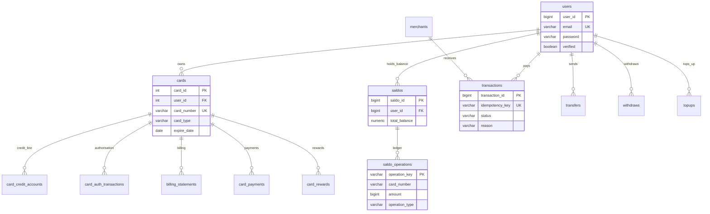

### ERD — E-Commerce (order lifecycle)

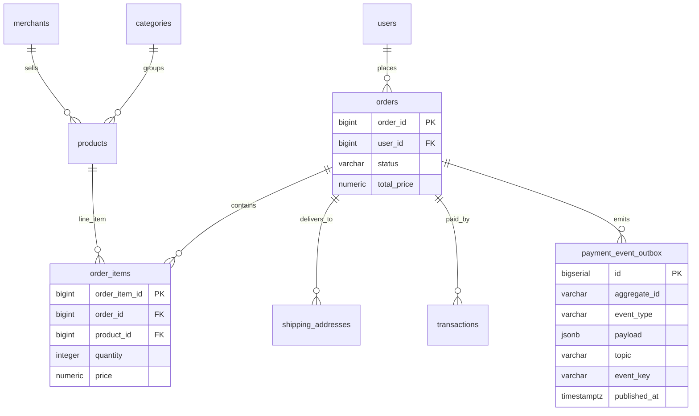

### ERD — Point of Sale (cashier and transactions)

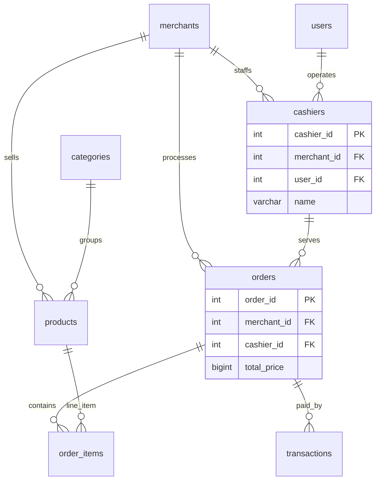

> These ERDs show the essential entities per platform, not the full schema. For complete DDL, see each module's migration files under `vertx-*/db-migration/src/main/resources/db/migration/` and `vertx-*/common/src/main/resources/db/migration/`.

---

## 4. Service and port reference

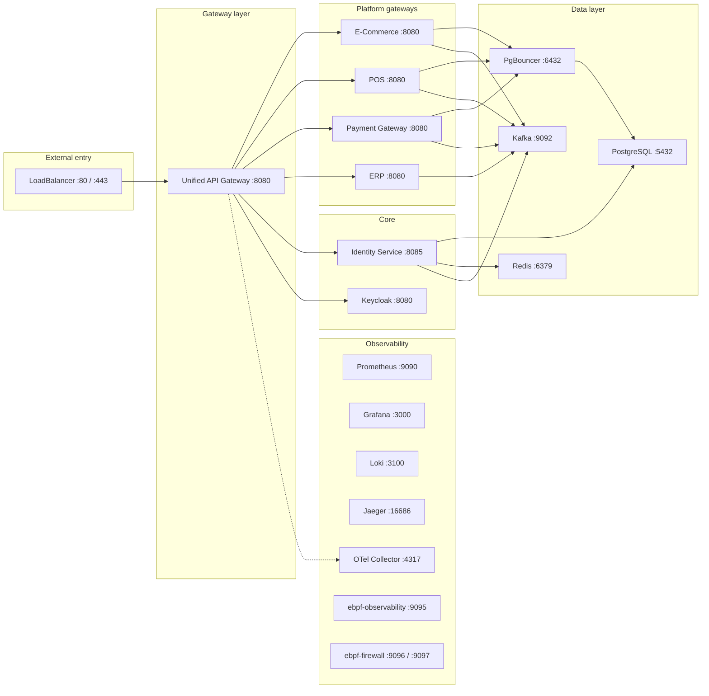

| Service | Port | Type | Purpose |
|---|---|---|---|
| Unified API Gateway | `8080` | LoadBalancer / NodePort | Single entry point for all platforms |
| E-Commerce Gateway | `8080` | ClusterIP | E-Commerce gRPC proxy and platform API |
| POS Gateway | `8080` | ClusterIP | Point of Sale gRPC proxy and platform API |
| Payment Gateway | `8080` | ClusterIP | Payment processing proxy |
| ERP (Quarkus) | `8080` | ClusterIP | ERP REST API and Kafka consumers/producers |
| ERP modules (modular mode) | `8086`–`8100` | ClusterIP | One port per ERP module, see [section 10](#10-erp-integration-architecture) |
| Identity Service | `8085` | ClusterIP | JWT issuance, refresh, user and role CRUD |
| Keycloak | `8080` | ClusterIP | OIDC provider, RS256 JWKS |
| PgBouncer | `6432` | ClusterIP | PostgreSQL connection pooling |
| PostgreSQL | `5432` | ClusterIP | Internal, reached through PgBouncer |
| Kafka | `9092` | ClusterIP | KRaft mode, no ZooKeeper |
| Redis | `6379` | ClusterIP | Token blacklist and query cache |
| Prometheus | `9090` | ClusterIP | Metrics scraping |
| Grafana | `3000` | ClusterIP | Dashboards and alerting |
| Loki | `3100` | ClusterIP | Log aggregation |
| Jaeger | `16686` | ClusterIP | Distributed tracing UI |
| OTel Collector | `4317` | ClusterIP | Span and metric pipeline |
| ebpf-observability agent | `9095` | ClusterIP | Runtime detection and TCP telemetry |
| ebpf-firewall exporter | `9096` | Sidecar | XDP drop engine metrics and control plane |
| ebpf-firewall signal | `9097` | Sidecar | L7 access signal (`runtime.endpoint.access`) |

> **Port note.** All platform gateways listen on `8080`. They are separate Kubernetes Services with their own ClusterIP addresses; the unified gateway routes by hostname, never by port.

---

## 5. Kubernetes topology

Namespace `superapp` on Minikube. Platform images are published as `superapp/*`; infrastructure uses `postgres:17-alpine`, `redis:7-alpine`, and `apache/kafka` in KRaft mode. Deployment is managed with Kustomize (`production/kubernetes/`) and synchronised by ArgoCD using an App-of-Apps layout.

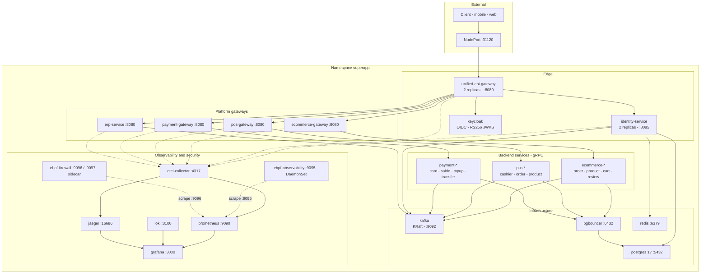

### Deployment tiers

| Tier | Deployments | Replicas |
|---|---|:---:|
| Edge | `unified-api-gateway`, `identity-service` | 2 |
| Gateway | `ecommerce-gateway`, `pos-gateway`, `payment-gateway`, `erp-service` | 1 |
| Backend (`tier: backend`) | `ecommerce-order`, `payment-card`, `pos-cashier`, … | 1 |
| Infrastructure | `kafka`, `postgres`, `redis`, `pgbouncer` | 1 |
| Observability | `otel-collector`, `prometheus`, `grafana`, `loki`, `jaeger` | 1 |
| Security | `ebpf-observability` (DaemonSet), `ebpf-firewall` (sidecar) | per node |

A `default-deny-all` NetworkPolicy is combined with per-service egress allow-lists (`production/kubernetes/network-policies/`). Per-service manifests live in `production/kubernetes/`.

---

## 6. Request lifecycle

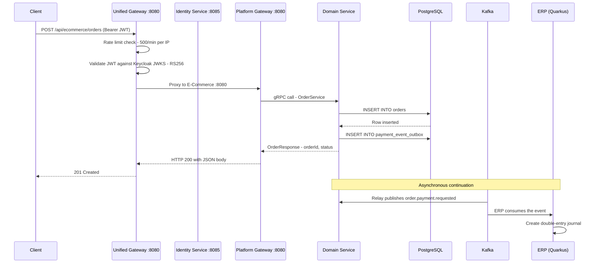

---

## 7. Authentication and authorization

Two distinct paths are supported:

1. **Registration and e-mail verification** — handled by the identity service (`:8085`).
2. **Login and token validation** — handled by **Keycloak OIDC** (realm `superapp`, **RS256**). The gateway validates tokens locally against the **JWKS** endpoint, caching keys and retrying with exponential backoff (6 attempts by default).

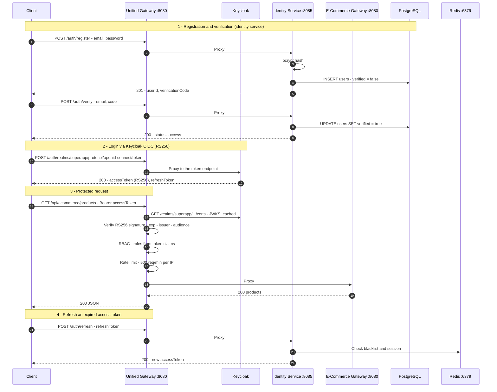

### Keycloak realm `superapp`

| Client | Used by | Notes |
|---|---|---|
| `unified-gateway` | Unified API Gateway | Token validation via JWKS (RS256) |
| `identity-service` | Identity Service | OIDC for internal authentication |
| `erp-backend` | ERP (Quarkus) | OIDC resource server |

Realm definition: `keycloak/superapp-realm.json`.

### JWT modes

| Mode | `JWT_MODE` | Constraint | Intended use |
|---|---|---|---|
| JWKS (RS256) | `jwks` (default) | None | Production and all deployments |
| HMAC (HS256) | `hs256` | Requires `APP_ENV` of `local`, `test`, or `development`, or an explicit `jwt_mode` in the verticle config | Local development and automated tests only |

The gateway refuses to start with `JWT_MODE=hs256` outside an explicit local/test configuration, so a production deployment cannot silently fall back to a shared secret.

---

## 8. Event streaming topology

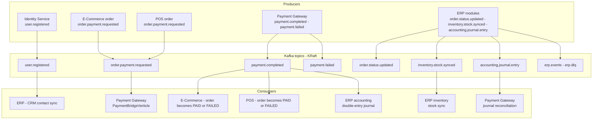

### Topic catalog

| Topic | Producer | Consumer | Status |
|---|---|---|---|
| `user.registered` | identity-service | ERP (`cross-platform-user-registered-in`) — CRM contact creation | Verified |
| `order.payment.requested` | E-Commerce and POS gateways via the V21 outbox trigger and relay | payment-gateway (`PaymentBridgeVerticle`), ERP | Wired |
| `payment.completed` | payment-gateway (`PaymentBridgeVerticle`) | E-Commerce and POS (`ErpEventConsumer`) → order `PAID`; ERP accounting → double-entry journal | Wired |
| `payment.failed` | payment-gateway (`PaymentBridgeVerticle`) | E-Commerce and POS → order `FAILED`; ERP | Wired |
| `order.status.updated` | ERP (`cross-platform-events-out`) | E-Commerce (`ErpEventConsumer`) | Wired |
| `inventory.stock.synced` | ERP (`cross-platform-events-out`) | E-Commerce (`ErpEventConsumer`), ERP inventory sync | Wired |
| `accounting.journal.entry` | ERP accounting (`accounting-journal-entry-out`) | payment-gateway → transaction reconciliation | Wired |
| `order.created` | E-Commerce / POS | ERP (`cross-platform-order-created-in`) | Wired |
| `erp.events` | ERP (`erp-events-out`) | — | Outgoing |
| `erp.manufacturing.events` | ERP manufacturing | ERP reporting (`reporting-events-in`) | Internal |
| `erp.integration.commands` | — | ERP integration (`erp-integration-commands-in`) | Internal |
| `erp.ai.agent.events` | — | ERP AI bridge (`ai-agent-events-in`) | Internal |
| `erp.dlq` | Failed ERP consumers (dead-letter strategy) | ERP DLQ consumer | Internal |

> **Consistency guarantees.** Producers publish through a **transactional outbox** — a database trigger writes the event to `payment_event_outbox`, and a relay publishes it with the `eventId` as idempotency key under a unique index. Consumers apply **claim, lease, and fencing** before processing, so redelivery never double-processes an event. The outbox migration chain is `V20`–`V23` in the E-Commerce and POS `db-migration` modules. Details: `METHOD_DESCRIPTION_ALGORITMA.md` and `PLANNING_WIRE_PAYMENTGATEWAY.md`.

### End-to-end transaction flow

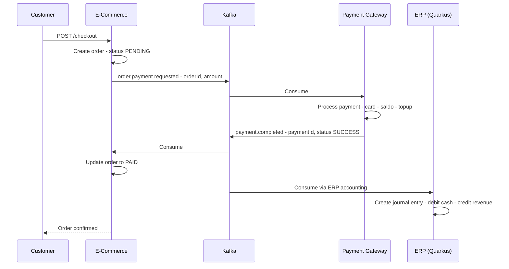

> **Verified at runtime (4 August 2026).** The loop above was exercised end to end: an order is created, `order.payment.requested` is published through the outbox trigger and relay, `PaymentBridgeVerticle` debits a real balance and creates a transaction, `payment.completed` moves the order to `PAID` consistently across database, cache, and API, the ERP accounting consumer creates a double-entry journal, and the ERP publishes `accounting.journal.entry` back for transaction reconciliation. The negative path was verified as well: an order with an insufficient balance produces `payment.failed` with `reason=INSUFFICIENT_FUNDS` and the order becomes `FAILED`. Probes: `e2e-tests/phase5-e2e-probe.py` and `e2e-tests/phase5-ac4-probe.py`.

---

## 9. Cross-platform payment flow

Status of the payment wiring across E-Commerce, POS, Payment Gateway, and ERP. All acceptance criteria were proven at runtime, not only at compile time. Full detail: `PLANNING_WIRE_PAYMENTGATEWAY.md`.

| Phase | Status |
|---|---|
| Phase 0–5 — baseline to end-to-end runtime loop | Complete |
| Phase 6 — documentation | Complete |
| Gaps G1–G6, G8, G9 | Complete |
| Runtime bugs R1–R9 | All fixed and documented |
| Acceptance criteria AC1–AC6 | Proven (AC1–AC5 at runtime, AC6 by unit test) |

### Verified runtime flow

```
Order created (PENDING)
  -> V21 trigger + outbox relay -> order.payment.requested
  -> PaymentBridgeVerticle: resolve card and merchant over gRPC
       -> TransactionCommandService.CreateTransaction
       -> SaldoCommandService.UpdateSaldoDebit (atomic SQL, guard total_balance >= amount)
  -> payment.completed (idempotency key = eventId, unique index)
  -> ErpEventConsumer (E-Commerce / POS) -> order PAID / FAILED (database, cache and API consistent)
  -> CrossPlatformAccountingConsumer (ERP) -> double-entry journal (debit cash / credit revenue)
  -> ERP publishes accounting.journal.entry -> PaymentBridgeVerticle.handleJournalEntry
       -> resolve merchant api key -> UpdateTransaction -> transaction reconciled
```

### Runtime evidence

| Aspect | Result | Evidence |
|---|---|---|
| Success path | Order reaches `PAID` with an ERP journal | Order 27/28 → `PAID`; balance debited once; journal `Payment from order #N` |
| Negative path | Order reaches `FAILED` | Order 26/29 → `payment.failed — reason=INSUFFICIENT_FUNDS` |
| Redelivery idempotency (AC5) | No double update | Order 27 redelivered → still `PAID`, one `DEBITED` row in `saldo_operations`; journal idempotent via `payment.completed:{txn}` |
| Reconciliation loop (R9) | ERP reconciles the transaction | `Transaction #18 reconciled: journal amount=44444.0 account=1000 debitCredit=DEBIT`; consumer group lag 0 |
| Unit tests (AC6) | Payment gateway builds green | merchant 205 · transaction 125 · apigateway 140, plus the remaining suites |

### Deployment notes

- Use **one** Flyway migration tree per database — either `common` or the standalone `db-migration` module, never both.
- Apply the payment migrations `V3__Add_transaction_idempotency_key` and `V4__Create_saldo_operation_ledger` to any environment that has not received them yet.
- The payment merchant cache uses the `paymerchant:` namespace, separated from the E-Commerce `merchant:` namespace (fix R4).
- The E-Commerce order cache uses the `ecommerce-order:` namespace (fix R5).

---

## 10. ERP integration architecture

The ERP is a **Quarkus 3.30 multi-module application** exposing a REST API over Hibernate Reactive and Panache. It integrates with the Vert.x platforms exclusively through Kafka — there is no synchronous cross-platform call path.

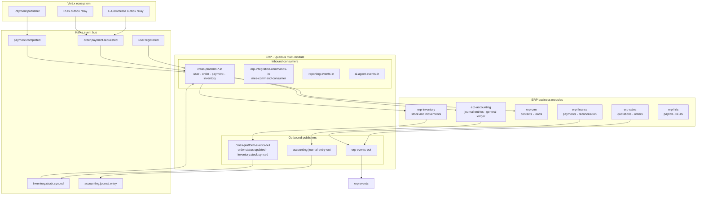

### How the unified gateway reaches the ERP

The gateway routes **per ERP module** rather than to a single aggregate bridge:

| Gateway prefix | Target | Default port |
|---|---|---|
| `/api/erp/v1/master-data/*` | `erp-master-data` | `8086` |
| `/api/erp/v1/purchasing/*` | `erp-purchasing` | `8087` |
| `/api/erp/v1/approval/*` | `erp-approval` | `8088` |
| `/api/erp/v1/inventory/*` | `erp-inventory` | `8089` |
| `/api/erp/v1/manufacturing/*` | `erp-manufacturing` | `8090` |
| `/api/erp/v1/subcontracting/*` | `erp-subcontracting` | `8091` |
| `/api/erp/v1/costing/*` | `erp-costing` | `8092` |
| `/api/erp/v1/accounting/*` | `erp-accounting` | `8093` |
| `/api/erp/v1/crm/*` | `erp-crm` | `8094` |
| `/api/erp/v1/sales/*` | `erp-sales` | `8095` |
| `/api/erp/v1/finance/*` | `erp-finance` | `8096` |
| `/api/erp/v1/hris/*` | `erp-hris` | `8097` |
| `/api/erp/v1/reporting/*` | `erp-reporting` | `8098` |
| `/api/erp/v1/integration/*` | `erp-integration` | `8099` |
| `/api/erp/v1/ai-bridge/*` | `erp-ai-bridge` | `8100` |
| `/api/erp/v1/dashboard/*` | `erp-reporting` (aggregate KPI dashboard) | `8098` |

Each target is overridable with `ERP_<MODULE>_HOST` and `ERP_<MODULE>_PORT`, falling back to `ERP_GATEWAY_HOST` and `ERP_GATEWAY_PORT`. In Kubernetes the ERP runs as a single monolith (`erp-service`, port `8080`), so both variables point at that deployment. `/api/erp/health` proxies to the Quarkus SmallRye health endpoint of a representative module (`ERP_HEALTH_HOST`, default `erp-finance:8096`).

> **Note on the legacy gRPC façade.** An earlier iteration exposed ERP operations over gRPC through the gateway (`/api/erp/grpc/journal`, `/api/erp/grpc/stock/*`, `/api/erp/grpc/ledger`, `/api/erp/grpc/items`). That HTTP façade was removed from the gateway and is **no longer registered**; the ERP today is REST plus Kafka. Prototypes and mocks remain in the test sources only (`unified-api-gateway/src/test/.../MockErpGrpcServer.java`).

---

## 11. Runtime configuration

### Rate limiter

All four gateways expose an environment-configurable rate limiter with safe defaults.

| Variable | Default | Description |
|---|---|---|
| `RATE_LIMIT_ENABLED` | `true` | Set to `false` to bypass rate limiting (E2E and load tests) |
| `RATE_LIMIT_MAX_PER_MIN` | `500` | Maximum requests per minute per IP address |

Implemented in: `unified-api-gateway`, `ecommerce-gateway`, `pos-gateway`, `payment-gateway`. Requests over the limit receive `429 Too Many Requests` with a `Retry-After` header and emit a `rate_limit.triggered` security event.

```bash
# Disable rate limiting for E2E or load testing
export RATE_LIMIT_ENABLED=false
```

```yaml
# Or in a Kubernetes deployment
env:
  - name: RATE_LIMIT_ENABLED
    value: "false"
```

### JVM tuning — `JAVA_TOOL_OPTIONS`

All platform gateways tune the JVM through the standard `JAVA_TOOL_OPTIONS` environment variable rather than command overrides.

```yaml
# Correct - read natively by the JVM, works with an exec-form ENTRYPOINT
env:
  - name: JAVA_TOOL_OPTIONS
    value: "-Dvertx.maxEventLoopExecuteTime=10000"

# Incorrect - requires shell expansion and breaks the exec-form ENTRYPOINT
env:
  - name: JAVA_OPTS
    value: "-Dvertx.maxEventLoopExecuteTime=10000"
command: ["sh", "-c", "java $JAVA_OPTS -jar app.jar"]
```

Why `JAVA_TOOL_OPTIONS` is preferred:

- The JVM parses it natively — no shell, no `command` override required.
- It is compatible with Docker's exec-form `ENTRYPOINT ["java", "-jar", "app.jar"]`.
- No shell-splitting hazards with special characters.
- Standard behaviour across all JDK distributions (8 and later).

Applied to `ecommerce-gateway`, `pos-gateway`, and `payment-gateway` deployments.

---

## 12. Getting started

### Prerequisites

| Tool | Version | Purpose |
|---|---|---|
| JDK | 21 | Build and run all services |
| Maven | 3.9+ | Build |
| Docker and Docker Compose | Recent | Local runtime stack |
| Minikube or Kind | Recent | Kubernetes testing |
| k6 | Recent | Load testing |
| Go | 1.21+ | Building the eBPF agents |

### 1. Build the shared library and core services

```bash
git clone <repository-url> microservice-superapp
cd microservice-superapp

# Shared cross-platform event schemas — consumed by every platform
cd cross-platform-events && mvn clean install -DskipTests && cd ..

# Identity service (authentication foundation)
cd identity-service && mvn clean package -DskipTests && cd ..

# Unified API gateway (entry point)
cd unified-api-gateway && mvn clean package -DskipTests && cd ..
```

### 2. Run the full stack locally

```bash
# PostgreSQL, Redis, Kafka, Keycloak, all platform gateways, ERP, and observability
docker compose up -d --build

# Follow the gateway startup
docker compose logs -f unified-api-gateway

# Verify
curl -s http://localhost:8080/health
curl -s http://localhost:8080/health/ready
```

### 3. Deploy to Minikube

```bash
minikube start --cpus=4 --memory=8192

eval $(minikube docker-env)
docker build -t superapp/identity-service:latest identity-service
docker build -t superapp/unified-api-gateway:latest unified-api-gateway

kubectl apply -k production/kubernetes/identity-service
kubectl apply -k production/kubernetes/unified-api-gateway

kubectl get pods -n superapp
kubectl get svc  -n superapp
```

### 4. Run the test suites

```bash
# Unit tests for a platform
cd vertx-payment-gateway && mvn test && cd ..

# Cross-platform E2E (Hurl)
cd e2e-tests && ./run-e2e.sh && cd ..

# Load tests
k6 run production/loadtest/auth-flow.js
k6 run production/loadtest/cross-platform-stress.js
```

---

## 13. Configuration reference

### Unified API Gateway — core

| Variable | Default | Description |
|---|---|---|
| `HTTP_PORT` | `8080` | Gateway listen port |
| `JWT_MODE` | `jwks` | `jwks` (RS256, production) or `hs256` (explicit local/test only) |
| `KEYCLOAK_URL` | `http://keycloak:8085` | Base URL; JWKS endpoint is `${KEYCLOAK_URL}/realms/superapp/protocol/openid-connect/certs` |
| `KEYCLOAK_HOST` / `KEYCLOAK_PORT` | `keycloak` / `8085` | Keycloak health-check target |
| `JWT_SECRET` | `my-secret-key` | Shared secret — **only** used when `JWT_MODE=hs256` in a local/test environment |
| `RATE_LIMIT_ENABLED` | `true` | Enable or disable the rate limiter |
| `RATE_LIMIT_MAX_PER_MIN` | `500` | Requests per minute per IP |
| `CORS_ALLOWED_ORIGIN` | `*` | Allowed CORS origin |
| `OTEL_EXPORTER_OTLP_ENDPOINT` | `http://otel-collector:4317` | OpenTelemetry collector endpoint |
| `APP_ENV` | *(unset)* | `local`, `test`, or `development` unlocks HS256 mode |

### Unified API Gateway — platform routing

| Variable | Code default | Kubernetes value | Description |
|---|---|---|---|
| `ECOMMERCE_GATEWAY_HOST` / `_PORT` | `localhost` / `8081` | `ecommerce-gateway` / `8080` | E-Commerce platform gateway |
| `POS_GATEWAY_HOST` / `_PORT` | `localhost` / `8082` | `pos-gateway` / `8080` | POS platform gateway |
| `PAYMENT_GATEWAY_HOST` / `_PORT` | `localhost` / `8083` | `payment-gateway` / `8080` | Payment platform gateway |
| `ERP_GATEWAY_HOST` / `_PORT` | per module | `erp-service` / `8080` | Fallback for every ERP module |
| `ERP_<MODULE>_HOST` / `_PORT` | `erp-<module>` / `8086`–`8100` | — | Per-module override; see [section 10](#10-erp-integration-architecture) |
| `ERP_REPORTING_HOST` / `_PORT` | `erp-reporting` / `8098` | — | Aggregate KPI dashboard target |
| `ERP_HEALTH_HOST` / `_PORT` | `erp-finance` / `8096` | — | Health-check target (`/api/erp/health`) |
| `IDENTITY_SERVICE_HOST` / `_PORT` | `localhost` / `8085` | `identity-service` / `8085` | Identity service |

### Identity Service

| Variable | Default | Description |
|---|---|---|
| `DB_HOST` | `postgres` | PostgreSQL host |
| `DB_PORT` | `5432` | PostgreSQL port |
| `DB_NAME` | `identity_db` | Database name |
| `DB_USER` | `DRAGON` | Database user |
| `DB_PASS` | `DRAGON` | Database password |
| `REDIS_HOST` | `redis` | Redis host |
| `REDIS_PORT` | `6379` | Redis port |
| `KAFKA_BROKERS` | `kafka:9092` | Kafka bootstrap servers |
| `JWT_SECRET` | `my-secret-key` | JWT signing secret |

---

## 14. CI/CD pipeline

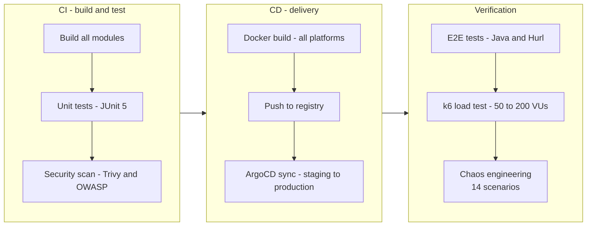

### GitHub Actions workflows

| Workflow | Trigger | Description |
|---|---|---|
| `ci-build-test.yml` | Push or pull request to `main` | Build, unit test, security scan |
| `ci-pr-checks.yml` | Pull request | Fast pre-merge checks |
| `cd-build-push.yml` | Push to `main` | Docker build and registry push |
| `cd-deploy.yml` | Manual or tag | ArgoCD deployment to staging or production |
| `cd-release.yml` | Tag | Release packaging and publication |
| `e2e-tests.yml` | Scheduled | Java and Hurl end-to-end verification |
| `load-test.yml` | Scheduled | k6 load test (50–200 VUs) |

---

## 15. Observability stack

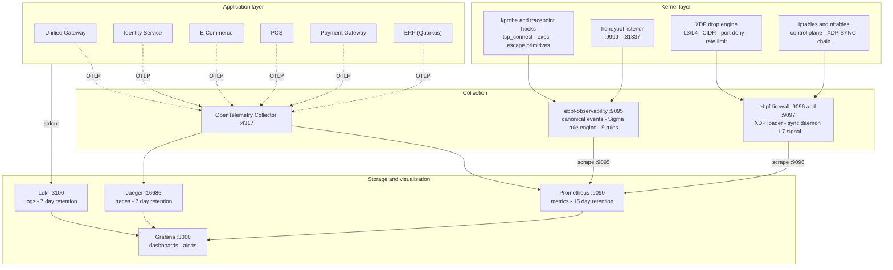

### Dashboards

| Dashboard | Component | Purpose |
|---|---|---|
| Cross-platform dashboard | — | Unified view of all platforms: request rate, error rate, Kafka lag |
| ERP dashboard | — | ERP request rates, latencies, and error rates per module |
| Identity service dashboard | — | Registration, login, verification rates, token metrics |
| Gateway dashboard | — | Rate limiter activity, proxy latency, platform health |
| eBPF TCP observability | `ebpf-observability` | Kernel-level connections per destination port and family, rate, latency percentiles (`uid: ebpf-observability`) |
| Security observability | `ebpf-observability` | Runtime security live — process layer (exec rate by class, escape primitives, honeypot hits), egress, auth and authz — 18 panels (`uid: security-observability`) |
| eBPF firewall — endpoint protection | `ebpf-firewall` | XDP drop and connection rate, drop ratio, blocked probing (`uid: ebpf-firewall`) |

#### Dashboard evidence

**Business Metrics** — request rate per platform (E-Commerce, POS, Payment, ERP), traffic distribution, Redis cache hit rate, and the OTLP telemetry pipeline.


**Infrastructure Health** — JVM heap and non-heap usage per service, CPU utilisation, thread counts, and garbage-collection behaviour across the Vert.x and Quarkus modules.


### eBPF runtime security — two components with distinct roles

Both agents are written in Go with `cilium/ebpf` (CO-RE) and require no application instrumentation. `ebpf-observability` **observes and detects**; `ebpf-firewall` **enforces and blocks**.

#### `ebpf-observability` — runtime detection and TCP telemetry (`:9095`)

The agent works entirely in the kernel: TCP tracing plus runtime process detection, container escape detection, and honeypot probing, driven by **9 Sigma detection rules** parsed at startup from `detections/sigma/`.

Detection layers:

- **TCP observability** — kprobes on `tcp_v4_connect`, `tcp_v6_connect` (IPv4 and IPv6) and `tcp_set_state`.
- **Process execution** — `runtime.process.exec` events classified as `shell`, `downloader`, `miner`, `reverse_shell_kit`, `privilege_tool`.
- **Container escape** — `runtime.container.escape` events for the `unshare`, `setns`, and `mount` primitives (DET-SEC-006).
- **Honeypot** — `runtime.endpoint.honeypot` events on the configured ports (default 9999 and 31337, override with `EBPF_HONEYPOT_PORTS`).
- **Egress policy** — destination class allow-list plus a host-namespace guard (DET-SEC-005).
- **Overhead control** — duty-cycle sampling (10 s on, 10 s off), gating, and rate limiting, surfaced through `ebpf_sampling_active` and `ebpf_proc_events_filtered_total{reason}`.

Prometheus metrics (`:9095/metrics`): `ebpf_tcp_connections_total{dport,family}`, `ebpf_tcp_connect_latency_seconds` (histogram), `ebpf_proc_exec_total{class}`, `ebpf_proc_escape_total{primitive}`, `ebpf_honeypot_hits_total{dport}`, `ebpf_rule_hits_total{rule}`, `ebpf_egress_policy_violations_total`.

The ruleset is the source of truth and is verified automatically by `sigma_ruleset_test.go` (every rule loads, IDs are unique, true positives and cross-talk guards pass):

```bash
cd ebpf-observability && go test -run TestSigmaRuleset -v .
```

Alerts: `ContainerMinerExecDetected`, `ContainerReverseShellToolExec`, `ContainerEscapePrimitiveDetected`, `HoneypotPortProbeDetected` (group `runtime-process`), `SecurityUnexpectedEgressDetected` and `SecurityRuntimeRuleMatch` (group `security-runtime-egress`). Investigation procedure: `docs/runbook/alert-runbook.md`.

Verified at runtime on 9 August 2026: miner (`/tmp/xmrig`), reverse shell (`/tmp/nc`), escape (`unshare`, `setns`), and honeypot (`nc :9999`) probes all appeared as series in Prometheus and Grafana. Plan: `docs/ebpf-observability-plan.md`.

**eBPF TCP Observability** (`uid: ebpf-observability`) — total and established connection rates, top destination ports, and the connect-to-established latency heatmap with p50/p95/p99 percentiles.


**Security Observability** (`uid: security-observability`) — Sigma rule hits per `rule_id`, process exec rate by class, escape primitive rate, and honeypot port hits.


#### `ebpf-firewall` — XDP enforcement and control plane (`:9096`, `:9097`)

The endpoint firewall protects HTTP and gRPC endpoints with an **XDP drop engine** for L3/L4 early drops, driven by **iptables and nftables as the control plane** — iptables and nftables hold the truth, the BPF maps are a cache.

- **XDP drop engine** (`firewall_bpf.go`) — per-CIDR drops using an LPM trie, destination port allow/block lists, per-source-IP rate limiting against SYN floods, and an `enforce` / `dry-run` mode. The filter is anchored to the pod network namespace (`ebpf_fw_filter_anchor_netns`).
- **Control plane** (`sync.go`) — administrators write rules in the iptables or nftables chain `XDP-SYNC`; the sync daemon watches `nft monitor` (or polls `iptables -S XDP-SYNC`) and writes the rules into the BPF maps.
- **L7 signal** (`signal_bpf.go`, `:9097`) — kprobes on `tcp_v4/v6_connect` emit `runtime.endpoint.access` with a bounded protocol class (http, grpc, tls), driving DET-SEC-010 (endpoint probing) and DET-SEC-011 (blocked probing).
- **Deployment** — a sidecar per service, with XDP attached to the pod veth interface.

Metrics (`:9096/metrics`): `ebpf_fw_packets_total`, `ebpf_fw_drops_total{reason,src_class,dport}`, `ebpf_fw_conns_total{proto_class,dport,family}`, `ebpf_fw_blocklist_entries`, `ebpf_fw_portpolicy_entries`, `ebpf_fw_enforce_mode`, `ebpf_fw_events_dropped`, plus the recording rules `security:fw_drops_rate5m`, `security:fw_conns_rate5m`, and `security:fw_drop_ratio5m`.

Alerts (group `endpoint-protection`): `EndpointProbingDetected`, `SecurityFWBlockedProbing`, and `SignalKprobeFilterFailOpen` — the last one fires when the kprobe filter errors and fail-open behaviour would allow traffic through.

Enforcement was verified on 9 August 2026 with the compose stack: `EBPF_FW_PORT_DENY=4444,31337`, `EBPF_FW_BLOCKLIST=203.0.113.0/24`, and `EBPF_FW_RATE_RPS=20` produced rising drop counts for all three reasons (`blocklist`, `port`, `ratelimit`). These drops came from **synthetic probes**, not from a real attack.

**eBPF Firewall — Endpoint Protection** (`uid: ebpf-firewall`) — XDP drop rate by reason, drop ratio, enforce mode, port policy and blocklist entries, plus the L7 endpoint-access signal and the DET-SEC-010/DET-SEC-011 detection panels. The `FAIL-OPEN` badge on the filter status is the honest state of the compose stack, described in the limitation below.


> **Honest limitation.** On the compose stack the global kprobe filter is in **fail-open** mode because it observes every workload node and cannot be anchored to a pod namespace. In Kubernetes the filter is anchored per pod (`EBPF_FW_CGROUP_FILTER=on`, `ebpf_fw_filter_anchor_netns=1`). The eBPF layer provides runtime detection and L3/L4 enforcement; it is **not** a full EDR — there is no memory integrity checking and no exhaustive syscall coverage. Capability matrix, evidence, and roadmap: `docs/security/security-observability.md`.

---

## 16. Security architecture

Policy is enforced independently at every layer, so a failure in one control does not collapse the whole model.

```mermaid
flowchart LR
    subgraph L1["L1 - Transport"]
        TLS["TLS 1.2+<br/>ingress and load balancer"]
    end
    subgraph L2["L2 - Edge - Unified Gateway"]
        RL["Rate limiter<br/>500 req/min per IP - token bucket"]
        JWT["JWT validation<br/>Keycloak JWKS - RS256"]
        RBAC["RBAC<br/>roles from token claims"]
    end
    subgraph L3["L3 - Network - Kubernetes"]
        NP["NetworkPolicy<br/>default-deny-all with egress allow-list"]
    end
    subgraph L4["L4 - Kernel - eBPF"]
        FW["ebpf-firewall<br/>XDP drop L3/L4 - CIDR - port deny - rate limit<br/>iptables and nftables control plane"]
        OBS["ebpf-observability<br/>kprobe - 9 Sigma rules - honeypot"]
    end
    subgraph L5["L5 - Data and application"]
        SEC["SealedSecrets<br/>encrypted secrets"]
        APP["Input validation<br/>parameterised SQL - JWT expiry"]
    end

    TLS --> RL
    RL --> JWT
    JWT --> RBAC
    RBAC --> NP
    NP --> FW
    FW --> OBS
    OBS --> SEC
    SEC --> APP
```

| Layer | Controls | Status |
|---|---|---|
| L1 — Transport | TLS 1.2+, ingress and load balancer | Active |
| L2 — Edge | Rate limiter 500 req/min per IP, JWT validation via JWKS RS256, RBAC from Keycloak claims | Active |
| L3 — Network | `default-deny-all` NetworkPolicy with per-service egress rules | Active |
| L4 — Kernel | XDP firewall drops at L3/L4 with an iptables control plane; runtime detection with 9 Sigma rules | Active |
| L5 — Data and application | SealedSecrets, input validation, reactive SQL without an ORM injection surface | Active, with residual risk tracked in the technical debt inventory |

> The five layers are enforced independently, so a failure in one control does not collapse the whole model. As noted in [section 15](#15-observability-stack), the kernel layer is runtime detection plus L3/L4 enforcement, not a full EDR. Reference: `docs/security/security-observability.md`, `docs/security-audit-checklist.md`, and `docs/security/security-hardening-guide.md`.

---

## 17. Technology stack

| Layer | Technology | Notes |
|---|---|---|
| Runtime | Java 21 | All JVM services |
| Framework | Eclipse Vert.x 4.5 | E-Commerce, POS, Payment Gateway, Identity, Unified Gateway |
| Framework | Quarkus 3.30 | ERP (17 modules) |
| API protocol | gRPC (Protobuf) | Service to service within a platform |
| API protocol | REST (Vert.x Router) | External APIs through the unified gateway |
| Database | PostgreSQL 17 | Multi-database: ecommerce, pos, payment, erp, identity |
| Data access (Vert.x) | `vertx-pg-client` | Raw reactive SQL, no ORM |
| Data access (Quarkus) | Hibernate Reactive + Panache | ORM in the ERP modules |
| Connection pooling | PgBouncer | Transaction pooling |
| Cache | Redis | Token blacklist and query cache |
| Messaging | Apache Kafka (KRaft) | No ZooKeeper, 3 partitions, replication factor 2 |
| Containers | Docker + Kustomize | Multi-stage builds |
| Orchestration | Kubernetes + ArgoCD | GitOps, App-of-Apps |
| CI/CD | GitHub Actions | 7 workflows |
| Observability | OpenTelemetry, Prometheus, Grafana, Loki, Jaeger, eBPF (`cilium/ebpf`) | Kernel TCP tracing, runtime detection, XDP firewall |
| Load testing | k6 | Authentication flow and cross-platform stress |
| Chaos testing | Custom ChaosManager | 14 scenarios across HTTP and Kafka |

---

## 18. Repository layout

```
microservice-superapp/
├── README.md                              # This document
├── CHANGELOG.md                           # Version history
├── CONNECTIVITY_DIAGRAM.md                # Connectivity map and per-service status
├── FULL_ENDPOINT_GAP_BREAKDOWN.md         # Endpoint coverage P0-P4
├── PLANNING_WIRE_PAYMENTGATEWAY.md        # Payment wiring plan and runtime evidence
├── METHOD_DESCRIPTION_ALGORITMA.md        # Outbox, idempotency, and algorithm reference
├── LEAD_ENGINEER_VERTX_ROADMAP.md         # Six-phase capability roadmap
├── ACTION_PLAN.md                         # Current execution plan
├── docker-compose.yml                     # Full local stack
├── seed_data.sql                          # Cross-platform E2E seed
├── chaos.yaml                             # Chaos injection configuration
│
├── unified-api-gateway/                   # Single entry point for all platforms
│   └── src/main/java/io/example/unified/
│       ├── UnifiedGatewayVerticle.java    # Vert.x web router
│       ├── config/GatewayConfig.java      # Platform and ERP module route table
│       ├── proxy/PlatformProxy.java       # HTTP reverse proxy
│       └── middleware/UnifiedAuthMiddleware.java  # JWT validation and RBAC
│
├── identity-service/                      # Centralised authentication and RBAC
│   └── src/main/java/io/example/identity/
│       ├── IdentityVerticle.java          # Router for /auth/*, /users, /roles
│       ├── handler/AuthHandler.java       # Register, login, verify, refresh
│       ├── service/KafkaService.java      # Event publication
│       └── repository/RepositoryImpl.java # PostgreSQL and Redis
│
├── cross-platform-events/                 # Shared Kafka event schemas
│   └── src/main/java/crossplatform/events/
│       ├── EventSchemas.java              # Typed business event builders
│       ├── SecurityEventSchemas.java      # Canonical security events
│       ├── RuntimeEgressSchemas.java      # Runtime egress events
│       └── KubernetesAuditSchemas.java    # Kubernetes audit envelopes
│
├── vertx-ecommerce/                       # E-Commerce platform - 20 modules
├── vertx-point_of_sale/                   # Point of Sale platform - 11 modules
├── vertx-payment-gateway/                 # Payment platform - 11 modules
│
├── PieroERPQuarkus/                       # ERP platform - 17 Quarkus modules
│   ├── erp-shared/                        # Kafka publisher and shared contracts
│   ├── erp-accounting/                    # Journal entries and general ledger
│   ├── erp-inventory/  erp-sales/  erp-crm/  erp-finance/  erp-hris/
│   ├── erp-master-data/  erp-purchasing/  erp-approval/  erp-manufacturing/
│   ├── erp-subcontracting/  erp-costing/  erp-reporting/  erp-integration/
│   ├── erp-ai-bridge/                     # AI agent integration
│   ├── erp-api-gateway/                   # ERP REST surface and Flyway migrations
│   └── erp-dashboard/                     # React and Vite dashboard
│
├── e2e-tests/                             # End-to-end suites and runtime probes
│   ├── e2e-cross-platform.hurl            # 28-request Hurl suite
│   ├── phase5-e2e-probe.py                # Payment flow probe
│   ├── phase5-ac4-probe.py                # Acceptance criteria probe
│   └── src/test/java/e2e/                # Java E2E suite
│
├── keycloak/                              # Keycloak realm configuration
│   └── superapp-realm.json                # Realm superapp - RS256 - 3 clients
│
├── observability/                         # Grafana provisioning
│   └── grafana/provisioning/dashboards/   # security-observability, ebpf-firewall, ...
│
├── ebpf-observability/                    # Runtime detection and TCP telemetry
│   ├── main.go                            # eBPF loader, ring buffer, metrics endpoint
│   ├── bpf/tcpmonitor.c                   # kprobes on tcp_v4/v6_connect, tcp_set_state
│   ├── security_events.go                 # Process exec, container escape, honeypot
│   ├── rules.go                           # Sigma rule engine, parsed at startup
│   └── sigma_ruleset_test.go              # Automatic verification of the 9 rules
│
├── ebpf-firewall/                         # XDP firewall and control plane
│   ├── firewall_bpf.go                    # XDP drop engine - L3/L4
│   ├── signal_bpf.go, signal.go           # L7 access signal
│   ├── sync.go                            # iptables/nftables to BPF map sync
│   └── main.go, exporter.go               # Sidecar loader and metrics endpoint
│
├── k8s-audit-collector/                   # Kubernetes API audit webhook receiver
├── detections/sigma/                      # Detection rules - source of truth
├── tests/fixtures/                        # Seed fixtures for every platform
├── tools/sweep/                           # Endpoint sweep generators
│
├── production/
│   ├── kubernetes/                        # Kustomize manifests, overlays, policies
│   │   ├── unified-api-gateway/
│   │   ├── identity-service/
│   │   ├── erp-service/
│   │   ├── backends/
│   │   ├── network-policies/
│   │   ├── ebpf/
│   │   ├── observability/
│   │   ├── argocd/  rbac/  sealed-secrets/
│   │   └── overlays/
│   ├── loadtest/                          # k6 scripts
│   ├── chaos/                             # Chaos scenarios
│   └── grafana/                           # Dashboard JSON
│
├── .github/workflows/                     # 7 CI/CD workflows
│
└── docs/
    ├── api-reference.md
    ├── onboarding-guide.md
    ├── developer-quickstart.md
    ├── code-review-standards.md
    ├── performance-tuning-guide.md
    ├── production-deployment-checklist.md
    ├── security-audit-checklist.md
    ├── technical-debt-inventory.md
    ├── architecture/                      # ARCHITECTURE_DIAGRAM.md and 8 ADRs
    ├── security/                          # Capability matrix, hardening, secrets
    ├── runbook/                           # Alert, incident, and disaster recovery
    └── ebpf-observability-plan.md
```

---

## 19. Verification status

> Deployment snapshot taken on **28 July 2026** on Minikube with 17 pods running and no crashes. Test and endpoint results are from the **v20 session on 3 August 2026**, and the payment wiring results from **v22 on 4 August 2026**. Dates are stated per table so that each claim remains traceable to the run that produced it.

### Test suites

| Suite | Result |
|---|---|
| E-Commerce (11 test-bearing modules) | 284 passing |
| Point of Sale (8 test-bearing modules) | 749 passing |
| Payment Gateway (12 modules) | 1,182 passing |
| ERP (17 modules) | 37 passing |
| **Total across four platforms** | **2,252 passing, 0 failures, 0 errors** |
| Cross-platform E2E (Hurl) | 28/28 requests |
| Cross-platform E2E (Java) | 24/24 |
| ERP GET sweep | 66/66 |
| ERP write sweep | 159 OK / 0 failures |
| Authentication | Keycloak JWKS RS256, login through `/auth/realms/*` |

### Deployment status

| Service | Pods | Status | Notes |
|---|---|---|---|
| `unified-api-gateway` | 2/2 | Running | NodePort 31120 |
| `identity-service` | 2/2 | Running | Authentication flow operational |
| `ecommerce-gateway` | 1/1 | Running | `JAVA_TOOL_OPTIONS`, port 8080 |
| `ecommerce-order` | 1/1 | Running | Safe `parseInt` in `RedisConfig` |
| `ecommerce-product` | 1/1 | Running | Safe `parseInt` in `RedisConfig` |
| `ecommerce-transaction` | 1/1 | Running | Safe `parseInt` in `RedisConfig` |
| `pos-gateway` | 1/1 | Running | `JAVA_TOOL_OPTIONS`, port 8080 |
| `payment-gateway` | 1/1 | Running | `JAVA_TOOL_OPTIONS`, port 8080 |
| `payment-card` | 1/1 | Running | `KAFKA_BROKERS` configured |
| `payment-saldo` | 1/1 | Running | `KAFKA_BROKERS` configured |
| `payment-transaction` | 1/1 | Running | Safe `parseInt` in `RedisConfig` |
| `kafka` | 1/1 | Running | KRaft mode |
| `postgres` | 1/1 | Running | 5 databases |
| `redis` | 1/1 | Running | Kubernetes Service created |
| `otel-collector` | 1/1 | Running | OTLP endpoint |
| **Total** | **17/17** | **Healthy** | **Zero crashes** |

### Authentication endpoints (identity service, `:8085`)

| Method | Endpoint | Status | Latency |
|---|---|---|---|
| `POST` | `/auth/register` | 200 | ~500 ms |
| `POST` | `/auth/verify?email=&code=` | 200 | ~200 ms |
| `POST` | `/auth/login` | 200 | ~300 ms |
| `POST` | `/auth/refresh` | 200 | ~200 ms |
| `GET` | `/auth/me/:userId` | 200 | ~200 ms |

### Platform health probes

| Method | Endpoint | Status | Target |
|---|---|---|---|
| `GET` | `/api/ecommerce/health` | 200 | E-Commerce gateway `:8080` |
| `GET` | `/api/pos/health` | 200 | POS gateway `:8080` |
| `GET` | `/api/payment/health` | 200 | Payment gateway `:8080` |
| `GET` | `/api/erp/health` | 200 | ERP `:8080` |

### E-Commerce endpoints

| Method | Endpoint | Status | Root cause of the original failure (resolved) |
|---|---|---|---|
| `GET` | `/api/ecommerce/products` | 200 | — |
| `GET` | `/api/ecommerce/categories` | 200 | — |
| `GET` | `/api/ecommerce/merchants` | 200 | — |
| `GET` | `/api/ecommerce/orders` | 200 | — |
| `POST` | `/api/ecommerce/orders` | 201 | Hostname and port mismatch — `GRPC_ORDER_ADDR=order` did not resolve to `ecommerce-order` |

### POS endpoints

| Method | Endpoint | Status | Notes |
|---|---|---|---|
| `GET` | `/api/pos/products` | 200 | — |
| `GET` | `/api/pos/orders` | 200 | — |
| `POST` | `/api/pos/orders` | 201 | ~60 s through the gRPC chain; `total_price` verified at 100000 |

### Payment Gateway endpoints

| Method | Endpoint | Status | Root cause of the original failure (resolved) |
|---|---|---|---|
| `GET` | `/api/payment/saldos` | 200 | `GRPC_SALDO_PORT` unset, defaulted to 8084 instead of `saldo:50056` |
| `GET` | `/api/payment/cards` | 200 | `GRPC_CARD_PORT` defaulted to 8089 instead of `card:50053`; the gateway `PAYMENT_GATEWAY_PORT` was 8083 and is now 8080 |
| `GET` | `/api/payment/transactions` | 200 | `GRPC_TRANSACTION_PORT` defaulted to 8090 instead of `transaction:50058` |

### ERP endpoints

| Method | Endpoint | Status |
|---|---|---|
| `GET` | `/api/erp/health` | 200 |
| `GET` | `/api/erp/v1/accounting/*` | 200 |
| `GET` | `/api/erp/v1/inventory/*` | 200 |
| `POST` | `/api/erp/v1/accounting/*` | 200 |
| `POST` | `/api/erp/v1/inventory/*` | 200 |

---

## 20. Roadmap

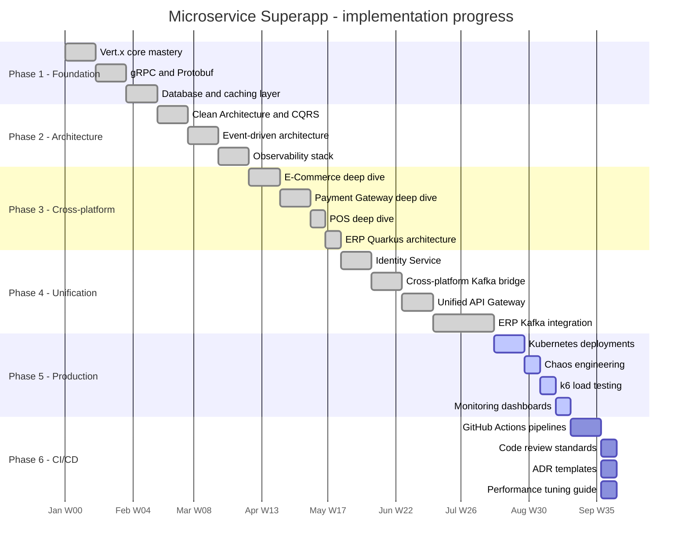

### Completed

- [x] Centralised Identity Service with JWT, RBAC, and e-mail verification
- [x] Unified API Gateway routing all four platforms behind one entry point
- [x] Cross-platform event schemas shared by every platform (`EventSchemas.java`)
- [x] Kafka topic chain: E-Commerce to Payment Gateway to ERP
- [x] Environment-configurable rate limiter with a disable flag
- [x] NetworkPolicy manifests for all services
- [x] End-to-end suites (Java, Hurl, k6)
- [x] CI/CD pipelines — 7 GitHub Actions workflows
- [x] Code review standards and ADR templates
- [x] Performance tuning guide
- [x] Full Quarkus ERP monolith building cleanly across 17 modules
- [x] Endpoint coverage P0–P2 and core P3 — 2,252 tests green, Hurl 28/28, Java 24/24, ERP GET sweep 66/66, ERP write sweep 159/0
- [x] Production-grade gateway authentication — Keycloak JWKS RS256 with retry, `/auth/realms/*` proxied to Keycloak, HS256 restricted to explicit local/test modes
- [x] Correctness hardening — one-based pagination across platforms, Redis `deleteByPattern` invalidation, aligned cache keys, synchronised fixture seed sequences
- [x] Cross-platform payment loop wired and verified at runtime — order to `payment.completed` to `PAID` with an ERP journal; the negative path returns `payment.failed` with `reason=INSUFFICIENT_FUNDS`; the ERP-to-gateway reconciliation loop is verified; redelivery causes no double debit
- [x] eBPF TCP observability — kprobes for IPv4 and IPv6 connections with a latency histogram, verified in Minikube, Docker Compose, and during the e2e suite
- [x] eBPF firewall — XDP drop engine with an iptables control plane, L7 access signal, Prometheus rules, and a Grafana dashboard

### In progress

- [ ] Deploy all platform backends to Minikube
- [ ] Validate the chaos engineering scenarios
- [ ] Production-grade monitoring dashboards
- [ ] Deploy the full Quarkus ERP monolith to Minikube

### Up next

- [ ] Deploy to a production Kubernetes cluster
- [ ] ArgoCD App-of-Apps setup
- [ ] Consolidate onto a unified database schema
- [ ] API versioning strategy (v1 to v2)

---

## 21. API reference

### Authentication (through the unified gateway)

| Method | Path | Auth | Description |
|---|---|---|---|
| `POST` | `/auth/register` | No | Register a user; returns a verification code |
| `POST` | `/auth/verify` | No | Verify an e-mail address with a code |
| `POST` | `/auth/login` | No | Issue an access token and a refresh token |
| `POST` | `/auth/refresh` | No | Refresh an expired access token |
| `GET` | `/auth/me/:userId` | JWT | Fetch the user profile |
| `POST` | `/auth/realms/*` | No | Keycloak OIDC proxy (token endpoint, JWKS, RS256, realm `superapp`) |

### Platform routing (through the unified gateway)

| Prefix | Auth | Target |
|---|---|---|
| `/api/ecommerce/*` | JWT | E-Commerce gateway `:8080` |
| `/api/pos/*` | JWT | POS gateway `:8080` |
| `/api/payment/*` | JWT | Payment gateway `:8080` |
| `/api/erp/v1/{module}/*` | JWT | The matching ERP module, see [section 10](#10-erp-integration-architecture) |

### Health and readiness

| Method | Path | Auth | Description |
|---|---|---|---|
| `GET` | `/health` | No | Liveness probe |
| `GET` | `/health/ready` | No | Readiness probe across platforms and both authentication dependencies |
| `GET` | `/api/ecommerce/health` | No | E-Commerce platform health |
| `GET` | `/api/pos/health` | No | POS platform health |
| `GET` | `/api/payment/health` | No | Payment platform health |
| `GET` | `/api/erp/health` | No | ERP health through Quarkus SmallRye |

The complete endpoint catalog lives in `docs/api-reference.md`.

---

## 22. Service internals

Every Vert.x service follows the same Clean Architecture and CQRS layout, identically across all four platforms.

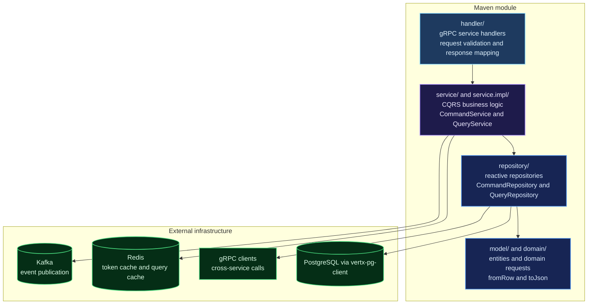

### CQRS layers

| Layer | Responsibility | Example |
|---|---|---|
| Handler | gRPC endpoint — validates input, maps to a domain request, returns a protobuf response | `OrderCommandHandler.create(FindByIdOrderRequest)` |
| CommandService | Write path — orchestrates business logic, enforces invariants, publishes events | `OrderCommandServiceImpl.createOrder(CreateOrderRequest)` |
| QueryService | Read path — cache first, then paginate and filter | `OrderQueryServiceImpl.findById(Long)` |
| CommandRepository | Database writes — `INSERT`, `UPDATE`, `DELETE` with a `RETURNING` clause | `OrderCommandRepositoryImpl.createOrder(CreateOrderRecordRequest)` |
| QueryRepository | Database reads — `SELECT` with pagination and soft-delete filtering (`deleted_at IS NULL`) | `OrderQueryRepositoryImpl.findAll(FindAllOrders)` |
| Model | Row mapping — `fromRow(Row)` and `toJson()` for serialisation | `Order.fromRow(row)` maps the `deleted_at` column |

---

## 23. Data and event flows

### Synchronous — HTTP to gRPC to database

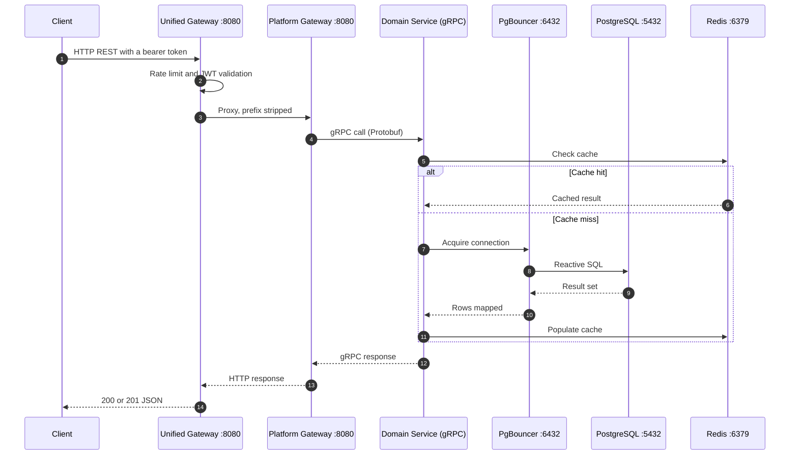

### Asynchronous — event-driven

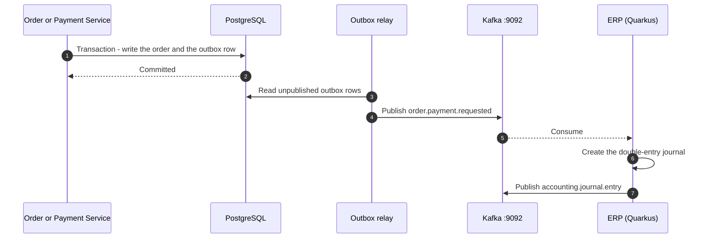

---

## 24. Troubleshooting

### Common issues

| Symptom | Cause | Fix |
|---|---|---|
| `Column deleted_at does not exist` | `fromRow()` reads `deleted_at` but the `SELECT` or `RETURNING` clause omits it | Add `deleted_at` to every `SELECT` and `RETURNING` clause that feeds `fromRow()` |
| `502 Backend unreachable` on `/api/pos/*` | The platform gateway is not deployed, or the image tag is wrong | `kubectl set image deployment/pos-gateway -n superapp mock=superapp/pos-gateway:latest` |
| POS order times out above 30 s | Several sequential gRPC calls exceed the default 30 s WebClient timeout | Set `proxyReq.timeout(120000)` in `PlatformProxy.forwardRequest()` |
| `total_price` is `"0"` in a POS order response | `calculateTotalPrice()` returns 0 because `getOrderItemsByOrder()` fails on a missing `deleted_at` column | Ensure `deleted_at` is selected in the `order_items` queries |
| The image does not update after a rebuild | The `:latest` tag is cached, and `kubectl rollout restart` does not pull | Build with a unique tag: `docker build -t superapp/pos-order:v$(date +%s)` |
| `ImagePullBackOff` | Minikube does not hold the image | `minikube image load superapp/<service>:<tag>` |
| `RedisConfig NumberFormatException` | Kubernetes injects `REDIS_PORT=tcp://...`, shadowing the real port | Use a guarded `parseInt` with try/catch in `common/RedisConfig.java` across all four platforms |
| The gateway enters `CrashLoopBackOff` | The OpenTelemetry SDK blocks the event loop during startup | Remove `OTEL_EXPORTER_OTLP_ENDPOINT` and set `JAVA_TOOL_OPTIONS=-Dvertx.maxEventLoopExecuteTime=10000` |
| The gateway stays at `0/1 Running` | The HTTP server listens on 8080 while the probes target 8081 or 8082 | Standardise every gateway on port 8080 |
| `GrpcClient` connection refused | Wrong service name or port in the gRPC address | Check the `GRPC_*_ADDR` and `GRPC_*_PORT` variables in the deployment |
| The rate limiter blocks E2E tests | `429 Too Many Requests` | Set `RATE_LIMIT_ENABLED=false` in the deployment environment |

### Diagnostic commands

```bash
# List pods in the superapp namespace
kubectl get pods -n superapp -o wide

# Recent logs, excluding OpenTelemetry export noise
kubectl logs -n superapp <pod-name> --tail=50 | grep -v 'otel\|Failed to export'

# Inspect the environment of a running pod
kubectl exec -n superapp <pod-name> -- env | sort

# Test TCP connectivity between pods
kubectl exec -n superapp <source-pod> -- sh -c 'nc -zv <target-service> <port>'

# Query PostgreSQL directly
kubectl exec -n superapp postgres -- psql -U DRAGON -d pos -c "SELECT * FROM orders LIMIT 5;"

# Restart a deployment with a fresh image
kubectl rollout restart deployment/<name> -n superapp

# Force delete a stuck pod
kubectl delete pod <name> -n superapp --force --grace-period=0

# List images loaded into Minikube
eval $(minikube docker-env) && docker images | grep superapp
```

---

**Four platforms. One gateway. One event bus.**
Built with Eclipse Vert.x, Quarkus, Apache Kafka, PostgreSQL, Redis, Kubernetes, and ArgoCD.
