# Microservice Super App — A Federated Domain Platform in Rust

A super-app backend built as a **federation of domains that never share code**: E-Commerce, Point of Sale, Payment Gateway, ERP, Identity, Logistics, Returns, and AI. Each one owns its own database, its own connection pool, and its own build. They meet at two places only — one edge gateway that verifies identity, and a Kafka backbone that carries events.

The interesting parts are the boundaries. Code is not shared between platforms, so changing a crate in POS cannot break a build in ERP. Databases are not shared either, so a join that crosses a stack boundary simply cannot be written. Identity is verified once at the edge and stamped into headers, so no downstream service can be talked into trusting a client-supplied user id.

Enforcement reaches further than the application. Two eBPF agents sit on the kernel: one drops packets at XDP and enforces a port policy, the other watches process and connection behaviour and applies detection rules. Both are written with **zero Cargo dependencies**, reaching libbpf through FFI, so the security layer has no supply chain of its own.

---

## Architecture Principles

Six rules hold the federation together. Every section below is an instance of one of them.

1. **Stack isolation is a build property.** Each platform is its own Cargo workspace with its own lockfile. There is no root manifest that could pull everything into one dependency graph.
2. **One crate per domain.** A domain is a binary with a handler, a service, and a repository. Two domains that look alike do not merge; `auth`, `user`, and `role` stay separate in every stack.
3. **gRPC inside, REST outside.** Services speak Protobuf. Clients speak REST through a per-stack gateway or the edge.
4. **Identity is decided once.** The edge verifies and overwrites identity headers. A second verification downstream could disagree with the first, so it does not exist.
5. **Claim before side effect.** Anything that leaves a transaction — deducting stock, crediting a balance — takes a database marker first, so a crash leaves the system in "not yet done", never "maybe twice".
6. **Fail closed.** Unvalidated configuration stops the process. An authentication mode that is unsafe outside development refuses to start in production.

---

## Architecture Overview

One edge, four platform stacks, three core services, two kernel agents, and a data layer no service can reach past its own context.

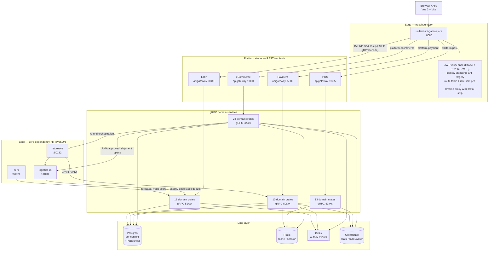

A client call crosses three boundaries: the edge verifies the token, the stack gateway turns REST into gRPC, and the domain crate turns that into a query against its own database.

### Platform Inventory

| Platform | Domains | Gateway | Port block |
| :--- | :--- | :--- | :--- |
| **Edge gateway** | 1 binary | — | `:8080` |
| **Payment Gateway** | 10 + 2 stats | `crates/apigateway` | `50xxx`, HTTP `:5000` |
| **ERP** | 18 | `crates/apigateway` | `51xxx`, HTTP `:8080` |
| **E-Commerce** | 24 + 2 stats | `crates/apigateway` | `52xxx`, HTTP `:5000` |
| **Point of Sale** | 13 + 2 stats | `crates/apigateway` | `53xxx`, HTTP `:8305` |
| **Identity** | 3 | — (Keycloak at the infra layer) | `54xxx`, HTTP `:8405` |
| **Logistics** | 1 | — | `:50131` |
| **Returns** | 1 | — | `:50132` |
| **AI** | 1 | — | `:50121` |
| **eBPF firewall** | 1 | — | exporter `:9096`, signal `:9097` |
| **eBPF observability** | 1 | — | metrics + ingest |

The port blocks let several stacks run on one machine at once: payment on `50xxx`, ERP on `51xxx`, eCommerce on `52xxx`, POS on `53xxx`, identity on `54xxx`.

---

## Workspace Layout

Six workspaces, six lockfiles. This is what makes "building one stack cannot break another" a fact rather than a convention.

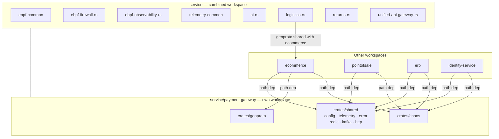

`payment-gateway/crates/shared` is the one crate every business stack depends on: configuration, telemetry, error kinds, Redis, Kafka, and HTTP. Adding a dependency there means every stack carries it, which is why it stays thin.

---

## Domain Map

Crates are grouped by responsibility rather than by table name, so the crate you want is where you expect it.

```mermaid
flowchart TB
    subgraph ECOM["eCommerce — 24 crates + 2 stats"]
        direction TB
        EC1["identity<br/>auth · user · role"]
        EC2["merchant<br/>merchant · detail · business<br/>document · policy · award · social_link"]
        EC3["catalog<br/>product · category<br/>banner · slider"]
        EC4["sales<br/>cart · order · order_item<br/>shipping_address · transaction"]
        EC5["experience<br/>review · review_detail"]
        EC6["infra<br/>email · stats-reader · stats-writer"]
    end

    subgraph PAY["Payment Gateway — 10 crates + 2 stats"]
        direction TB
        PY1["identity<br/>auth · user · role"]
        PY2["payment<br/>card · merchant · saldo<br/>topup · transaction"]
        PY3["financial<br/>transfer · withdraw"]
        PY4["infra<br/>email · stats-reader · stats-writer"]
    end

    subgraph POS["Point of Sale — 13 crates + 2 stats"]
        direction TB
        PS1["identity<br/>auth · user · role"]
        PS2["merchant<br/>merchant"]
        PS3["catalog<br/>category · product"]
        PS4["sales<br/>cashier · order · order_item · transaction"]
        PS5["infra<br/>stats_events · stats-reader · stats-writer"]
    end

    subgraph ERP["ERP — 18 crates"]
        direction TB
        ER1["finance<br/>accounting · finance<br/>costing · reporting"]
        ER2["supply<br/>inventory · purchasing<br/>manufacturing · subcontract<br/>master-data"]
        ER3["sales<br/>sales · crm · approval"]
        ER4["hr<br/>hris"]
        ER5["platform<br/>auth · user · role<br/>ai-bridge · integration"]
    end
```

---

## Data Architecture

Nothing is shared for convenience. A domain reads its own database, and anything that crosses a stack goes over gRPC or HTTP.

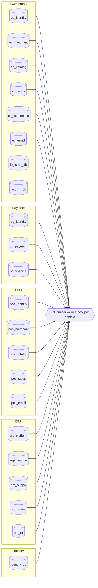

The boundary is the point: a join across stacks is not a performance trade-off to weigh, it is something the design does not allow. ClickHouse sits beside the transactional tier for analytics and is fed by consumers, so a dashboard query never loads a live database.

---

## Request Lifecycle

Inside a domain crate, a request moves through the same four stages every time.

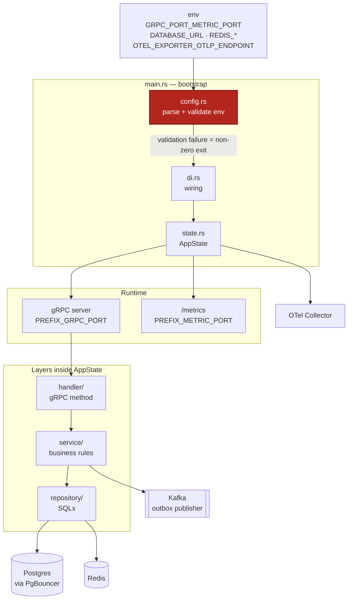

**Fail closed.** A `config.rs` that cannot validate its environment stops the process with a non-zero exit. No default is quietly treated as safe for a secret.

**Strict layering.** `repository/` only touches data, `service/` only holds business rules. A query in `service/` is a review rejection, not a style note.

---

## Authentication

Identity is verified exactly once, at the edge, and the result is written into the request rather than added to it. A client that sends `x-user-id` never reaches a domain service with that value intact.

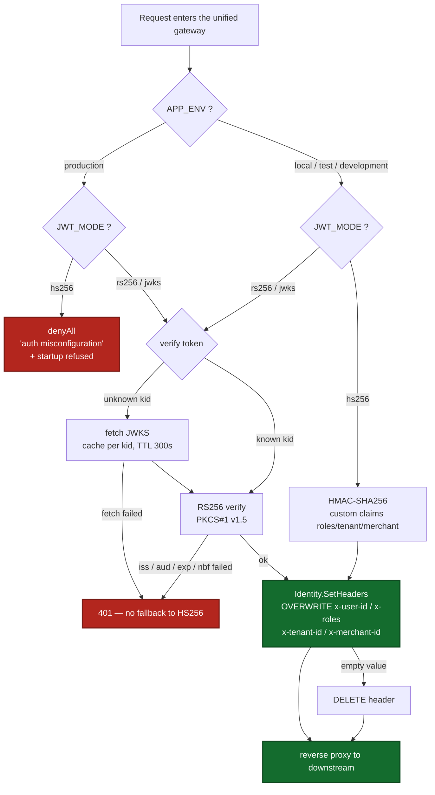

`JWT_MODE=hs256` exists for local and test environments only. In production the gateway refuses to start and denies every request. There is no fallback from JWKS to a shared secret, because a fallback that triggers on failure is one an attacker can trigger.

---

## Event Backbone — Outbox to Kafka

A state change and its event are written in the same transaction to an outbox table; a separate publisher moves them to Kafka. No service writes to its database and calls another service in the same breath.

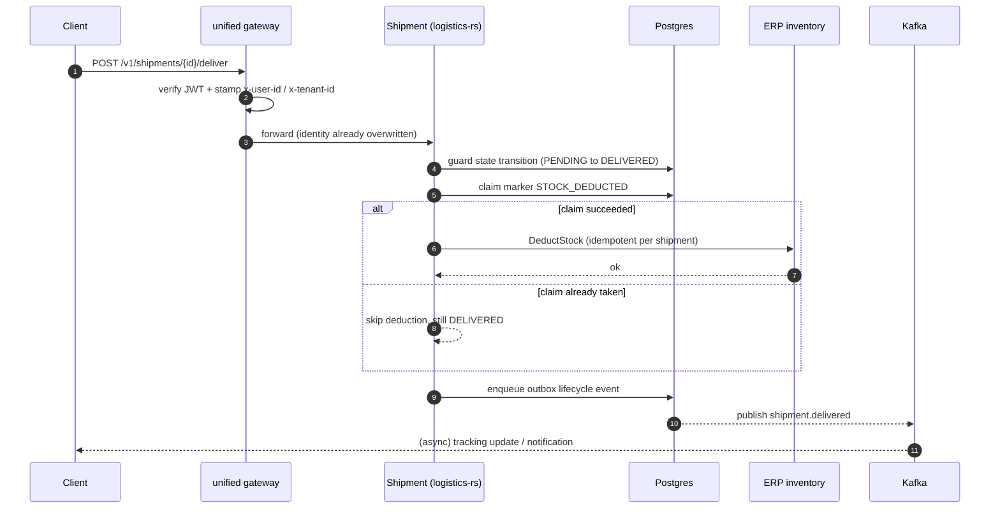

The claim comes before the side effect. If the process dies between the two, the shipment stays "not yet deducted" — never "maybe deducted twice".

---

## Cross-Domain Flows

Three flows carry the platform's promises: a shipment that deducts stock exactly once, a return that refunds exactly once, and a refund that survives a gateway outage.

### Shipment

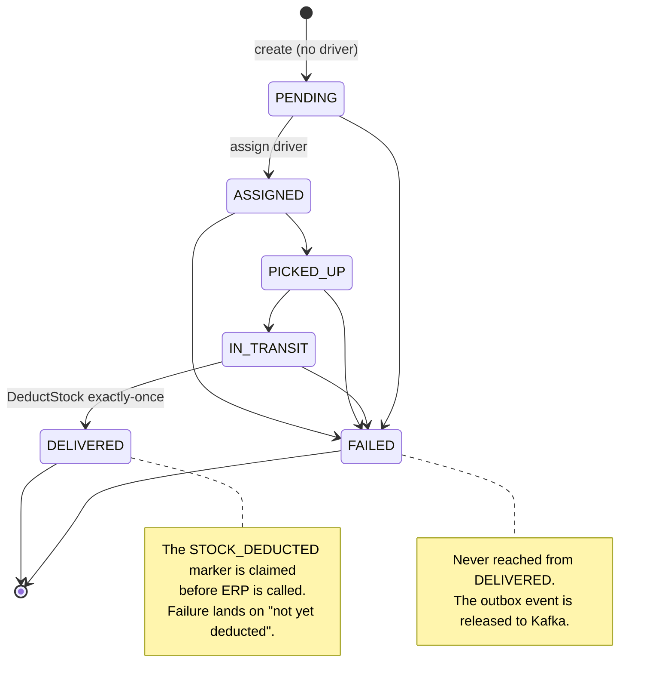

### Return / RMA

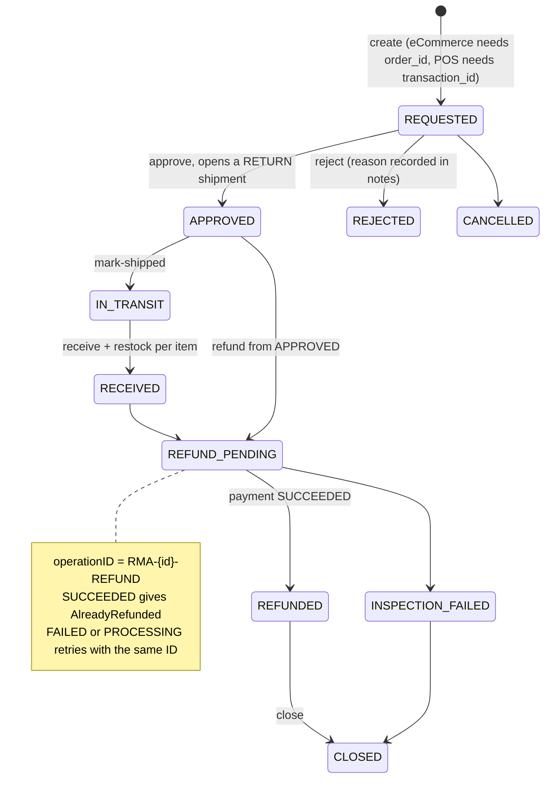

### Refund Idempotency

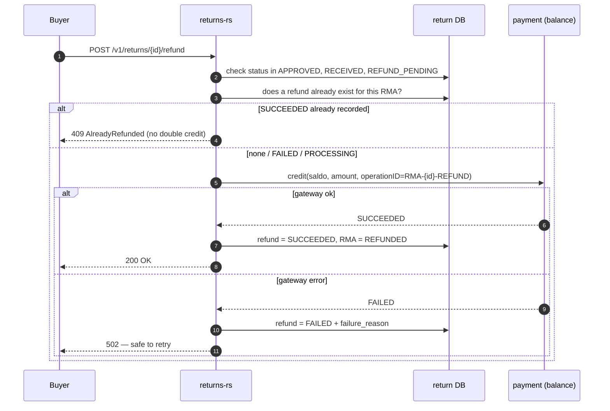

The crash-recovery case is the one that matters: the RMA still reads `APPROVED` while a `SUCCEEDED` refund is already recorded. A repeat refund is refused. A retry after the gateway recovers sends the credit **exactly once**, because the `operationID` never changes.

---

## Kernel-Level Security

Both agents are zero-dependency crates that reach libbpf through FFI, so the security layer carries no supply chain of its own.

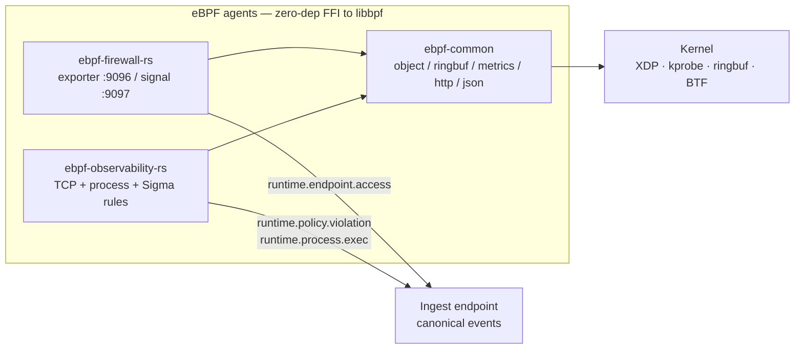

The firewall drops packets at XDP, enforces port policy and rate limits, hooks L7 signals through kprobe, and reconciles against nft or iptables so the host ruleset and the BPF state never drift apart. The observability agent reports TCP connect and state metrics, enforces an egress policy, and runs Sigma-subset rules over process events, including escape detection.

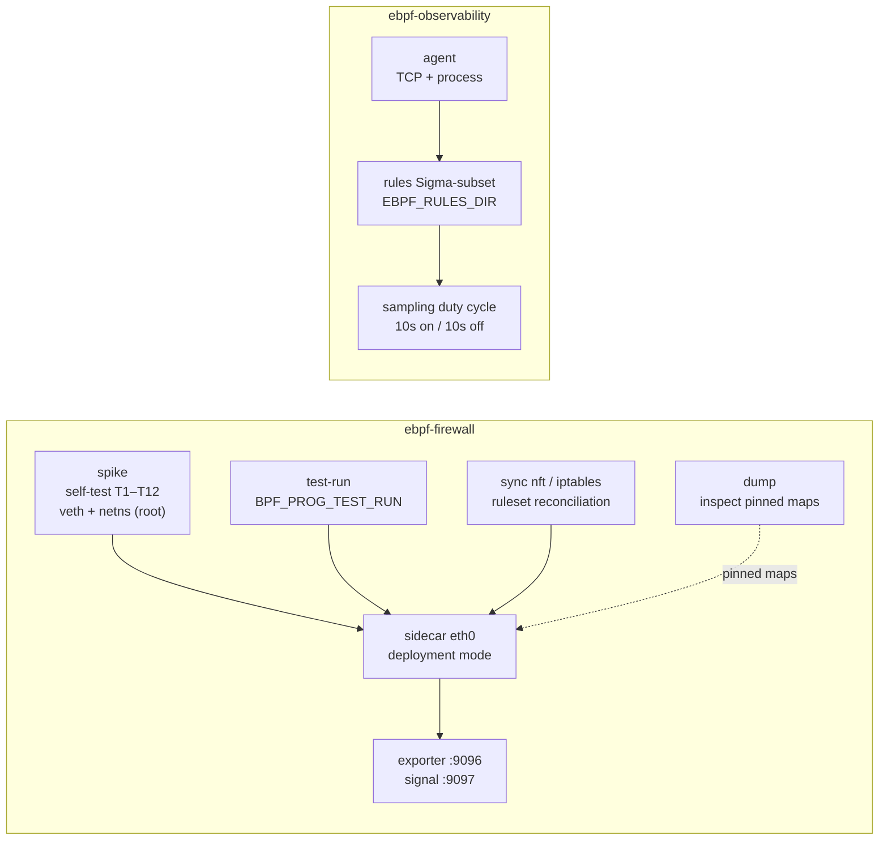

Both need Linux 5.10 or newer with BTF at `/sys/kernel/btf/vmlinux` and `libbpf.so.1` at runtime. Enforcement mode needs root or `CAP_BPF`.

---

## Observability

Every service exposes Prometheus metrics and ships traces and logs over OTLP to a collector.

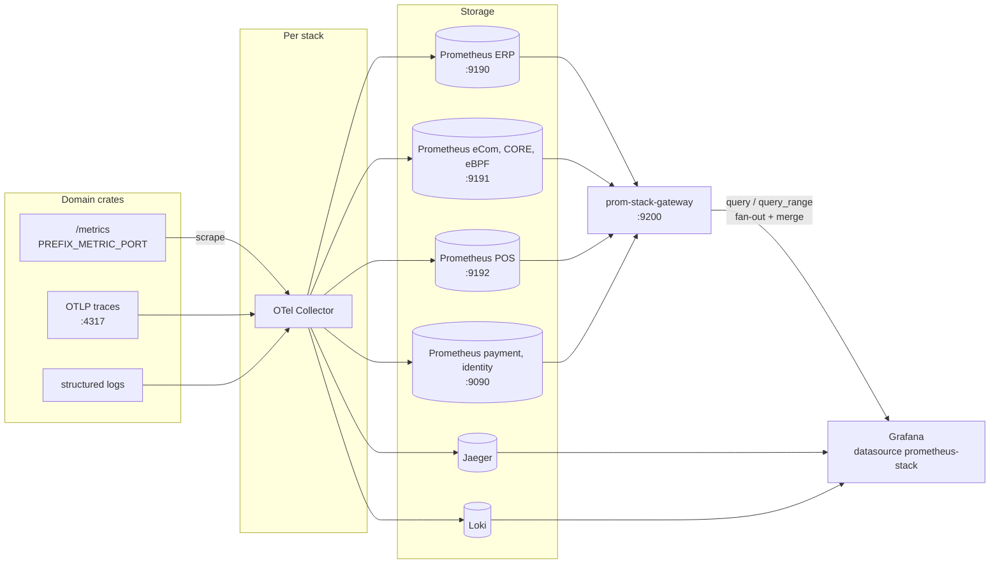

Each stack runs its own Prometheus, so no single instance holds the whole platform. Without `prom-stack-gateway`, a dashboard that spans two stacks renders **empty rather than wrong**, because no single Prometheus knows the answer.

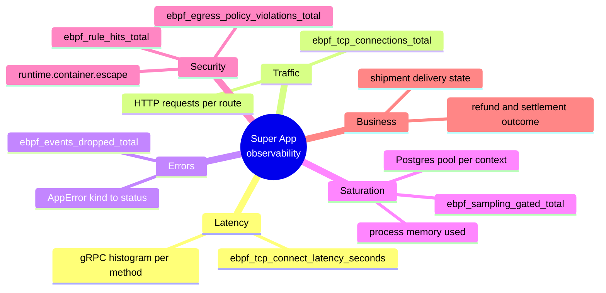

---

## Frontend

Six Vue 3.5 applications sit on top, all sharing one API client that attaches the token and refreshes it.

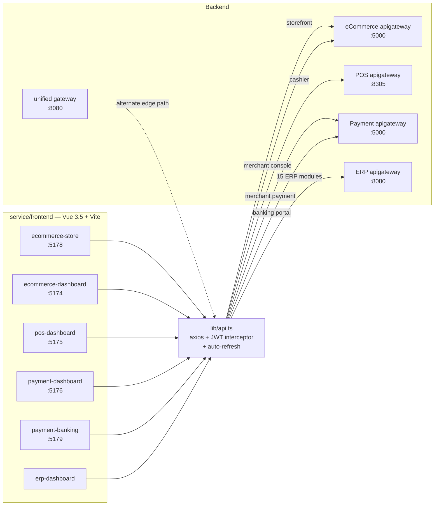

---

## Running Locally

Every stack ships the same script and supports the same two shapes.

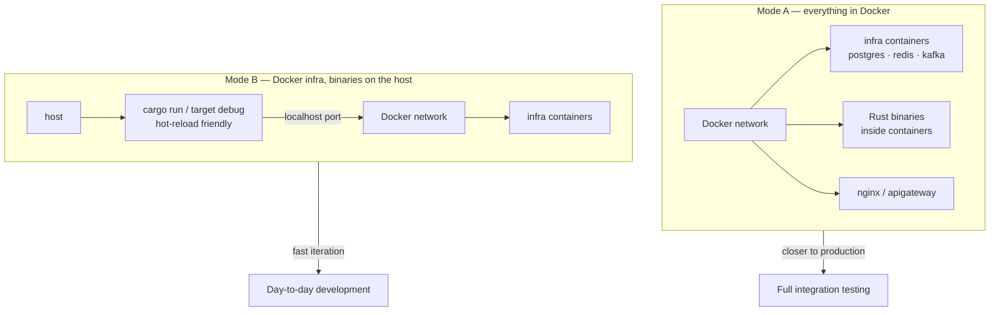

Mode A puts everything in containers. Mode B keeps only Postgres, PgBouncer, Redis, Kafka, ClickHouse, the collector, and the dashboards in Docker while the binaries run on the host, which is the mode used for daily iteration.

```bash
cd service/payment-gateway/deployments/local
cp docker.env.example docker.env   # adjust credentials
./run-local.sh up                  # infra + all binaries
./run-local.sh smoke               # register, login, /api/auth/me, /api/cards
./run-local.sh down                # add --docker to stop the infra too
```

The same script exists in `erp/`, `ecommerce/`, `pointofsale/`, and `identity-service/`, with `up`, `build`, `smoke`, `stop`, and `down` doing the same thing in each.

### Build and Test

```bash
cd service && cargo build --release && cargo test     # eBPF, AI, core, gateway

cd service/ecommerce && cargo build --release          # one stack at a time
cargo build -p order --release                         # or one crate inside it
cargo test  -p ebpf-common                             # from service/
```

On a machine short on RAM, cap parallelism and skip SQLx's compile-time query checking:

```bash
cargo build --release -j 2
SQLX_OFFLINE=true cargo build --release   # needs .sqlx/ from cargo sqlx prepare
```

Integration tests live in `tests/` and cover state machines, idempotency, and header forgery.

---

## Technical Decisions and Trade-offs

| Decision | Choice | Why |
| :--- | :--- | :--- |
| Kernel and core crates | **Zero Cargo dependencies**, HTTP/JSON plus FFI to libbpf | The security layer should not inherit a supply chain; a CVE in a transitive crate becomes a CVE in the sandbox |
| Logistics, Returns, AI persistence | In-memory repositories behind a trait | Keeps the zero-dependency path; a Postgres implementation drops in behind the same trait |
| ERP façade transport | An `ErpInvoker` trait, defaulting to 503 | The contract and validation are settled; only the transport is left to be fitted |
| Build structure | Six workspaces, six lockfiles | Isolation by tooling instead of discipline; a stack cannot compile another by accident |
| Identity | Verified once at the edge, headers overwritten | A second verification downstream can disagree with the first, and then nobody knows which answer is right |
| Cross-domain writes | Outbox, never a dual write | An event that fails to publish is recoverable; a dual write that half-succeeds is not |
| Side effects outside a transaction | Claim first, then act | A crash lands on "not yet done" instead of "maybe twice" |
| Unsafe auth configuration | Refuse to start | A service that silently weakens its own auth is worse than one that does not boot |
| Analytics | Separate ClickHouse tier fed by consumers | A dashboard query never loads a transactional database |
| Entry ports | Service port versus gRPC port kept distinct | `PORT` is read by shared config but is not the gRPC listener; conflating them produces a service that starts on a port nothing connects to |

---

## Deployment

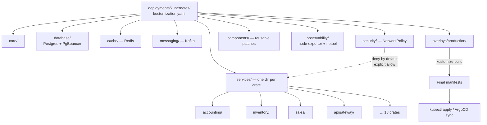

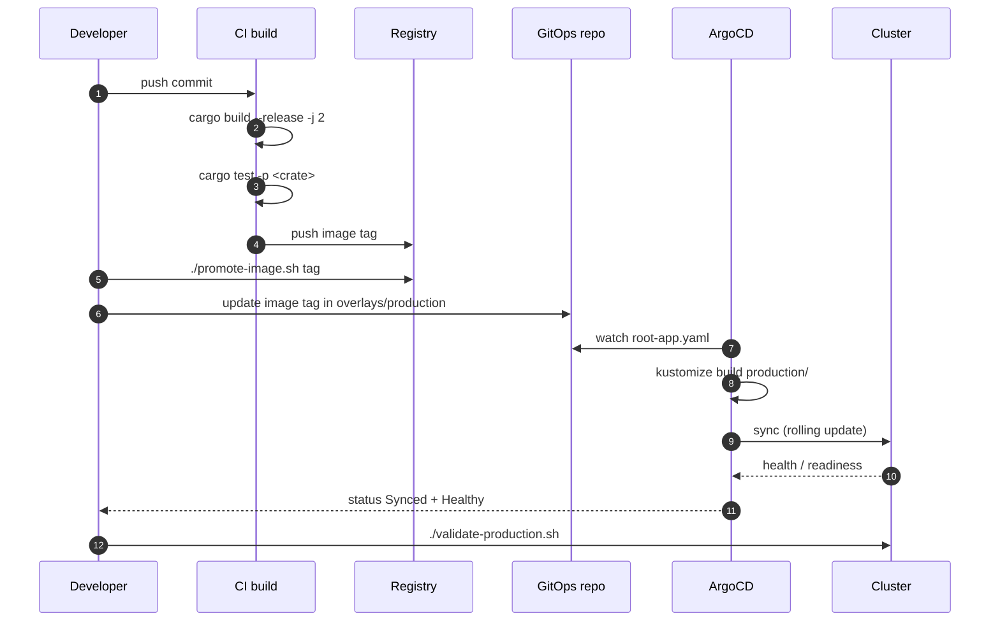

Only the `production` overlay exists today. A new environment is a new folder under `overlays/`, never an edit to `core/` or `services/`.

---

## Repository Conventions

A few rules bind changes rather than describe them.

| Rule | What breaks if it is ignored |
| :--- | :--- |
| No fallback that weakens authentication | An auth hole, by construction |
| Never change ports in code to dodge a conflict | Every other environment breaks to solve one local problem |
| Never commit `target/`, `node_modules/`, logs, or a `docker.env` with credentials | Leaked secrets and an inflated repository |
| Do not invent a crate structure | Follow `service/ecommerce/crates/order` |
| Never edit an applied migration | Two databases end up with different schemas from the same history |
| Never rename a metric or label | Dashboards go quietly empty |

Beyond the table: validation sits in the handler, invariants in the service, constraints in the database, and none of the three alone is treated as enough. Daily counters are atomic rather than `SELECT MAX() + 1`. Status timestamps are stamped on the first transition and never overwritten. Readiness dials the dependency it depends on, because reporting ready while that dependency is unreachable is a lie the cluster acts on.

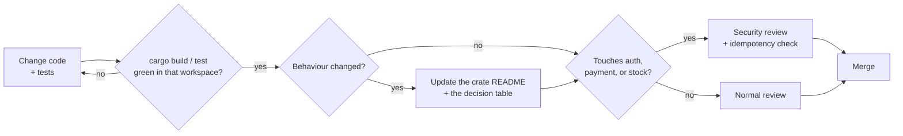

---

## Verification and Status

- **Build isolation** — six workspaces, six lockfiles; a build in one stack does not compile another.
- **Integration tests** — state machine, idempotency, and header forgery suites live in `tests/` per crate.
- **Local smoke** — `run-local.sh smoke` walks register, login, `/api/auth/me`, and `/api/cards` through the apigateway.
- **Kernel track** — the eBPF agents build as zero-dependency crates and need a BTF-enabled kernel with `libbpf.so.1`; enforcement claims require a host that has both.

What is not claimed: this is a learning project, not a production system. The in-memory repositories behind Logistics, Returns, and AI are a deliberate simplification, and no load or chaos numbers are quoted here that were not actually run.

---

## Technology Stack

| Aspect | Choice |
| :--- | :--- |
| Toolchain | Rust stable; build image `rust:1.96.0-bookworm`, runtime `debian:bookworm-slim` |
| Async runtime | Tokio |
| Web and RPC | Axum and Tonic in business stacks; a zero-dependency HTTP server in eBPF, AI, and gateway crates |
| Persistence | SQLx with Postgres behind PgBouncer |
| Cache | Redis via `deadpool-redis` |
| Messaging | Kafka with the outbox pattern for cross-domain events |
| Analytics | ClickHouse through `stats-reader` and `stats-writer` |
| Auth | JWT via `jsonwebtoken`, plus Keycloak for identity-service |
| Telemetry | OpenTelemetry into a collector, then Prometheus, Jaeger, and Loki |
| Allocator | mimalloc with the `secure` feature |

---

## Closing Notes

The federation is the interesting part. Each platform can be replaced without touching the others, and the only things that hold them together are a contract and an event format.

Two choices made that easier. Build isolation became a property of the tooling rather than a rule in a document, and the crates closest to the kernel gave up their dependency graphs entirely so the security layer has nothing to inherit from the ecosystem. Neither was free: the zero-dependency crates hand-roll HTTP, JSON, and the libbpf binding, and the trade-off is written down in each crate's README rather than hidden.
