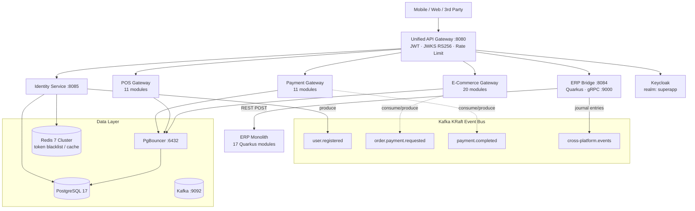

# Microservice Superapp — Unified Vert.x Ecosystem

Four business platforms — **E-Commerce (20 modules)**, **Point of Sale (11 modules)**, **Payment Gateway (11 modules)**, and a Quarkus-based **ERP (17 modules)** — connected through one Unified API Gateway, one Kafka KRaft event bus, and one gRPC bridge into the ERP. **63+ Maven modules**, **2,251+ green unit tests** across all four platforms, deployed on Kubernetes with ArgoCD.

The design goal: keep every platform independently modular (domain-driven Maven modules with their own gRPC boundaries), while exposing a single hardened edge and a single asynchronous integration fabric.

---

## Key Features

| Feature | Description |
|---------|-------------|
| **Unified API Gateway** | Single entry point (`:8080`) routing `/api/ecommerce/*`, `/api/pos/*`, `/api/payment/*`, `/api/erp/*` with JWT validation, RBAC claims check, and 500 req/min/IP rate limiting |
| **Event-Driven Core** | Apache Kafka (KRaft mode, no ZooKeeper): `user.registered`, `order.payment.requested`, `payment.completed`, `inventory.stock.synced`, `order.status.updated`, `accounting.journal.entry` |
| **Dual Auth Paths** | Registration & email verification via Identity Service (`:8085`, bcrypt + verification codes); login & token issuance via Keycloak OIDC (realm `superapp`, RS256); gateway validates JWT against cached JWKS |
| **ERP Bridge** | Quarkus bridge (`:8084`) translating REST/gateway traffic into gRPC (`:9000`) plus Kafka consumers that turn domain events into ERP journal entries |
| **Money Movement** | Idempotent card/saldo/topup/transfer/withdraw flows with outbox-pattern events (`payment_event_outbox`) |
| **eBPF Security Sidecars** | `ebpf-observability` DaemonSet (kprobe CO-RE telemetry, 9 Sigma rules) and `ebpf-firewall` sidecar (XDP L3/L4 drop engine + iptables/nftables sync) |
| **Full Observability** | OpenTelemetry → Prometheus, Grafana, Loki, Jaeger across every service |

---

## Architecture Overview

### Request Lifecycle (happy path)

1. Client sends `POST /api/ecommerce/orders` with Bearer token.
2. Gateway checks rate limit, verifies RS256 signature/exp/issuer/audience via Keycloak JWKS (cached, retry with exponential backoff), checks RBAC claims.
3. Request proxies to the E-Commerce gateway, which calls the OrderService over gRPC.
4. Service writes to PostgreSQL through PgBouncer, publishes `order.created` to Kafka.
5. ERP Bridge consumes the event and creates a journal entry (Debit: Cash / Credit: Revenue).
6. Response returns `201 Created {orderId}` end-to-end.

---

## Data Architecture

- **PostgreSQL 17** with per-domain databases, always accessed through **PgBouncer** pooling.
- **Three isolated Flyway zones** so module migrations never collide: shared history on `PAYMENT_GATEWAY` (ecommerce + POS + payment), isolated identity history table, and a separate Quarkus-managed ERP database.
- **Redis 7 cluster** for token blacklists, sessions, and read-through caching.
- Outbox pattern for payment events guarantees at-least-once delivery of financial events without dual writes.

Core money-movement entities (`users`, `cards`, `saldos`, `transactions` with `idempotency_key`, `saldo_operations` ledger, card credit/auth/billing/rewards tables) are modeled as an explicit ERD in the project README.

---

## Verification Snapshot

Claims are kept falsifiable:

| Check | Result |
|-------|--------|
| Unit tests (4 platforms) | **2,251+ green** |
| E2E hurl suite | **28/28 passing** |
| Java E2E suite | **24/24 passing** |
| ERP GET sweep | **66/66 OK** |
| ERP write sweep | **159 OK / 0 failures** |
| Payment wiring | Runtime-verified **August 4, 2026** |
| Cluster | Minikube, **17+ pods running**, namespace `superapp` |

Deployment is GitOps-style: Kustomize manifests under `production/kubernetes/`, synced by **ArgoCD (App-of-Apps)**, with `default-deny-all` NetworkPolicies plus per-service egress allow-lists.

Honest status tracking (🟢 real/deployed, 🟡 code-exists-not-wired) is maintained per service and per Kafka topic in the main README — not everything is end-to-end wired yet, and the docs say so explicitly.
