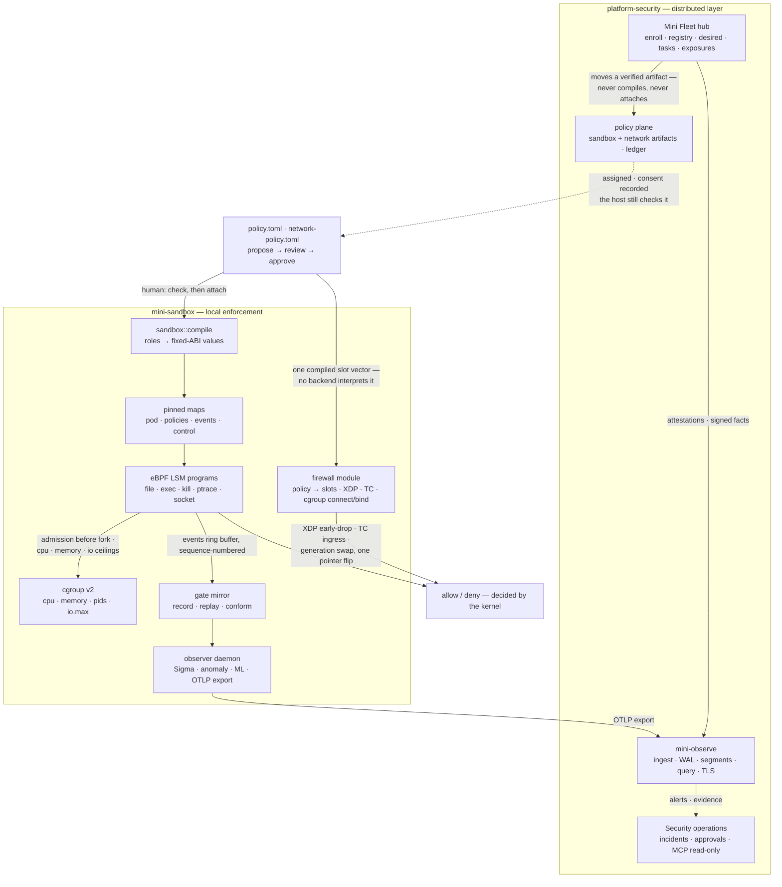
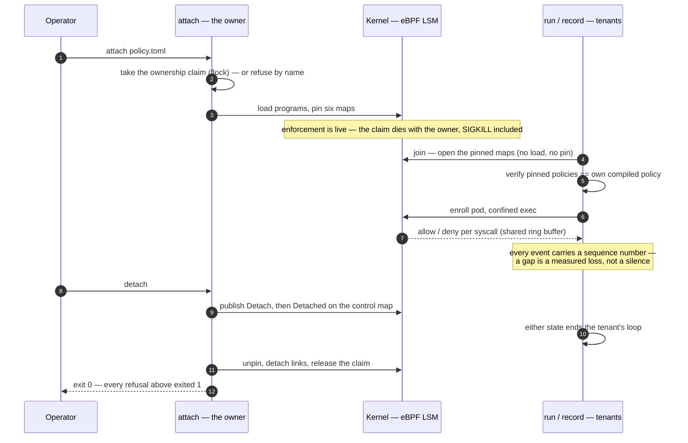
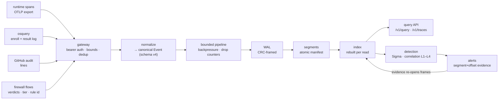
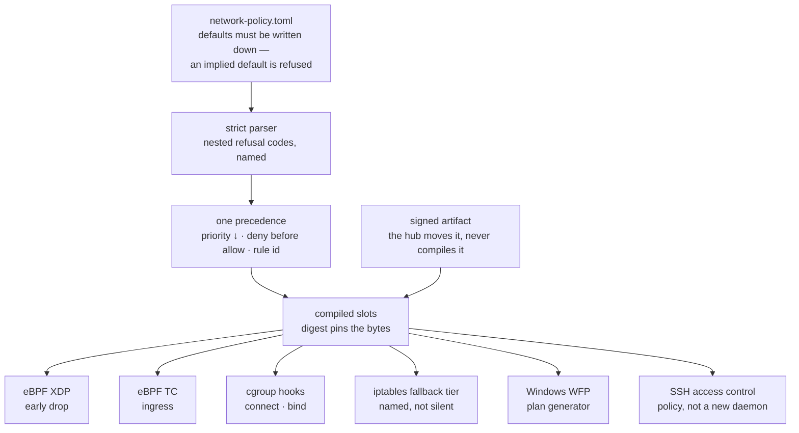
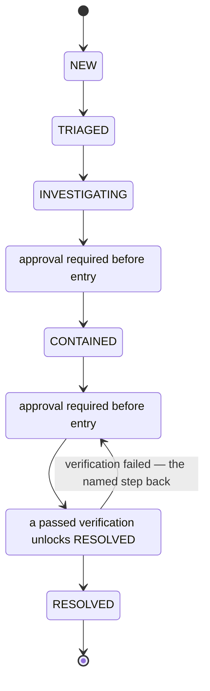
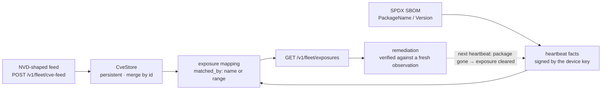
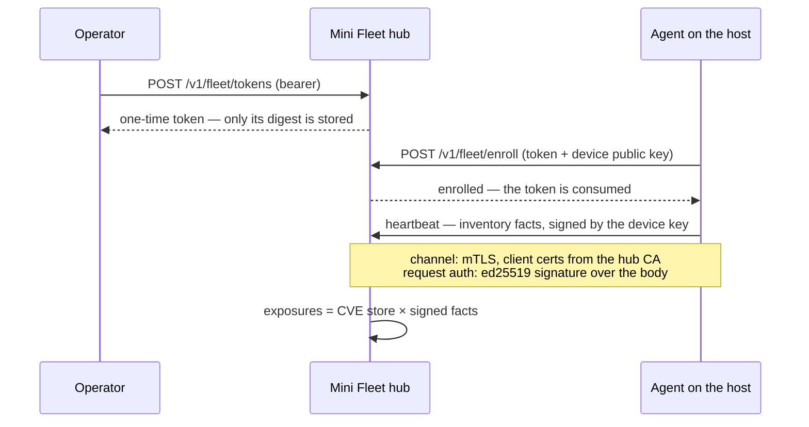

# mini-sandbox-rust

A Rust reimplementation of the Zig `mini-sandbox`: a small, policy-driven sandbox where the enforcement lives in the kernel, not in the application. Userspace parses a TOML policy and compiles roles into fixed-ABI values; Linux eBPF LSM programs and a Windows backend then enforce those exact values.

Around that runtime grew a platform: **Mini Fleet** (endpoint control plane), **Mini Observe** (telemetry engine), **Security Operations** (incidents, vulnerability intel, read-only AI), and a **Mini Firewall** module that extends the runtime with a host network contract. Six further domain crates — Cloud, Network, Supply Chain, Identity, Runtime, ML — sit around it, each one deliberately unable to touch enforcement.

The claim that matters is the one this project refuses to make: **host-track green is not live.** A capability is green when its logic, its refusals, and its CLI are proven against fixtures on a host — never when a lab, a kernel, or a device held it. Every capability on this page is held by a test that names it, and a skip is never counted as a pass.

---

## The shape of the system

Two crates carry every capability that can decide an outcome. Everything else observes, scores, or reports — and is structurally prevented from doing more.

| Component | Crate | Responsibility | Must never become |
| :--- | :--- | :--- | :--- |
| **mini-sandbox** | `crates/mini-sandbox-rust` | Local enforcement runtime: policy formats, eBPF LSM + cgroup enforcement, traces, observer, governance CLI | A central fleet controller or AI decision engine |
| **platform-security** | `crates/platform-security` | Distributed layer: Mini Fleet hub, Mini Observe engine, Security Operations, network-policy distribution | A replacement for native MDM capability; an enforcement authority |
| **mini-firewall** (module) | `crates/mini-sandbox-rust/src/firewall` | Host network policy: one TOML contract compiled once, consumed by eBPF (XDP + TC + cgroup), the iptables fallback tier, and Windows WFP | A second policy engine, an nftables parity chase, or a daemon of its own |

Ownership is one-way and pinned by a test: `platform-security` may depend on `mini-sandbox`, never the reverse.



A running pod never asks the observer or the policy file how to decide a syscall — the kernel reads the pinned values. If the observer daemon dies, its rules disappear, or a model artifact is rejected, active enforcement is unchanged.

---

## The fence: nine crates, one rule

The crates that can say *no* to a syscall are the two above. Every other crate can only say *this is what I observed*.

Each domain crate depends on **nothing** in the workspace, and that emptiness is the guarantee. Its own `fence_crate_boundary.rs` reads its `Cargo.toml` and fails by name the moment a workspace dependency appears — so a refusal, a finding, or a score here has no compiled path to the kernel or the pins. That path does not exist by construction, not by discipline.

| Domain crate | Responsibility | Position |
| :--- | :--- | :--- |
| **mini-cloud** | Read-only libvirt inventory, `AssetIdentity` = hypervisor UUID, 12 posture checks (`CLOUD-001..012`), snapshot + per-field drift | Host-green C1–C3; live claim waits on the C0 VMs |
| **mini-network** | RouterOS API protocol layer: sentence encode, reply parse, read-only command allowlist, bounded retry, credential redaction, non-IP device identity | Phase 1 **live** against chr-7.16.1; Phase 2 host-green |
| **mini-supply-chain** | Artifact trust: signed manifests, provenance verified at insert, default-deny artifact policy, time-bounded audited exceptions | Host-green S1–S6; CI signing waits on S7 |
| **mini-identity** | Subjects, authority-signed credentials, short-lived tokens, closed RBAC matrix (Analyst / Operator / Approver / Administrator), revocation on every verify | Host-green I1–I6; OIDC deferred (I7) |
| **mini-runtime** | Container/Kubernetes posture: Docker CLI inventory, 9 checks (`RUNTIME-001..009`), a pure admission function with named denials | Host-green R1–R4; Kubernetes half fixture-only until R0 |
| **mini-ml** | Feature schema v1, deterministic extraction over event windows, reproducible datasets, leakage-free splits, statistical baseline | Phase 7 host-green; **no model training**, no enforcement path |

---

## Gate order — why the crates are green but unproven

The domain crates were built *around* the gates, on the host track, because their fixtures do not need a lab. They are code-green and unproven where it counts. A milestone opens when its gate closes — never because a crate exists.


---

## Session tenancy — attach owns, run and record join

Before tenancy, every CLI invocation loaded its own maps and cleared the pins, so the verdicts a confined run produced never reached the map a separate `record` read.

Now `attach` is the one owner. It takes an ownership claim — a `flock` acquired before anything loads, released by the kernel when the process dies, SIGKILL included, so a recycled pid never inherits one. `run` and `record` become *tenants* of a live session: they open the pinned maps, never pin, never clear, never unpin. A tenant refuses by name unless the pinned policy equals its own compiled policy, compared through the role hash the trace header carries.



This closes `record → replay` over real kernel decisions: a joined `record` streams the same ring buffer the confined pods feed, and `replay` re-derives every recorded verdict through the mirror.

The VM track paid for itself twice already. A refused `attach` — and later a refused `run` — printed the refusal and **exited 0**, so a supervisor could not tell refusal from success; both now exit 1. And an event carried only a counter, so a dead host and a saturated ring buffer both looked like "nothing happened" — the ABI now carries a monotonic `seq` and `attach` reports the gap it found.

---

## Telemetry pipeline

Every event is written to the WAL *before* its acknowledgment — a kill -9 lifecycle test holds that a crash between the two loses nothing acknowledged.



Detection responsibilities are deliberately split so nothing detects twice: the runtime's local observer does host-level detection and immediate telemetry; Mini Observe does centralized detection and cross-host correlation; Security Operations owns the incident lifecycle.

The fifth source is the firewall's own by-product — allowed and denied connections, refused connects and binds, each carrying the rule id and the tier the verdict came from. It is telemetry *about* enforcement, never an input to it: the kernel counters keep counting if the exporter dies, and the exporter reports the delta between two snapshots rather than narrating an absolute.

---

## Mini Firewall — one contract, one order, many tiers

No backend interprets the policy. The order is total and decided once — `priority` descending, then deny before allow, then rule id — so a rule that can never matter is refused at compile time instead of shipped as dead configuration.



A generation swap is a pointer flip over `MapIo`, which is why replacing a live policy needs no window where nothing is enforced. The contract and every backend are host-green — 76 unit tests plus a 40-row golden corpus of 30 refusals and 10 compiles — and **no kernel-side or WFP claim is made** until the VM and Windows tracks hold them.

---

## Incident lifecycle and the vulnerability plane

The lifecycle is linear and refuses shortcuts by name. Containment and remediation need a recorded approval *before* the move; resolution needs a passed verification on record; the postmortem after RESOLVED is what makes an incident finished rather than merely closed.





Version ranges are decisive with a conservative direction: numeric dotted comparison (`8.5` equals `8.5.0`), and a comparison that cannot be decided — a distro suffix like `8.5.0-4ubuntu2` — *stays exposed*. A false positive costs a look; a false negative hides a vulnerable host.

---

## Fleet enrollment



Revoked identities are refused by name; a policy assigned to another tenant never reaches this agent; tasks are named kinds with idempotency keys, expiry, and — for isolation — a recorded approval whose execution *stages the policy path*, leaving a person to apply it with `check` → `attach`.

---

## What holds, and what does not

Claims are tiered — **verified / compile-verified / pending** — and a skip narrows a result without becoming a pass.

| Area | Position |
| :--- | :--- |
| Host workspace | fmt / clippy `-D warnings` / full suite green in CI |
| Gate mirror parity | Conformance corpus, 255 rows, 0 divergences against the Zig reference |
| Kernel: admission + fail-safe | Guest runs: `admission-flood.sh` 11 passed, `failsafe-kernel.sh` 11 passed |
| Kernel: session tenancy | Ownership claim unit-held and record→replay gate kernel-held (6/6 on a 6.14 `bpf` LSM guest); session-chaos 10/15 awaiting a rerun on the fixed binary |
| Windows backend | Native harness executed: 81 PASS / 0 FAIL / 2 named SKIP |
| Policy schema & rollback | `v2` compiles to the same identity as `v1` — a rollback reproduces its trace header byte for byte |
| Shared contracts | Eight contracts pinned to golden wire formats; renames fail CI by name |
| Firewall — contract | Host-green: 76 unit tests, 40-row corpus over 14 named refusal codes |
| Firewall — kernel attach | Guest phases went green on 2026-11-10 and hang intermittently — still pending a stable run |

**Limits that matter more than the green rows:**

- **Host-track green is not live.** `mini-cloud`, `mini-runtime`, and the library half of `mini-network` are proven against fixtures; no lab VM, no live container, and no lab router has been inventoried in the general case. The one live claim on this page is Phase 1 against chr-7.16.1.
- Linux kernel enforcement requires `CONFIG_BPF_LSM`, an active `bpf` LSM, bpffs, and a delegated cgroup v2 subtree. Host tests exercise the mirror and observer without a BPF kernel; kernel verdict claims require the VM or a suitable host.
- `mini-ml` does not train a model. It builds features, datasets, splits, and a statistical baseline — training arrives with Phase 8, only after the telemetry contracts are stable.
- `MINI_SANDBOX_MAX_PODS` is scoped to one jailer's pod map, not the whole machine — a recorded design limit, not a bug waiting for a fix.

---

## Design boundaries

What this project deliberately does **not** do:

- Not a FleetDM, osquery, Jamf, Kandji, or commercial EDR replacement.
- No general-purpose SQL or columnar database before query requirements prove one.
- No autonomous destructive response by an AI agent; no remote arbitrary shell as the default management mechanism.
- No central control-plane dependency for local kernel enforcement — a dead hub changes nothing on a host.
- No parity claims (full MDM/EDR/SIEM) based solely on a custom agent, an OTLP receiver, or Sigma support.
- No domain crate that can reach enforcement — the path from any of them to the pins does not exist by construction.
- No model training before the telemetry contracts are stable.
- No "runtime protection" claim from container scanning — findings are configuration risks, not evidence of escape resistance.

---

## Running it

```bash
cargo build --locked --package mini-sandbox --bin mini-sandbox
cargo test --locked --all-targets
cargo fmt --all -- --check
cargo clippy --lib --bins -- -D warnings
```

The normal local gate then adds the conformance run and the regression corpus; `--all-targets` runs the domain crates' suites and their fences, so a new workspace dependency in any of them fails there by name. The kernel gates are separate and each one skips by name on a host without a BPF LSM.

---

<p align="center">
  Built in Rust with eBPF LSM, cgroup v2, and an insistence that a skip is never a pass.
</p>
