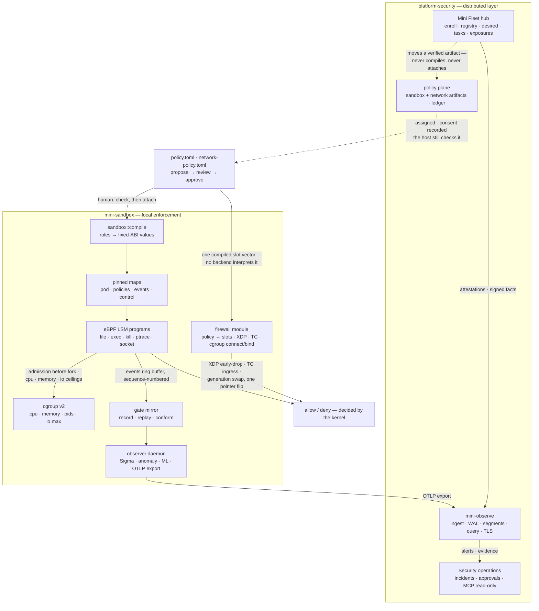
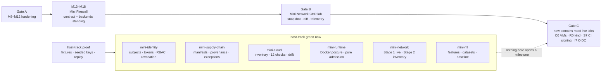
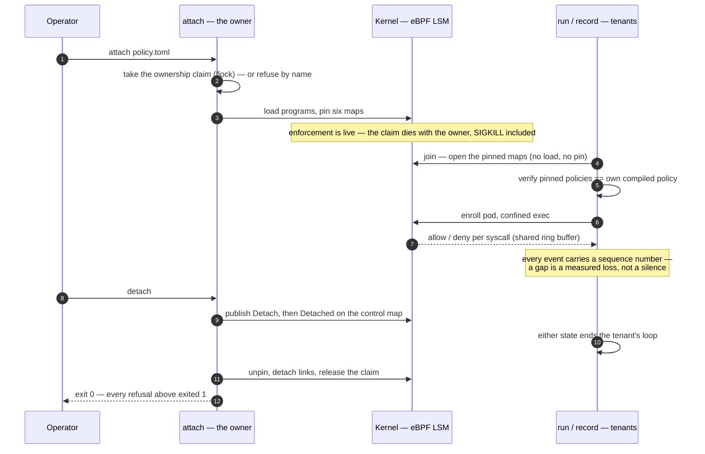
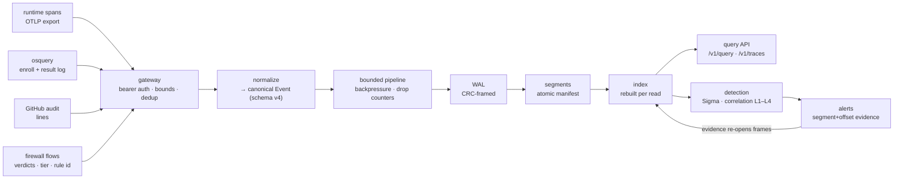
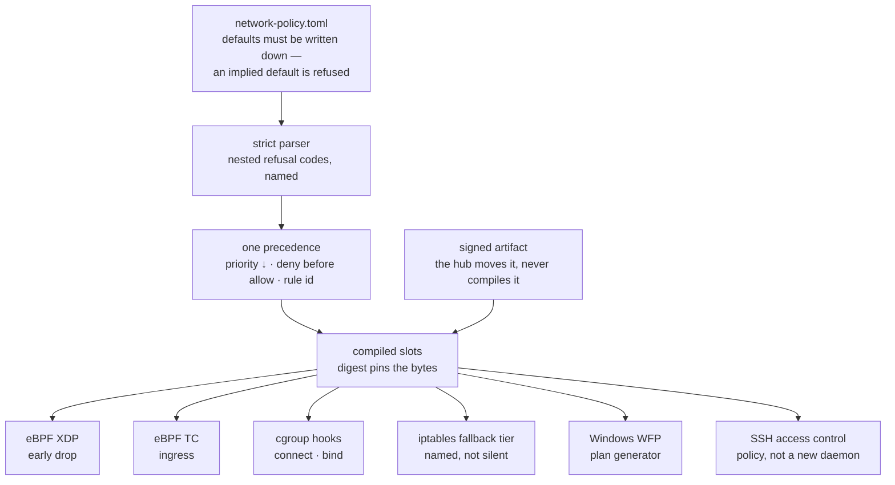
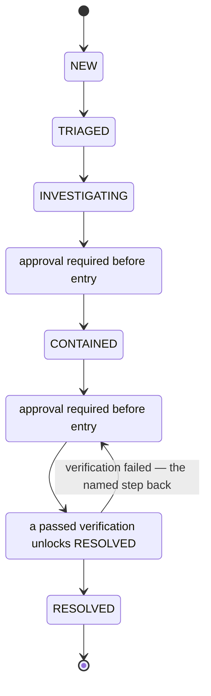
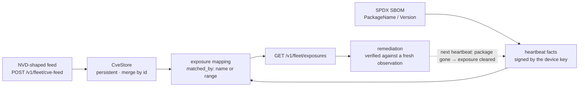
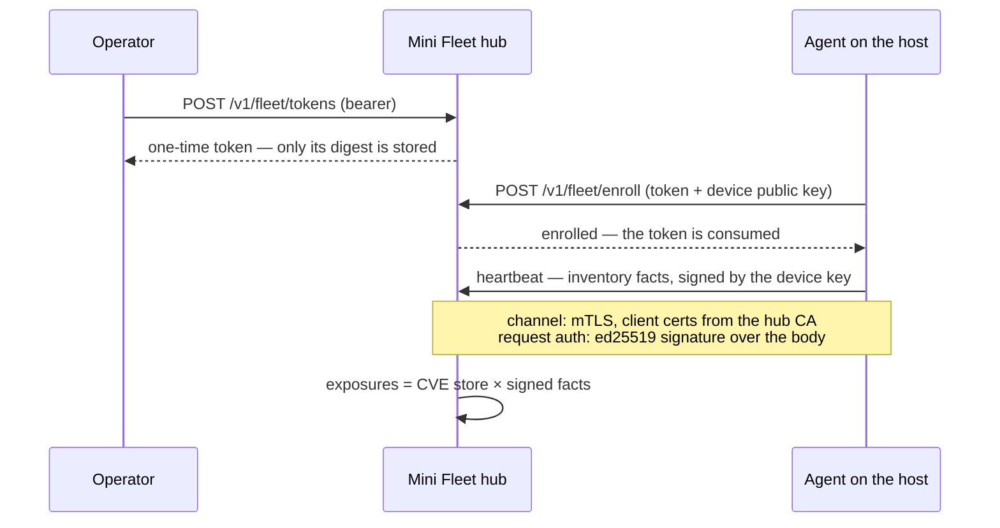

# mini-sandbox-rust

Most sandboxes enforce their policy inside the application. This one hands the decision to the kernel.

A TOML policy is parsed in userspace and compiled into fixed-layout values. Linux eBPF LSM programs then enforce exactly those values on every syscall, and a Windows backend enforces the same compiled policy through WFP. If the userspace daemon stops, runs out of memory, or is killed, enforcement does not change — it was never living there.

Around that runtime sits a full platform: **Mini Fleet** for endpoint control, **Mini Observe** for telemetry, **Security Operations** for incidents and vulnerability intel, and a **Mini Firewall** module that gives the runtime a real network contract. Six more domain crates — Cloud, Network, Supply Chain, Identity, Runtime, ML — sit around the edge, and every one of them is structurally unable to touch enforcement.

The honest part matters as much as the engine. **Host-track green is not live.** A capability is green when its logic, its refusals, and its CLI are proven against fixtures on a normal machine — not when a lab, a kernel, or a device held it. Every claim on this page is held by a test that names it, and a skipped test is never counted as a pass.

---

## What the platform is made of

Two crates carry everything that can decide an outcome. Everything else observes, scores, or reports, and is prevented by design from doing more.

**`mini-sandbox`** is the local enforcement runtime. It owns the policy formats, the eBPF LSM and cgroup enforcement, the traces, the observer, and the governance CLI. It is the only thing on a host that can say *no*.

**`platform-security`** is the distributed layer: the Mini Fleet hub, the Mini Observe engine, Security Operations, and network-policy distribution. It moves signed artefacts and it records facts — it never compiles a policy and never attaches one.

**`mini-firewall`** is a module inside the runtime, not a service. One TOML contract, compiled once, consumed by eBPF at XDP and TC, by the cgroup connect and bind hooks, by an iptables fallback tier, and by the Windows WFP backend.

Ownership is one-way and held by a test: `platform-security` may depend on `mini-sandbox`, never the reverse.



A confined pod never asks the observer, the API, or the policy file how to decide a syscall. The kernel reads the pinned values and answers. Kill the observer, delete its rules, reject the model artefact — the verdicts stay the same.

---

## The fence: nine crates, one rule

Only the two crates above can refuse a syscall. Every other crate can only report what it observed.

Each domain crate depends on **nothing** in the workspace, and that emptiness is the guarantee. Its own `fence_crate_boundary.rs` parses its `Cargo.toml` and fails by name the moment a workspace dependency appears. A finding, a refusal, or a score produced by a domain crate has no compiled path to the kernel or the pins — the path does not exist by construction, not by discipline.

| Crate | What it does | Where it stands |
| :--- | :--- | :--- |
| **mini-cloud** | Read-only libvirt inventory, asset identity from the hypervisor UUID, 12 posture checks, snapshot and per-field drift | Host-green; live claim waits on the C0 VMs |
| **mini-network** | RouterOS API layer: sentence encode, reply parse, read-only command allowlist, bounded retry, credential redaction | Stage 1 **live** against a CHR router; Stage 2 host-green |
| **mini-supply-chain** | Signed manifests, provenance verified at insert, default-deny artefact policy, time-bounded audited exceptions | Host-green; CI signing still pending |
| **mini-identity** | Subjects, authority-signed credentials, short-lived tokens, a closed four-role matrix, revocation on every verify | Host-green; OIDC deferred |
| **mini-runtime** | Docker inventory, 9 posture checks, a pure admission function with named denials | Host-green; the Kubernetes half is fixture-only |
| **mini-ml** | Feature schema, deterministic extraction over event windows, reproducible datasets, leakage-free splits, statistical baseline | Host-green; **no model training**, no path to enforcement |

---

## Why the crates are green but unproven

The domain crates were built *around* the gates, on the host track, because their fixtures do not need a lab. They are code-green and unproven exactly where it counts: a milestone opens when its gate closes, never because a crate exists.



---

## One owner per session

Before tenancy existed, every CLI invocation loaded its own maps and cleared the pins. The verdicts a confined run produced never reached the map a separate `record` read — the session had already been overwritten.

Now `attach` is the single owner. It takes an ownership claim before anything loads: a `flock` that the kernel releases when the process dies, SIGKILL included, so a recycled pid never inherits a live claim. `run` and `record` become *tenants* of that session. They open the pinned maps, and they never pin, clear, or unpin. A tenant that finds a pinned policy different from its own compiled policy refuses by name, comparing through the role hash carried in the trace header.



This closes the loop from `record` to `replay` over real kernel decisions: a joined `record` streams the same ring buffer the confined pods feed, and `replay` re-derives every recorded verdict through the mirror.

The VM track already paid for itself twice. A refused `attach` — and later a refused `run` — printed its refusal and **exited 0**, so a supervisor could not tell refusal from success; both exit 1 now. And an event carried nothing but a counter, so a dead host and a saturated ring buffer both looked like "nothing happened" — the ABI now carries a monotonic sequence number and `attach` reports the gap it found.

---

## Telemetry that survives a crash

Every event reaches the write-ahead log *before* it is acknowledged. A kill -9 lifecycle test holds that line: a crash between the write and the acknowledgment loses nothing already promised.



Detection is split so nothing detects twice. The runtime observer handles host-level detection and immediate telemetry. Mini Observe handles centralized detection and cross-host correlation. Security Operations owns the incident lifecycle.

The fourth source is the firewall's own by-product: allowed and denied connections, refused connects and binds, each tagged with the rule id and the tier that produced the verdict. It is telemetry *about* enforcement, never an input to it. The kernel counters keep counting if the exporter dies, and the exporter reports the delta between two snapshots instead of narrating an absolute.

---

## One contract, one order, many backends

No backend interprets the policy. The precedence order is total and decided once — `priority` descending, deny before allow, then rule id — so a rule that could never matter is refused at compile time instead of shipped as dead configuration.



Replacing a live policy is a pointer flip over the shared map, which is why no window exists where nothing is enforced. Contract and backends are host-green — 76 unit tests and a 40-row golden corpus of 30 refusals and 10 compiles — and **no kernel-side or WFP claim is made** until the VM and Windows tracks hold them.

---

## Incidents and vulnerabilities

The incident lifecycle is linear and refuses shortcuts by name. Containment and remediation need a recorded approval *before* the move. Resolution needs a passed verification on record. The postmortem after RESOLVED is what makes an incident finished rather than merely closed.



The vulnerability plane joins a CVE feed with the signed inventory each host reports on heartbeat, and answers one question: which machines are exposed to what.



Version ranges resolve conservatively. Numeric dotted comparison treats `8.5` as equal to `8.5.0`, but a comparison that cannot be settled — a distro suffix like `8.5.0-4ubuntu2` — stays exposed. A false positive costs a look; a false negative hides a vulnerable host.

---

## Enrolling a host



Revoked identities are refused by name. A policy assigned to another tenant never reaches this agent. Tasks are named kinds with idempotency keys and expiry, and anything classified as isolation only *stages* the policy path — a person still has to apply it with `check`, then `attach`.

---

## What holds, and what does not

Every claim is tiered as verified, compile-verified, or pending. A skip narrows a result; it never becomes a pass.

| Area | Position |
| :--- | :--- |
| Host workspace | fmt, clippy with `-D warnings`, and the full suite green in CI |
| Gate mirror parity | 255-row conformance corpus, zero divergences from the Zig reference |
| Kernel admission and fail-safe | Guest runs: 11 passed for admission flood, 11 for fail-safe |
| Kernel session tenancy | Ownership and record→replay held on a 6.14 `bpf` LSM guest (6/6); session-chaos 10/15 awaiting a rerun on the fixed binary |
| Windows backend | Native harness: 81 passed, 0 failed, 2 named skips |
| Policy schema and rollback | `v2` compiles to the same identity as `v1` — a rollback reproduces its trace header byte for byte |
| Shared contracts | Eight contracts pinned to golden wire formats; a rename fails CI by name |
| Firewall contract | Host-green: 76 unit tests, 40-row corpus over 14 named refusal codes |
| Firewall kernel attach | Guest stages went green on 2026-11-10 and hang intermittently — still waiting on a stable run |

The limits matter more than the green rows:

- **Host-track green is not live.** `mini-cloud`, `mini-runtime`, and the library half of `mini-network` are proven against fixtures. No lab VM, no live container, and no lab router has been inventoried in the general case. The single live claim on this page is Stage 1 against a CHR router.
- Kernel enforcement needs `CONFIG_BPF_LSM`, an active `bpf` LSM, bpffs, and a delegated cgroup v2 subtree. Host tests exercise the mirror and the observer without a BPF kernel; a kernel verdict claim needs the VM or a suitable host.
- `mini-ml` does not train a model. It builds features, datasets, splits, and a statistical baseline. Training arrives in a later stage, only once the telemetry contracts stop moving.
- `MINI_SANDBOX_MAX_PODS` is scoped to one jailer's pod map, not the whole machine. That is a recorded design limit, not a bug waiting for a fix.

---

## What this deliberately is not

- Not a replacement for FleetDM, osquery, Jamf, Kandji, or a commercial EDR.
- No general-purpose SQL or columnar database until query requirements prove one is needed.
- No autonomous destructive response by an AI agent, and no remote arbitrary shell as the default management path.
- No dependency on a central control plane for local enforcement — a dead hub changes nothing on a host.
- No parity claims against full MDM, EDR, or SIEM products just because there is an agent, an OTLP receiver, and Sigma support.
- No domain crate that can reach enforcement — that path does not exist by construction.
- No model training before the telemetry contracts are stable.
- No "runtime protection" claim from container scanning — those findings are configuration risks, not evidence of escape resistance.

---

## Running it

```bash
cargo build --locked --package mini-sandbox --bin mini-sandbox
cargo test --locked --all-targets
cargo fmt --all -- --check
cargo clippy --lib --bins -- -D warnings
```

The normal local gate then adds the conformance run and the regression corpus. `--all-targets` also runs the domain crates and their fences, so a new workspace dependency in any of them fails there by name. Kernel gates are separate, and each one skips by name on a host without a BPF LSM.

---

<p align="center">
  Built in Rust with eBPF LSM, cgroup v2, and an insistence that a skip is never a pass.
</p>
