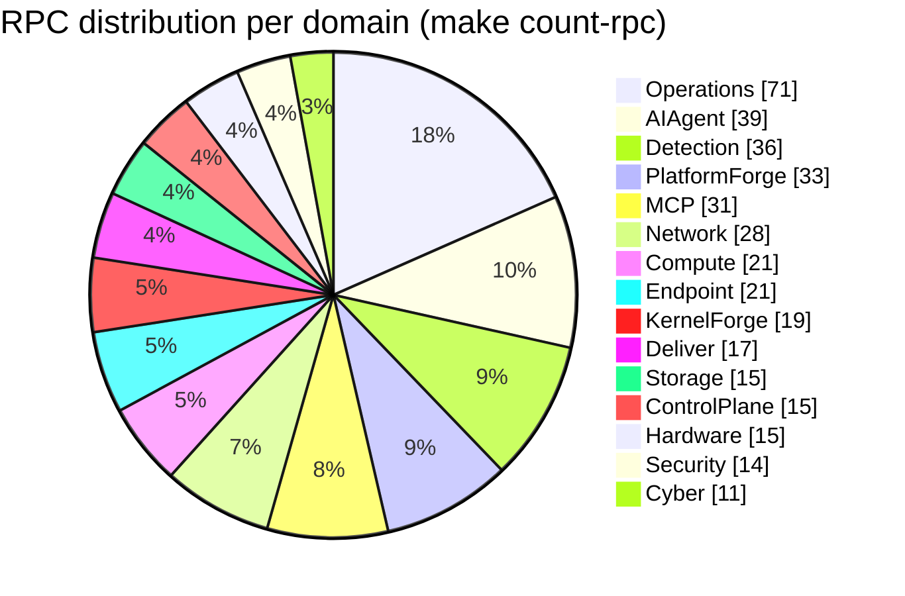
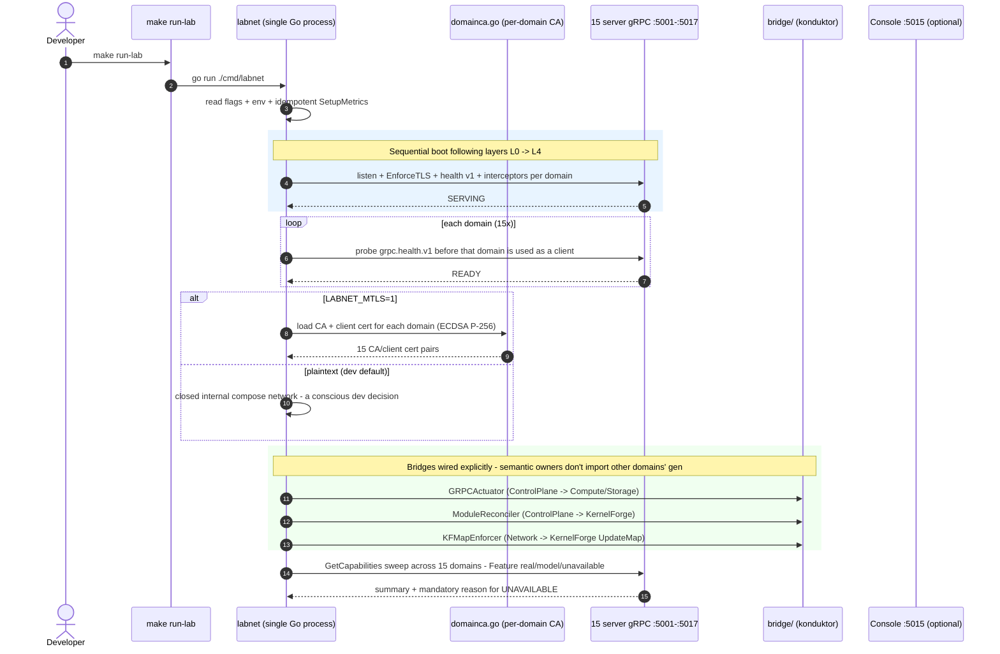
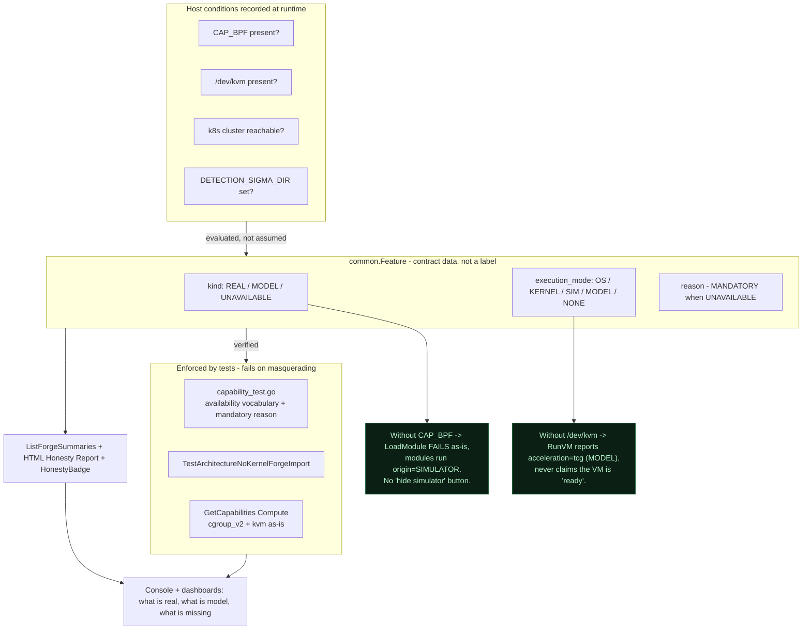
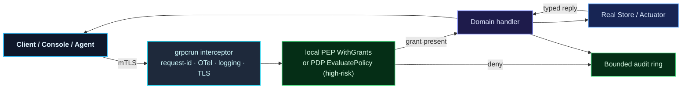
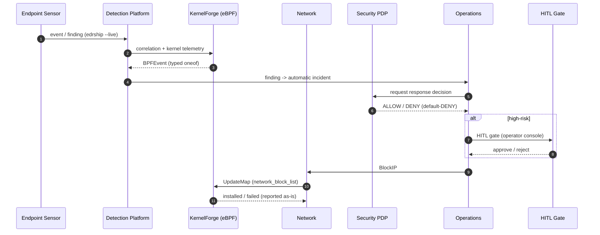
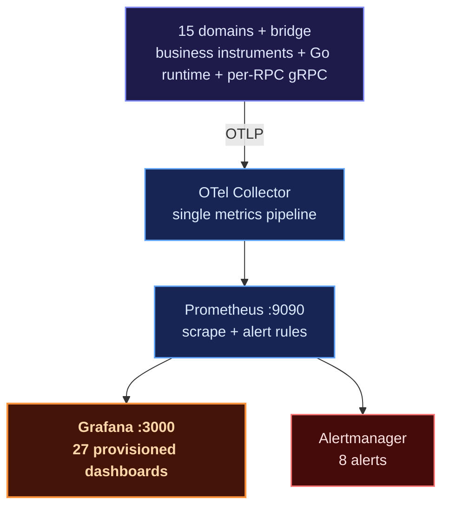

# Platform Labs — Sovereign Mini-Cloud Control Plane (Go)

A **15-domain platform lab** that mirrors a modern infrastructure control plane
— security, telemetry, delivery, and intelligence — entirely written in
**Go**, where each domain is a **separate Go module**, and all of them are
connected through a **gRPC contract** defined in one place
(`GrpcConnect/proto/`) and then tested end-to-end against that same contract.

The goal is not to replace Kubernetes or Kafka. The goal is different and
deliberate: **understanding the control plane from the inside** — how reconcile loops,
detection, enforcement, and actuation actually work — with one non-negotiable
design commitment: **honesty**.

> Real backends are reported as `real`, mock backends are reported as `model`, and
> what cannot run is reported as `unavailable` — nothing masquerades. Every
> domain exposes `GetCapabilities` / `GetFeatures` that state this status
> as it is, and **tests enforce that honesty**.

---

## Position in the PIERO LOKA Ecosystem

Platform Labs is the **Go embodiment of PIERO LOKA** — a high-performance
eBPF-based security and FinOps monitoring platform — rendered here anew
as a 15-domain mini-cloud control plane built from the ground up.

PIERO LOKA uses a **Core Dispatcher** pattern: more than 28 kernel hooks
are consolidated into 6 high-performance kernel entry points, using
zero-copy ring buffers and internal event correlation, so kernel overhead and
context switches drop by 60–75% with system overhead below 1.5%.

The discipline is the same: **system honesty** — kernel signals are the source
of truth, and feature status is stated as it is. In this Go embodiment, that
discipline
is enforced as data (`common.Feature`) and tests, not merely convention.

---

## Screenshots

The cluster dashboard below reads a **real kind cluster** through
`kubectl` (read-only), with write actions only via ArgoCD/Flux and going through
the PDP console — pods showing `Running` are genuinely running, not sample
data. The HITL panel on the right is deliberately empty and says so: *"Empty is
honest"* — no high-risk approvals are pending. If any section cannot be
accessed, it reports `unavailable` along with the reason, rather than
being covered up with a fake green status.


The agent console shows the same discipline in its UI: every answer
carries an **honesty label** (REAL/MODEL) from the generator that produced it,
and its limitations are stated in place — for example "session lost when the domain restarts"
because sessions are kept in memory. The footer reminds you too: PDP default-deny,
risky actions wait for HITL.


---

## At a Glance

| | |
| :--- | :--- |
| **Domains** | 15 — each domain is a separate Go module, wired via `replace` in `GrpcConnect/go.mod` |
| **Contract** | 18 `.proto` files (3 common + 15 domain) → **386 typed RPCs**, no `map<string,string>` |
| **Streaming** | 14 server-streaming flows — telemetry & progress without polling |
| **Substrate** | `grpcrun`: health v1, graceful stop, request-id/OTel/logging interceptors, TLS + mTLS domain CA, circuit breaker + retry, OTLP traces & metrics, cert auto-renewal |
| **Observability** | Full OTel — one path: app → OTLP → Collector → Prometheus → Grafana; 27 provisioned dashboards + 8 alerts (active when `OTLP_ENDPOINT` is set) |
| **Real actuation** | namespaced processes + cgroup v2 limits/OOM, sparse volumes + COW snapshots, eBPF modules, host links via rtnetlink |
| **eBPF** | 16 CORE C modules (53 ELF objects) + loader, simulator, byte-accurate DWARF decoder, mapctl fastpath |
| **Authorization** | local PEP (`WithGrants`) + default-DENY PDP, 4-role console, MSP-lite multi-tenancy |
| **Testing** | `go test -race` green on 16/16 packages on the dev host · 18 cross-domain e2e scenario files (bufconn) |

---

## 5-Layer Architecture

The lab is layered, from physical hardware up to the agent tool gateway. Each
layer only talks to the layer below it through typed gRPC contracts.


This layer separation principle is not just a diagram — it is **enforced by tests**.
`TestArchitectureNoKernelForgeImport` fails if Detection imports
`gen/kernelforge`: a semantic owner never imports another domain's types,
and cross-domain connections only go through explicit bridges in `bridge/`.

---

## 15 Domains — What Actually Runs

> The **RPC** column numbers are generated from the `.proto` files — verify with
> `cd GrpcConnect && make count-rpc`.

| Domain | Port | RPC | What actually runs |
| :--- | :--: | :--: | :--- |
| **Hardware** | :5001 | 15 | Reads real `/proc`, `/sys`, `lspci`; NUMA PCI from sysfs; failed sections are reported per-section, not hidden; thermal/power sensors (hwmon + power_supply) |
| **Compute** | :5002 | 21 | `RunPod` with real namespaced processes + **real cgroup v2** (`memory.max`/`cpu.max`/`pids.max`); `oom_killed`/`memory_peak` read from the kernel; pure-Go WASM interpreter; honest QEMU `RunVM` (kvm→host, tcg→MODEL) |
| **Network** | :5003 | 28 | Decode Ethernet→IP→TCP/UDP/ICMP/ARP; deterministic persistent IPAM; **real rtnetlink** (bridge/veth/netns via `NETLINK_ROUTE`); NetFlow v5/IPFIX collector; `mikrotikforge` RouterOS CHR |
| **Storage** | :5004 | 15 | Sparse volumes + COW snapshots + refcount (thin provisioning); MiniFS + fsck; SHA-256 object store + corruption scrub |
| **ControlPlane** | :5005 | 15 | Deterministic reconcile + HIGH/MED/LOW drift; **real** pod & volume **actuators**; eBPF modules as desired state |
| **Security** | :5006 | 14 | Ed25519/HMAC tokens + cert issuance; **default-DENY PDP** + rule engine; audit stream; **native TOTP MFA** (RFC 6238/4226, AEAD-sealed secrets, anti-replay) |
| **Deliver** | :5007 | 17 | Real docker container builds (digest + SBOM); 8-stage pipeline; recreate/rolling/blue-green/canary deploys; **in-toto provenance + SLSA subset** (Ed25519/DSSE) + Merkle transparency log |
| **Operations** | :5008 | 71 | Push/query metrics; SLO + error budget + burn-rate; incident war-room; chaos injection; **service map measured from traces**; pprof continuous profiling |
| **Detection** | :5009 | 36 | ingest → normalize → enrich → dedup → index → search → rules → correlate → investigate; **Sigma** rule subset; syslog receiver; endpoint OTLP logs |
| **MCP** | :5010 | 31 | default-deny capability tool gateway; real tool execution; high-risk tools → Security PDP + **HITL gate**; external MCP server bridges (stdio/HTTP/SSE) |
| **AIAgent** | :5011 | 39 | Planner + reasoner; step actions via MCP; episodic memory; persona/profile, durable chat sessions, skill catalog, `MEMORY.md` org memory |
| **PlatformForge** | :5012 | 33 | HCL parser + typed evaluator; mini ArgoCD (real git repos, wave/hook/canary); Flux CD model (real CRD manifests); catalog + scaffold |
| **Cyber** | :5013 | 11 | Scope gate (loopback ok, external rejected); MITRE ATT&CK **Adversary Simulation**; BlueForge breach root-cause attribution |
| **KernelForge** | :5014 | 19 | Load/attach to kernel (CAP_BPF) or simulator; typed oneof streams; lease auto-unload; `UpdateMap`/`DeleteMapKey`/`ReadMap` primitives; BpfJailer MAC |
| **Endpoint** | :5017 | 21 | Real Linux host sensor (`/proc` poll, inotify FIM, `/proc/net`); local Sigma rules → ECS alerts; `edrship --live`; PDP-gated automatic response |

### RPC Distribution — The Weight of the Science Lies in Observability

RPCs are not spread evenly. **Observability & detection (Operations + Detection = 107
RPCs)** is clearly the center of gravity — consistent with this lab's position as a
control-plane learning exercise, not a generic orchestrator.



---

## 60-Second Map — What Happens on `make run-lab`

A single command boots the whole lab. **No Docker, no k8s, no
external database** — 15 gRPC servers + cross-domain bridges live in
a single Go process, then shut down cleanly on `Ctrl+C`:



> `labnet` is a dev/lab tool, not a production topology. In production each domain
> is a separate process on its own port — `make run-hardware` through
> `make run-cyber` run each domain standalone.

---

## Honesty as an Enforced Contract

Honesty in this repo is not a culture, but a **mechanism**. This is the part I am
most proud of, because it turns claims into something that can fail.

Three components keep it from quietly shrinking:

1. **Data model** — `common.Feature` carries `kind` (REAL/MODEL/UNAVAILABLE)
   plus structured capability: `availability`, `execution_mode`
   (OS/KERNEL/SIM/MODEL/NONE), and `requirements` (e.g. `CAP_BPF`, `/dev/kvm`).
2. **Aggregate reporting** — `ListForgeSummaries` summarizes the
   real/model/unavailable counts per domain in one call.
3. **Enforcing tests** — e2e enforces the policy against real `GetFeatures`:
   `availability` must come from the official vocabulary, `UNAVAILABLE` **must have
   a `reason`** — the test fails if a capability is reported in a way that doesn't match reality.



**Real example:** on a host without `CAP_BPF`, KernelForge still boots — the kernel
loader fails as-is, modules run with `origin=SIMULATOR`, and `GetFeatures`
says so. There is no "hide simulator" button.

**Second example:** without `/dev/kvm`, `RunVM` reports `acceleration=tcg`
(slow, MODEL) and never claims the VM is "ready"; with KVM → `host`.

---

## Lifecycle of a Single Request

Every request goes through exactly one path: created at a certified client,
classified at the gateway, executed with an explicit grant, and recorded.



The design point: **authorization sits as close as possible to execution** — a local
PEP in KernelForge + ControlPlane + MCP, and the PDP (`EvaluatePolicy`) in the
Security domain for high-risk tools. There is no single "god gateway" judging everything;
quite the opposite, each domain holds the decision over its own resources.

---

## Security Response Chain (S1) — Correct Ownership

This is the core flow of the lab: a finding doesn't stop at an alert, it
flows through until enforcement happens — and every step has a clear owner.



**This semantic ownership is strictly guarded:** Network owns `BlockIP`,
KernelForge owns `UpdateMap`, Security owns the `EvaluatePolicy`
decision. No domain touches another domain's maps
directly — everything goes through contracts.

---

## Observability — One Path, Period

The metrics in this lab are **not** a pile of generic gRPC blocks. Every number on the dashboards
has a real source in code:



What is exported is not just health. There is the **Go runtime** (GC pause histogram from
`runtime/metrics`, heap, goroutines), **per-RPC** gRPC metrics with a `domain`
attribute, and **per-domain business instruments** — all flowing into Prometheus
and verified by tests (`grpcrun/metrics_otlp_test.go` decodes and
asserts their contents) and by the `deploy/grafana/check_metrics.py` audit that
ensures every metric on the dashboards is actually declared in the Go code.

**Honest OTLP status:** the exporter is active **only if `OTLPEndpoint` is set** to
an external collector. Without that env var, spans are no-op and **metrics are completely dead** — stated
honestly, not "as if recorded".

---

## Real Actuation — Not Just a Reconcile Diagram

What sets this lab apart from a mere "renamed CRD": several
paths actually change the system state.

| Path | What actually happens |
| :--- | :--- |
| `compute.pod` | Process with new namespaces (PID/UTS/IPC/Mount/User) + **cgroup v2** `memory.max`/`cpu.max`/`pids.max`; `oom_killed` read from `memory.events` |
| `storage.volume` | **Sparse** volume + **COW** snapshots with refcount; `physical_size` = actual physical bytes |
| rtnetlink | Create/delete bridges & veths, bring links up, move netns via `NETLINK_ROUTE` sockets (using `x/sys/unix`, no third-party libraries) |
| eBPF | Load/attach to the kernel when `CAP_BPF` is available; otherwise an honest `origin=SIMULATOR` simulator |
| Right-sizing | **Real cgroup v2** sampler → recommendation (percentile × headroom, clamp) → HITL-gated desired-state apply → **live cgroup resize** with a kill switch |

---

## Tech & Stack

| Category | Technology | Role |
| :--- | :--- | :--- |
| **Language** | Go 1.26 | One language for all 15 domains; each domain is a separate module |
| **RPC** | gRPC + Protocol Buffers | Typed contracts, 386 RPCs, 14 streams |
| **Bridges** | Pure Go modules | `bridge/` as the conductor; no cross-domain imports |
| **Kernel** | eBPF (C + Go loader) | 16 CORE modules, 53 ELF objects, DWARF decoder |
| **Telemetry** | OpenTelemetry | One path OTLP → Collector → Prometheus → Grafana |
| **Visibility** | Prometheus + Grafana + Tempo | 27 dashboards, 8 alerts, trace-driven service map |
| **Security** | mTLS domain CA (ECDSA P-256) | Cert auto-renewal; default-DENY PDP; TOTP MFA |
| **Agent** | MCP + AI orchestration | default-deny tool gateway, HITL, external MCP bridges |
| **Deploy** | Docker Compose (dev) | labnet + collector + tempo + prometheus + grafana |

---

## Technical Decisions & Trade-offs

**One repo, 15 separate modules — not a mono-module.**
Each domain is its own Go module with its own `go.mod`. This curbs
the tendency toward cross-imports: if Detection wants to use a KernelForge type, it
has to touch `gen/`, and **a test fails** (`TestArchitectureNoKernelForgeImport`).
The cost is messier wiring via `replace` in `GrpcConnect/go.mod` — but
the architectural boundaries become real, not just convention.

**The `grpcrun` substrate used by every domain.**
Health, TLS, breaker, retry, OTel, cert renewal — all in one place.
Cross-domain consistency across 15 domains comes for free. The risk: a bug in the substrate
spreads to every domain at once; the mitigation is that `grpcrun` itself is tested
with an in-process OTLP receiver.

**Typed contracts, no `map<string,string`.**
Payloads are protobuf messages with typed fields. This makes contract
errors fail at compile time, not at runtime. The cost is more
`.proto` files and regeneration, but there are no more "magic fields" holding undocumented
strings.

**Honesty made into data, not intent.**
`common.Feature` carries `kind` + `availability` + `requirements` + `reason`.
Consequently, every new feature must be honest about its requirements from the start —
it cannot be deferred with "it'll be reported later". The trade-off is one extra
level of boilerplate per feature; to me that is a fair price for claims
that can be verified.

**The lab prefers "one process for everything" during dev.**
`labnet` boots 15 domains in one process without Docker/k8s/external DB.
This drastically speeds up iteration, but is consciously **not** a production topology —
and the README states that plainly.

---

## What Already Works, What Is Half-Done, and What Is Missing

I try not to oversell beyond what exists. Here is the honest map — what
actually runs, what is deliberately simplified, and what is still
pending.

**Genuinely running on a real host:** pods with their own namespaces + cgroup v2,
sparse volumes + COW snapshots, an object store with SHA-256 scrub, network packet
decoding, the full Detection pipeline, the Sigma rule subset, the host Endpoint sensor,
mTLS domain CA, eBPF modules from loader to simulator, MCP tool execution, complete
OTel metrics, and the cluster watcher via client-go.

**Deliberately simplified:** network reconcile (its netlink is not fully
wired), the `deploy` step in workflows (still a no-op), the k8s catalog in PlatformForge,
and chaos targets (model only).

**Not there yet because the infrastructure isn't available:** a real k8s cluster
(deliberately skipped), pushing to a registry, a production-grade OTLP collector (the compose file here
is dev-grade), outgoing Alertmanager, the *live-root* gate for cgroup resize, and
admission webhooks.

Every per-feature status is announced via `GetCapabilities`/`GetFeatures`, and it is the tests
that keep those announcements from drifting from reality. If claim and
reality differ, the test wins — not the README.

---

## Running

All tooling lives in the `Makefile` inside `GrpcConnect/`:

```bash
cd GrpcConnect

make gen            # generate proto -> gen/
make test           # unit test all packages (go test -race ./...)
make test-e2e       # 18 cross-domain e2e scenario files (bufconn, -race)
make count-rpc      # count RPCs per domain from the .proto files
make run-lab        # boot 15 domains + bridges (single process, dev)

LABNET_MTLS=1 make run-lab   # same, with mTLS domain CA enabled
make run-hardware            # Hardware :5001 (standalone)
make run-compute             # Compute :5002
# ... one target per domain, up to: make run-cyber (Cyber :5013)
make run                      # KernelForge :5014 (cmd/bpfgrpc)
```

**Environment variables that change behavior (honestly reported in capabilities):**

| Variable | Effect |
| :--- | :--- |
| `LABNET_MTLS=1` | All labnet clients load a client cert from their respective domain CA |
| `OTLP_ENDPOINT=host:port` | Enable OTLP spans + metrics to the collector; **without it, metrics are completely dead** |
| `NETWORK_IPAM_DIR=/path` | Persistent IPAM (atomic JSON snapshot); otherwise in-memory |
| `DETECTION_SIGMA_DIR=/path` | Load Sigma rules; failed files are skipped + reported |
| `PIEROLOKA_IFACE` / `PIEROLOKA_CGROUP2` / `PIEROLOKA_UPROBE` | eBPF attach targets (XDP/TC, cgroup_skb, SSL uprobe) |

---

## Port Map Registry

| Domain / Service | Port |
| :--- | :--- |
| Hardware · Compute · Network · Storage | :5001 · :5002 · :5003 · :5004 |
| ControlPlane · Security · Deliver | :5005 · :5006 · :5007 |
| Operations · Detection · MCP | :5008 · :5009 · :5010 |
| AIAgent · PlatformForge · Cyber · KernelForge | :5011 · :5012 · :5013 · :5014 |
| Console (single binary, embedded React) | :5015 |
| Agent Web UI (standalone, SSE) | :5016 |
| Endpoint | :5017 |
| Grafana · Prometheus | :3000 · :9090 |

---

## Repo Structure

```text
platformlab/
├── GrpcConnect/          contract + substrate + 15 services + e2e  (core module)
│   ├── proto/            18 files: common (3) + 15 domains -> gen/
│   ├── gen/              generated output (go + grpc stubs)
│   ├── grpcrun/          server/client/interceptor/TLS/domainca/breaker/OTLP/metrics
│   ├── bridge/           GRPCActuator, ModuleReconciler, KFMapEnforcer, ...
│   ├── <domain>/         service implementation + service_test.go (bufconn)
│   ├── console/          single-binary web console (REST/WS + embedded React in web/)
│   ├── e2e/              18 files: S1-S5, B0-B8, capability, mTLS, kernel + harness
│   └── capability/       official availability vocabulary - used by enforcing tests
├── Hardware/ Compute/ Network/ Storage/     domain engines (own Go module)
├── ControlPlane/ Deliver/ Operations/       ditto
├── DetectionRuntime/                        Detection Platform (9 modules)
├── Security/ Mcp/ AIAgent/ Cyber/           ditto
├── PlatformDeveloper/                       PlatformForge (IaC, GitOps, portal)
├── Endpoint/                                the 15th Domain: Endpoint (EDR)
├── bpf/                 16 CORE C modules + bpfrun (loader/simulator/decoder)
├── docker-compose.yml   labnet + collector + tempo + prometheus + grafana
├── deploy/              otel-collector, tempo, prometheus, grafana configs
├── planning/            iteration documents (Planning*.md)
└── MAPPING.md, Kritik.md  origin audit & architecture critique
```

---

## Conclusion

Platform Labs is an exercise in building a control plane from the bottom up with
one hard discipline: **never claim more than what actually
runs**. Every real/model/unavailable claim is data enforced by tests,
every metric on the dashboards has a declaration in code, and every limit not yet
reached is written out plainly instead of hidden.

The result is not a generic orchestrator, but something more useful for
learning: a system where the architecture diagram, the real capabilities, and the
runtime status **agree with each other** — and when they don't, the tests will catch it.

<p align="center">
  Built with Go, gRPC, eBPF, OpenTelemetry, and an obsession with system honesty.
</p>
