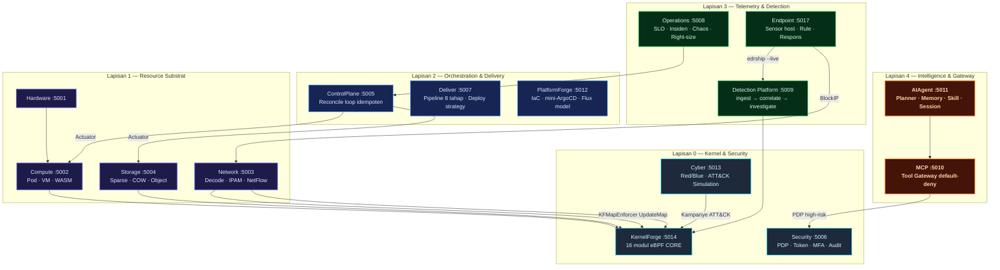
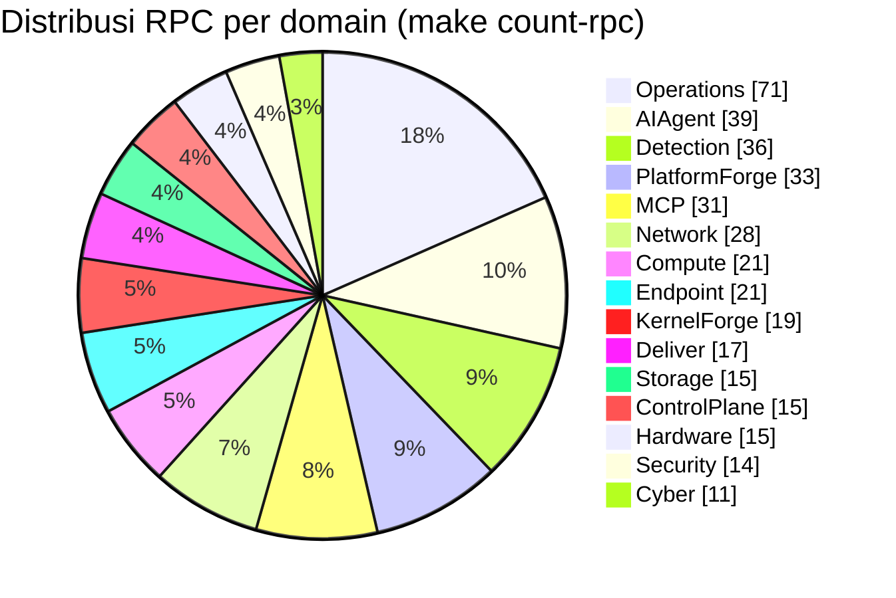
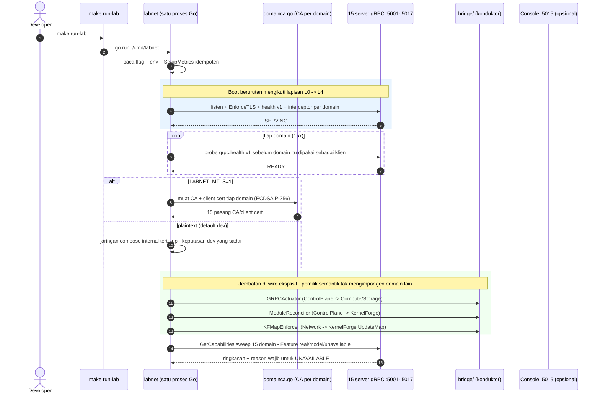
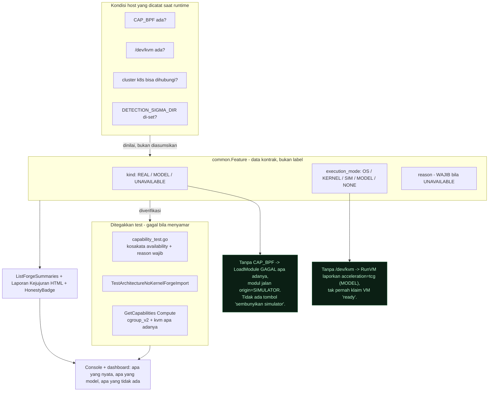
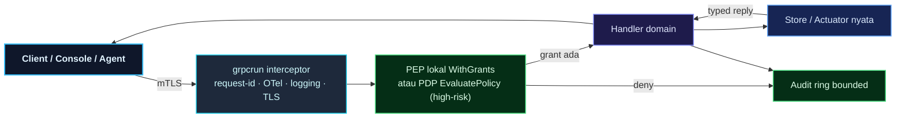
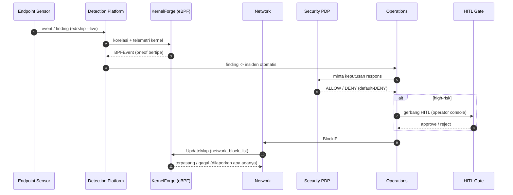
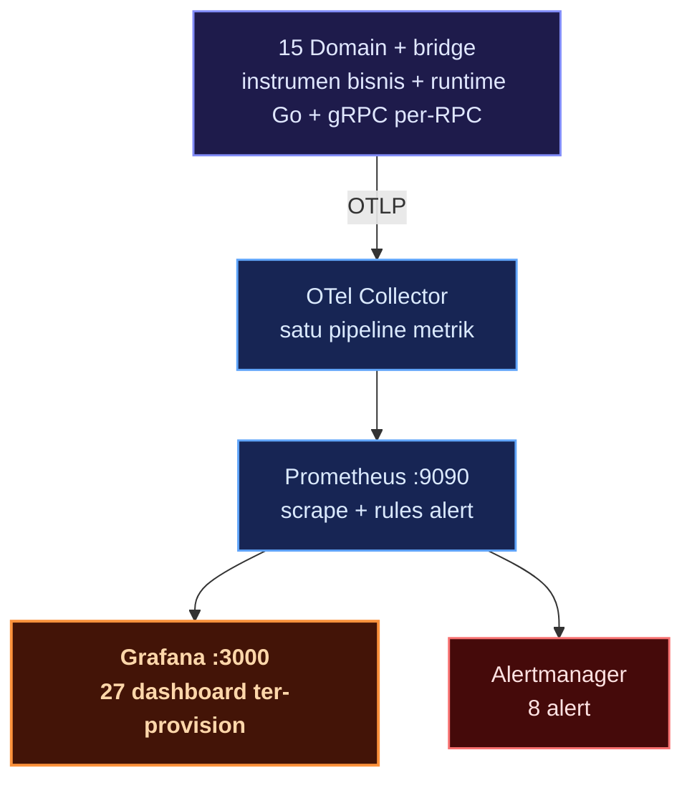

# Platform Labs — Sovereign Mini-Cloud Control Plane (Go)

Sebuah **platform lab 15 domain** yang meniru control-plane infrastruktur modern
— security, telemetry, delivery, dan intelligence — seluruhnya ditulis dalam
**Go**, masing-masing domain adalah **Go module terpisah**, dan semuanya
terhubung lewat **kontrak gRPC** yang didefinisikan di satu tempat
(`GrpcConnect/proto/`) lalu diuji end-to-end di atas kontrak yang sama.

Tujuannya bukan menggantikan Kubernetes atau Kafka. Tujuannya berbeda dan
disengaja: **memahami control-plane dari dalam** — bagaimana reconcile loop,
deteksi, enforcement, dan actuation benar-benar bekerja — dengan satu komitmen
desain yang tidak bisa ditawar: **kejujuran**.

> Backend nyata dilaporkan `real`, backend tiruan dilaporkan `model`, yang
> tidak bisa jalan dilaporkan `unavailable` — tidak ada yang menyamar. Setiap
> domain mengekspos `GetCapabilities` / `GetFeatures` yang menyatakan status
> ini apa adanya, dan **test menegakkan kejujuran itu**.

---

## Posisi dalam Ekosistem PIERO LOKA

Platform Labs ini adalah **wujud Go dari PIERO LOKA** — platform pemantauan
keamanan dan FinOps performa tinggi berbasis eBPF — yang di sini dirender ulang
sebagai control-plane mini-cloud 15 domain yang dibangun dari bawah.

PIERO LOKA memakai pola **Core Dispatcher**: lebih dari 28 kernel hook
dikonsolidasikan menjadi 6 titik masuk kernel berkinerja tinggi, memakai
zero-copy ring buffer dan korelasi event internal, sehingga overhead kernel dan
context switch turun 60–75% dengan overhead sistem di bawah 1,5%.

Disiplin yang dipegang sama: **kejujuran sistem** — sinyal kernel adalah sumber
kebenaran, dan status fitur dinyatakan apa adanya. Pada wujud Go ini, disiplin
itu ditegakkan sebagai data (`common.Feature`) dan test, bukan sekadar konvensi.

---

## Tampilan

Dashboard cluster di bawah ini membaca klaster **kind sungguhan** lewat
`kubectl` (read-only), dengan aksi tulis hanya lewat ArgoCD/Flux dan melewati
PDP console — pod yang tampil `Running` memang benar-benar jalan, bukan data
contoh. Panel HITL di sisi kanan sengaja kosong dan menyatakannya: *"Kosong itu
jujur"* — tidak ada approval high-risk yang menunggu. Kalau ada bagian yang
tidak bisa diakses, ia melaporkan `unavailable` beserta alasannya, bukan
ditutup dengan status hijau palsu.


Agent console memperlihatkan disiplin yang sama di UI-nya: setiap jawaban
dibubuhi **label kejujuran** (REAL/MODEL) dari generator yang menghasilkannya,
dan batasannya ditulis di tempat — misalnya "sesi hilang saat domain restart"
karena session disimpan in-memory. Di footer pun diingatkan: PDP default-deny,
aksi berisiko menunggu HITL.


---

## Sorotan Sekilas

| | |
| :--- | :--- |
| **Domain** | 15 — tiap domain Go module terpisah, diwired lewat `replace` di `GrpcConnect/go.mod` |
| **Kontrak** | 18 file `.proto` (3 common + 15 domain) → **386 RPC** bertipe, tanpa `map<string,string>` |
| **Streaming** | 14 aliran server-streaming — telemetri & progress tanpa polling |
| **Substrat** | `grpcrun`: health v1, graceful stop, interceptor request-id/OTel/logging, TLS + mTLS domain CA, circuit breaker + retry, OTLP trace & metrik, cert auto-renewal |
| **Observability** | Full OTel — satu jalur: aplikasi → OTLP → Collector → Prometheus → Grafana; 27 dashboard ter-provision + 8 alert (aktif bila `OTLP_ENDPOINT` di-set) |
| **Actuation nyata** | proses ber-namespace + cgroup v2 limits/OOM, volume sparse + COW snapshot, modul eBPF, link host via rtnetlink |
| **eBPF** | 16 modul CORE C (53 objek ELF) + loader, simulator, decoder DWARF byte-accurate, mapctl fastpath |
| **Otorisasi** | PEP lokal (`WithGrants`) + PDP default-DENY, console 4 role, multi-tenancy MSP-lite |
| **Uji** | `go test -race` hijau 16/16 package di host pengembangan · 18 file skenario e2e lintas domain (bufconn) |

---

## Arsitektur 5 Lapis

Lab ini disusun berlapis, dari hardware fisik sampai gerbang tool agen. Setiap
lapisan hanya berbicara dengan lapisan di bawahnya lewat kontrak gRPC bertipe.



Prinsip pemisahan lapisan ini bukan sekadar diagram — ia **ditegakkan test**.
`TestArchitectureNoKernelForgeImport` gagal bila Detection mengimpor
`gen/kernelforge`: pemilik semantik tidak pernah mengimpor tipe domain lain,
dan koneksi lintas domain hanya lewat jembatan eksplisit di `bridge/`.

---

## 15 Domain — Apa yang Benar-benar Jalan

> Angka kolom **RPC** dihasilkan dari `.proto` — verifikasi dengan
> `cd GrpcConnect && make count-rpc`.

| Domain | Port | RPC | Yang nyata dijalankan |
| :--- | :--: | :--: | :--- |
| **Hardware** | :5001 | 15 | Baca `/proc`, `/sys`, `lspci` nyata; NUMA PCI dari sysfs; bagian gagal dilaporkan per-section, bukan disembunyikan; sensor thermal/power (hwmon + power_supply) |
| **Compute** | :5002 | 21 | `RunPod` proses ber-namespace nyata + **cgroup v2 nyata** (`memory.max`/`cpu.max`/`pids.max`); `oom_killed`/`memory_peak` dibaca dari kernel; WASM interpreter Go murni; `RunVM` QEMU jujur (kvm→host, tcg→MODEL) |
| **Network** | :5003 | 28 | Decode Ethernet→IP→TCP/UDP/ICMP/ARP; IPAM deterministik persisten; **rtnetlink nyata** (bridge/veth/netns via `NETLINK_ROUTE`); collector NetFlow v5/IPFIX; `mikrotikforge` RouterOS CHR |
| **Storage** | :5004 | 15 | Volume sparse + snapshot COW + refcount (thin provisioning); MiniFS + fsck; object store SHA-256 + scrub korupsi |
| **ControlPlane** | :5005 | 15 | Reconcile deterministik + drift HIGH/MED/LOW; **actuator** pod & volume nyata; modul eBPF sebagai desired state |
| **Security** | :5006 | 14 | Token Ed25519/HMAC + issue cert; **PDP default-DENY** + rule engine; audit stream; **MFA TOTP native** (RFC 6238/4226, secret di-seal AEAD, anti-replay) |
| **Deliver** | :5007 | 17 | Build container docker nyata (digest + SBOM); pipeline 8 tahap; deploy recreate/rolling/blue-green/canary; **provenance in-toto + SLSA subset** (Ed25519/DSSE) + transparency log Merkle |
| **Operations** | :5008 | 71 | Push/query metrik; SLO + error budget + burn-rate; war-room insiden; chaos injection; **service map terukur dari trace**; continuous profiling pprof |
| **Detection** | :5009 | 36 | ingest → normalize → enrich → dedup → index → search → rules → correlate → investigate; rule **Sigma** subset; syslog receiver; endpoint OTLP logs |
| **MCP** | :5010 | 31 | Tool gateway capability default-deny; eksekusi tool nyata; tool high-risk → PDP Security + **gerbang HITL**; jembatan server MCP eksternal (stdio/HTTP/SSE) |
| **AIAgent** | :5011 | 39 | Planner + reasoner; aksi langkah via MCP; memory episode; persona/profil, sesi chat durable, katalog skill, org memory `MEMORY.md` |
| **PlatformForge** | :5012 | 33 | Parser HCL + evaluator typed; mini ArgoCD (repo git nyata, wave/hook/canary); model Flux CD (manifest CRD asli); katalog + scaffold |
| **Cyber** | :5013 | 11 | Scope gate (loopback ok, eksternal ditolak); **Adversary Simulation** MITRE ATT&CK; BlueForge atribusi akar masalah breach |
| **KernelForge** | :5014 | 19 | Load/attach kernel (CAP_BPF) atau simulator; stream oneof bertipe; lease auto-unload; primitive `UpdateMap`/`DeleteMapKey`/`ReadMap`; MAC BpfJailer |
| **Endpoint** | :5017 | 21 | Sensor host Linux nyata (`/proc` poll, inotify FIM, `/proc/net`); rule Sigma lokal → alert ECS; `edrship --live`; respons otomatis ber-PDP |

### Distribusi RPC — Berat Ilmu Ada di Observability

RPC tidak tersebar rata. **Observability & deteksi (Operations + Detection = 107
RPC)** jelas jadi pusat gravitasi — konsisten dengan posisi lab ini sebagai bahan
belajar control-plane, bukan orchestrator generik.



---

## Peta 60 Detik — Apa yang Terjadi Saat `make run-lab`

Satu perintah menyalakan seluruh lab. **Tidak ada Docker, tidak ada k8s, tidak
ada database eksternal** — 15 server gRPC + jembatan lintas domain hidup dalam
satu proses Go, lalu mati dengan rapi saat `Ctrl+C`:



> `labnet` adalah alat dev/lab, bukan topologi produksi. Di produksi tiap domain
> adalah proses terpisah pada port-nya sendiri — `make run-hardware` sampai
> `make run-cyber` menjalankan masing-masing domain secara standalone.

---

## Kejujuran sebagai Kontrak yang Ditegakkan

Kejujuran di repo ini bukan budaya, tapi **mekanisme**. Ini bagian yang paling
saya banggakan, karena ia mengubah klaim menjadi sesuatu yang bisa gagal.

Tiga komponen membuatnya tidak bisa menyusut diam-diam:

1. **Model data** — `common.Feature` membawa `kind` (REAL/MODEL/UNAVAILABLE)
   plus capability terstruktur: `availability`, `execution_mode`
   (OS/KERNEL/SIM/MODEL/NONE), dan `requirements` (mis. `CAP_BPF`, `/dev/kvm`).
2. **Pelaporan agregat** — `ListForgeSummaries` merangkum hitungan
   real/model/unavailable per domain dalam satu panggilan.
3. **Test penegak** — e2e menegakkan kebijakan atas `GetFeatures` nyata:
   `availability` wajib dari kosakata resmi, `UNAVAILABLE` **wajib punya
   `reason`** — test gagal bila capability dilaporkan tidak sesuai kenyataan.



**Contoh nyata:** di host tanpa `CAP_BPF`, KernelForge tetap boot — loader
kernel gagal apa adanya, modul jalan `origin=SIMULATOR`, dan `GetFeatures`
menyatakan itu. Tidak ada tombol "sembunyikan simulator".

**Contoh kedua:** tanpa `/dev/kvm`, `RunVM` melaporkan `acceleration=tcg`
(lambat, MODEL) dan tidak pernah mengklaim VM "ready"; dengan KVM → `host`.

---

## Siklus Hidup Satu Request

Setiap request melewati tepat satu jalur: dibuat di client bersertifikat,
diklasifikasi di gateway, dieksekusi dengan grant eksplisit, dan dicatat.



Poin desainnya: **otorisasi berada sedekat mungkin dengan eksekusi** — PEP
lokal di KernelForge + ControlPlane + MCP, dan PDP (`EvaluatePolicy`) di domain
Security untuk tool high-risk. Tidak ada satu "god gateway" yang menilai semua;
justru sebaliknya, tiap domain memegang keputusan atas sumber dayanya sendiri.

---

## Rantai Respons Keamanan (S1) — Ownership Benar

Ini alur yang menjadi inti dari lab: satu temuan tidak berhenti di alert, ia
mengalir sampai ada penegakan — dan setiap langkah punya pemilik yang jelas.



**Ownership semantik ini dijaga ketat:** Network yang memiliki `BlockIP`,
KernelForge yang memiliki `UpdateMap`, Security yang memiliki keputusan
`EvaluatePolicy`. Tidak ada domain yang menyentuh peta domain lain secara
langsung — semuanya lewat kontrak.

---

## Observability — Satu Jalur, Titik

Metrik di lab ini **bukan** kumpulan blok gRPC generik. Setiap angka di dashboard
punya sumber nyata di kode:



Yang diekspor bukan cuma health. Ada **runtime Go** (GC pause histogram dari
`runtime/metrics`, heap, goroutine), **metrik per-RPC** gRPC dengan atribut
`domain`, dan **instrumen bisnis per domain** — semua bermuara ke Prometheus
dan diverifikasi oleh test (`grpcrun/metrics_otlp_test.go` mendekode dan
mengasert isinya) dan oleh audit `deploy/grafana/check_metrics.py` yang
memastikan setiap metrik di dashboard benar-benar dideklarasikan di kode Go.

**Status jujur OTLP:** exporter aktif **hanya bila `OTLPEndpoint` di-set** ke
kolektor luar. Tanpa env itu, span no-op dan **metrik mati total** — dinyatakan
jujur, bukan "seolah direkam".

---

## Actuation Nyata — Bukan Sekadar Reconcile Diagram

Bagian yang membedakan lab ini dari sekadar "CRD yang dinamai ulang": beberapa
jalur benar-benar mengubah keadaan sistem.

| Jalur | Yang benar-benar terjadi |
| :--- | :--- |
| `compute.pod` | Proses dengan namespace baru (PID/UTS/IPC/Mount/User) + **cgroup v2** `memory.max`/`cpu.max`/`pids.max`; `oom_killed` dibaca dari `memory.events` |
| `storage.volume` | Volume **sparse** + snapshot **COW** dengan refcount; `physical_size` = byte fisik nyata |
| rtnetlink | Buat/hapus bridge & veth, naikkan link, pindah netns via socket `NETLINK_ROUTE` (pakai `x/sys/unix`, tanpa library pihak ketiga) |
| eBPF | Load/attach ke kernel bila ada `CAP_BPF`; jika tidak, simulator jujur `origin=SIMULATOR` |
| Right-sizing | Sampler **cgroup v2 nyata** → rekomendasi (persentil × headroom, clamp) → apply desired-state ber-HITL → **resize cgroup live** dengan kill switch |

---

## Teknologi & Stack

| Kategori | Teknologi | Peran |
| :--- | :--- | :--- |
| **Bahasa** | Go 1.26 | Satu bahasa untuk seluruh 15 domain; tiap domain module terpisah |
| **RPC** | gRPC + Protocol Buffers | Kontrak bertipe, 386 RPC, 14 stream |
| **Jembatan** | Modul Go murni | `bridge/` sebagai konduktor; tanpa import lintas domain |
| **Kernel** | eBPF (C + loader Go) | 16 modul CORE, 53 objek ELF, decoder DWARF |
| **Telemetri** | OpenTelemetry | Satu jalur OTLP → Collector → Prometheus → Grafana |
| **Visibilitas** | Prometheus + Grafana + Tempo | 27 dashboard, 8 alert, trace-driven service map |
| **Keamanan** | mTLS domain CA (ECDSA P-256) | Cert auto-renewal; PDP default-DENY; MFA TOTP |
| **Agen** | MCP + AI orchestration | Tool gateway default-deny, HITL, bridge MCP eksternal |
| **Deploy** | Docker Compose (dev) | labnet + collector + tempo + prometheus + grafana |

---

## Keputusan Teknis & Trade-off

**Satu repo, 15 module terpisah — bukan mono-module.**
Setiap domain adalah Go module sendiri dengan `go.mod`-nya. Ini menahan
kecenderungan import silang: bila Detection ingin memakai tipe KernelForge, ia
harus menyentuh `gen/`, dan **ada test yang gagal** (`TestArchitectureNoKernelForgeImport`).
Biayanya, wiring lebih repot lewat `replace` di `GrpcConnect/go.mod` — tapi
batas arsitektur jadi nyata, bukan sekadar konvensi.

**Substrat `grpcrun` yang dipakai semua domain.**
Health, TLS, breaker, retry, OTel, cert renewal — semuanya di satu tempat.
Konsistensi lintas 15 domain datang gratis. Risikonya: bug di substrat
menyebar ke semua domain sekaligus; mitigasinya adalah `grpcrun` sendiri diuji
dengan receiver OTLP in-process.

**Kontrak bertipe, tanpa `map<string,string`.**
Payload berbentuk pesan protobuf dengan field bertipe. Ini membuat kesalahan
kontrak gagal saat compile, bukan saat runtime. Ongkosnya lebih banyak
`.proto` dan regenerasi, tapi tidak ada lagi "field ajaib" yang isinya string
tak terdokumentasi.

**Kejujuran dijadikan data, bukan niat.**
`common.Feature` membawa `kind` + `availability` + `requirements` + `reason`.
Konsekuensinya, setiap fitur baru harus jujur soal kebutuhannya sejak awal —
tidak bisa menunda dengan "nanti saja dilaporkan". Trade-off-nya bertambah satu
level boilerplate di setiap fitur; menurut saya itu harga yang wajar untuk klaim
yang bisa diverifikasi.

**Lab lebih memilih "satu proses untuk semua" saat dev.**
`labnet` menyalakan 15 domain dalam satu proses tanpa Docker/k8s/DB eksternal.
Ini mempercepat iterasi drastis, tapi secara sadar **bukan** topologi produksi —
dan README menyatakannya terang-terangan.

---

## Yang Sudah Jalan, Yang Masih Setengah, dan Yang Belum Ada

Saya berusaha tidak menjual lebih dari yang ada. Ini peta jujurnya — mana yang
benar-benar berjalan, mana yang sengaja disederhanakan, dan mana yang masih
menunggu.

**Benar-benar jalan di host sungguhan:** pod dengan namespace sendiri + cgroup v2,
volume sparse + snapshot COW, object store dengan scrub SHA-256, decode paket
jaringan, pipeline Detection penuh, rule Sigma subset, sensor Endpoint di host,
mTLS domain CA, modul eBPF dari loader sampai simulator, eksekusi tool MCP, metrik
OTel lengkap, dan watcher klaster lewat client-go.

**Sengaja dibuat sederhana:** reconcile network (netlink-nya belum di-wire
sepenuhnya), step `deploy` di workflow (masih no-op), katalog k8s di PlatformForge,
dan target chaos (baru model).

**Belum ada karena infrastrukturnya belum tersedia:** cluster k8s sungguhan
(sengaja di-skip), push ke registry, kolektor OTLP kelas produksi (compose di sini
baru kelas dev), Alertmanager keluar, gate *live-root* untuk resize cgroup, dan
admission webhook.

Semua status per fitur diumumkan lewat `GetCapabilities`/`GetFeatures`, dan test
yang menjaga agar pengumuman itu tidak melenceng dari kenyataan. Kalau klaim dan
realita berbeda, yang menang adalah test — bukan README.

---

## Menjalankan

Semua tooling ada di `Makefile` dalam `GrpcConnect/`:

```bash
cd GrpcConnect

make gen            # generate proto -> gen/
make test           # unit test semua package (go test -race ./...)
make test-e2e       # 18 file skenario e2e lintas domain (bufconn, -race)
make count-rpc      # hitung RPC per domain dari .proto
make run-lab        # boot 15 domain + jembatan (satu proses, dev)

LABNET_MTLS=1 make run-lab   # idem, mTLS domain CA aktif
make run-hardware            # Hardware :5001 (standalone)
make run-compute             # Compute :5002
# ... satu target per domain, sampai: make run-cyber (Cyber :5013)
make run                      # KernelForge :5014 (cmd/bpfgrpc)
```

**Environment variable yang mengubah perilaku (jujur dilaporkan di capability):**

| Variabel | Efek |
| :--- | :--- |
| `LABNET_MTLS=1` | Semua klien labnet load client cert dari domain CA masing-masing |
| `OTLP_ENDPOINT=host:port` | Aktifkan span + metrik OTLP ke kolektor; **tanpa ini metrik mati total** |
| `NETWORK_IPAM_DIR=/path` | IPAM persisten (snapshot JSON atomik); tanpa ini in-memory |
| `DETECTION_SIGMA_DIR=/path` | Load rule Sigma; file gagal dilewati + dilaporkan |
| `PIEROLOKA_IFACE` / `PIEROLOKA_CGROUP2` / `PIEROLOKA_UPROBE` | Target attach eBPF (XDP/TC, cgroup_skb, uprobe SSL) |

---

## Port Map Registry

| Domain / Layanan | Port |
| :--- | :--- |
| Hardware · Compute · Network · Storage | :5001 · :5002 · :5003 · :5004 |
| ControlPlane · Security · Deliver | :5005 · :5006 · :5007 |
| Operations · Detection · MCP | :5008 · :5009 · :5010 |
| AIAgent · PlatformForge · Cyber · KernelForge | :5011 · :5012 · :5013 · :5014 |
| Console (satu biner, React ter-embed) | :5015 |
| Agent Web UI (mandiri, SSE) | :5016 |
| Endpoint | :5017 |
| Grafana · Prometheus | :3000 · :9090 |

---

## Struktur Repo

```text
platformlab/
├── GrpcConnect/          kontrak + substrat + 15 service + e2e  (module inti)
│   ├── proto/            18 file: common (3) + 15 domain -> gen/
│   ├── gen/              hasil generate (go + grpc stubs)
│   ├── grpcrun/          server/client/interceptor/TLS/domainca/breaker/OTLP/metrics
│   ├── bridge/           GRPCActuator, ModuleReconciler, KFMapEnforcer, ...
│   ├── <domain>/         implementasi service + service_test.go (bufconn)
│   ├── console/          web console satu biner (REST/WS + web/ React ter-embed)
│   ├── e2e/              18 file: S1-S5, B0-B8, capability, mTLS, kernel + harness
│   └── capability/       kosakata availability resmi - dipakai test penegak
├── Hardware/ Compute/ Network/ Storage/     engine domain (Go module sendiri)
├── ControlPlane/ Deliver/ Operations/       idem
├── DetectionRuntime/                        Detection Platform (9 modul)
├── Security/ Mcp/ AIAgent/ Cyber/           idem
├── PlatformDeveloper/                       PlatformForge (IaC, GitOps, portal)
├── Endpoint/                                domain Endpoint ke-15 (EDR)
├── bpf/                 16 modul CORE C + bpfrun (loader/simulator/decoder)
├── docker-compose.yml   labnet + collector + tempo + prometheus + grafana
├── deploy/              config otel-collector, tempo, prometheus, grafana
├── planning/            dokumen iterasi (Planning*.md)
└── MAPPING.md, Kritik.md  audit asal-usul & kritik arsitektur
```

---

## Kesimpulan

Platform Labs adalah latihan membangun control-plane dari bawah ke atas dengan
satu disiplin yang keras: **jangan pernah mengklaim lebih dari yang benar-benar
jalan**. Setiap klaim real/model/unavailable adalah data yang ditegakkan test,
setiap metrik di dashboard punya deklarasi di kode, dan setiap batas yang belum
tercapai ditulis terang-terangan alih-alih disembunyikan.

Hasilnya bukan orkestrator generik, tetapi sesuatu yang lebih berguna untuk
belajar: sebuah sistem di mana diagram arsitektur, kemampuan nyata, dan status
runtime **sepakat satu sama lain** — dan bila tidak, test yang akan menangkapnya.

<p align="center">
  Dibangun dengan Go, gRPC, eBPF, OpenTelemetry, dan obsesi pada kejujuran sistem.
</p>
