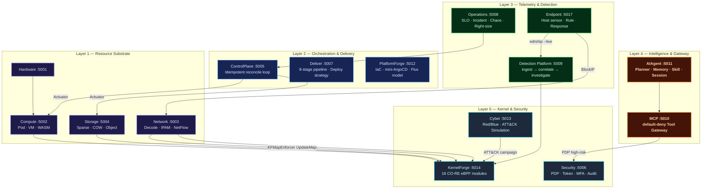
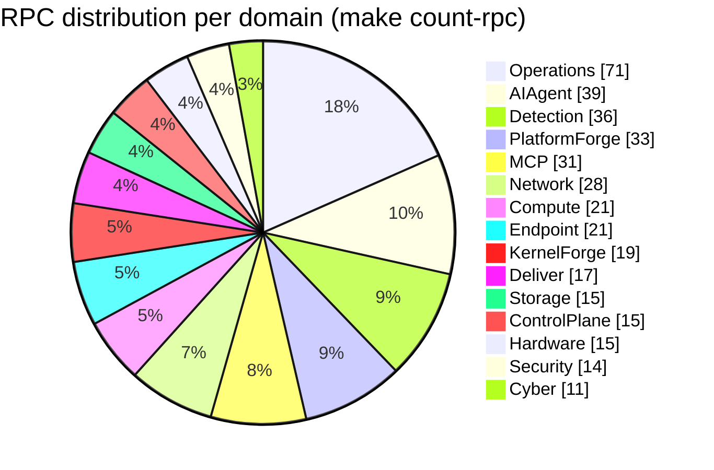
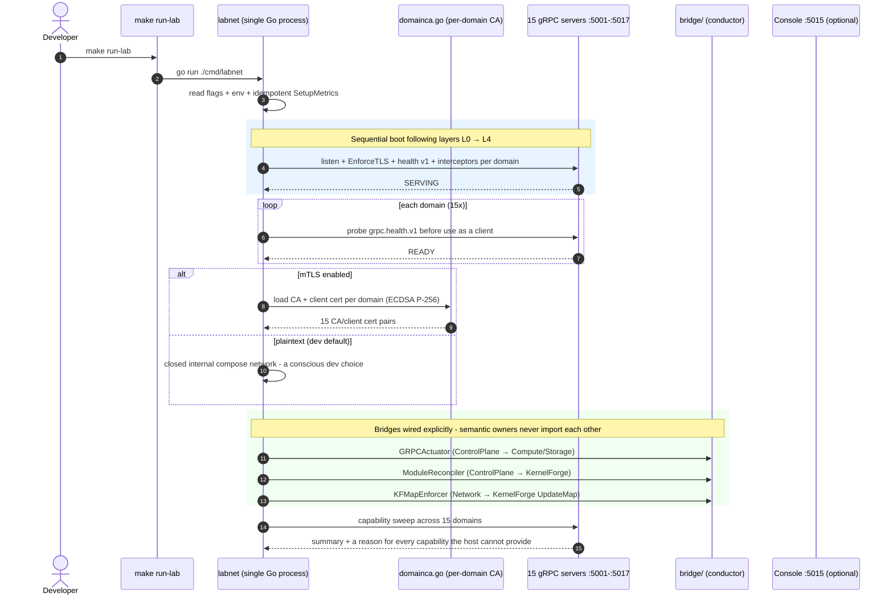
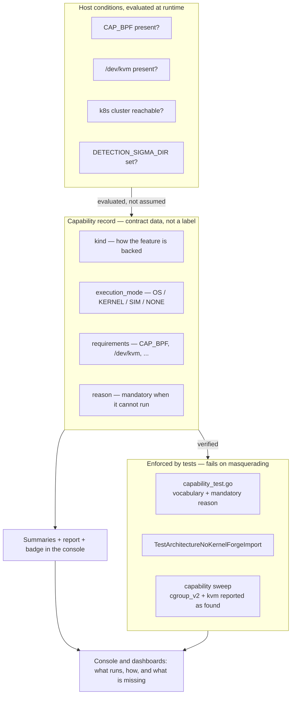
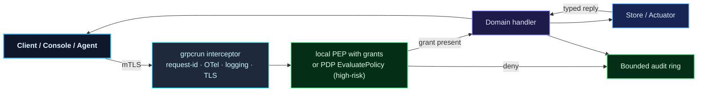
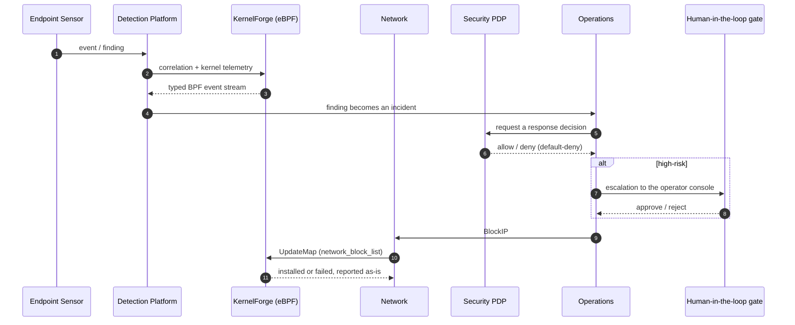
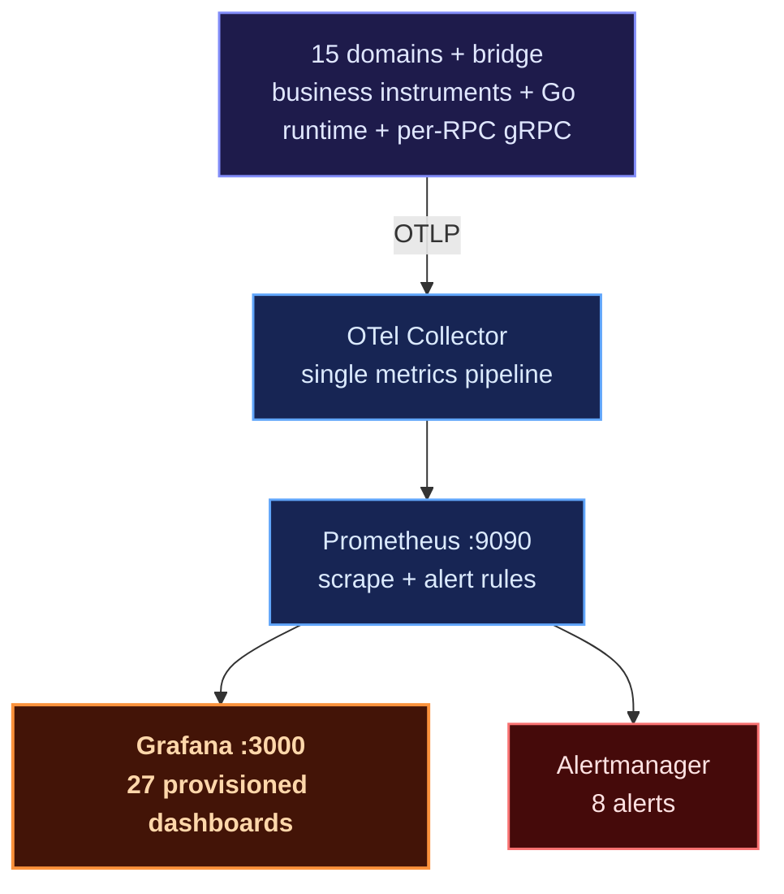

# Platform Labs — Sovereign Mini-Cloud Control Plane (Go)

A **15-domain platform lab** that mirrors a modern infrastructure control plane — security, telemetry, delivery, and intelligence — written entirely in **Go**. Each domain is a **separate Go module**, and all of them are connected through a **gRPC contract defined in one place**, then tested end-to-end against that same contract.

The goal is not to replace Kubernetes or Kafka. It is to **understand the control plane from the inside**: how reconcile loops, detection, enforcement, and actuation actually work when you have to build them yourself.

---

## Position in the PIERO LOKA ecosystem

Platform Labs is the Go embodiment of **PIERO LOKA**, a high-performance eBPF-based security and FinOps monitoring platform, rendered here anew as a 15-domain mini-cloud control plane.

PIERO LOKA uses a **Core Dispatcher** pattern: more than 28 kernel hooks are consolidated into 6 high-performance kernel entry points with zero-copy ring buffers and internal event correlation, cutting kernel overhead and context switches by 60–75% with total system overhead under 1.5%. The same discipline carries into this Go version — kernel signals are the source of truth, and a capability is stated exactly as it behaves.

---

## Screenshots

The cluster dashboard reads a **real kind cluster** through read-only `kubectl`; write actions only go through ArgoCD/Flux and the policy console. Pods showing `Running` are genuinely running, not sample data. Sections that cannot be reached say so instead of rendering a fake green status.


The agent console carries the same discipline: every answer is labelled with how it was produced, and its limitations are stated in place — for example, that sessions live in memory and are lost when the domain restarts.


---

## At a glance

| | |
| :--- | :--- |
| **Domains** | 15 — each a separate Go module, wired via `replace` in `GrpcConnect/go.mod` |
| **Contract** | 18 `.proto` files (3 common + 15 domain) → **386 typed RPCs**, no `map<string,string>` |
| **Streaming** | 14 server-streaming flows — telemetry and progress without polling |
| **Substrate** | `grpcrun`: health v1, graceful stop, request-id/OTel/logging interceptors, TLS + mTLS domain CA, circuit breaker + retry, OTLP traces and metrics, cert auto-renewal |
| **Observability** | One path — app → OTLP → Collector → Prometheus → Grafana; 27 dashboards + 8 alerts |
| **Actuation** | Namespaced processes + cgroup v2 limits and OOM reporting, sparse volumes + COW snapshots, eBPF modules, host links via rtnetlink |
| **eBPF** | 16 CO-RE C modules (53 ELF objects) + loader, simulator, byte-accurate DWARF decoder, mapctl fastpath |
| **Authorization** | Local PEP with explicit grants + default-deny PDP, 4-role console, multi-tenancy |
| **Testing** | `go test -race` green on 16/16 packages · 18 cross-domain e2e scenario files over bufconn |

---

## Five-layer architecture

The lab is layered from physical hardware up to the agent tool gateway. Each layer only talks to the layer below through typed gRPC contracts.



The layer separation is enforced by tests, not by discipline alone. A semantic owner never imports another domain's generated types — a test fails if Detection imports the KernelForge package — and cross-domain traffic only flows through explicit bridges in `bridge/`.

---

## The 15 domains

RPC counts are generated from the `.proto` files with `make count-rpc`.

| Domain | Port | RPC | What actually runs |
| :--- | :--: | :--: | :--- |
| **Hardware** | :5001 | 15 | Reads real `/proc`, `/sys`, and `lspci`; NUMA PCI from sysfs; thermal and power sensors via hwmon and power_supply. Sections that fail are reported per section, never hidden. |
| **Compute** | :5002 | 21 | `RunPod` spawns real namespaced processes under **real cgroup v2** (`memory.max`, `cpu.max`, `pids.max`); `oom_killed` and `memory_peak` read from the kernel. Includes a pure-Go WASM interpreter and QEMU-backed VMs with acceleration reported as it is. |
| **Network** | :5003 | 28 | Decodes Ethernet → IP → TCP/UDP/ICMP/ARP; deterministic persistent IPAM; **real rtnetlink** for bridges, veths, and netns; NetFlow v5 and IPFIX collector; RouterOS CHR integration. |
| **Storage** | :5004 | 15 | Sparse volumes, COW snapshots with refcount for thin provisioning; MiniFS with fsck; SHA-256 object store with corruption scrub. |
| **ControlPlane** | :5005 | 15 | Deterministic reconcile with HIGH/MED/LOW drift classification and **real** pod and volume actuators; eBPF modules treated as desired state. |
| **Security** | :5006 | 14 | Ed25519/HMAC tokens and certificate issuance; **default-deny PDP** with a rule engine; audit stream; native TOTP MFA (RFC 6238/4226) with AEAD-sealed secrets and anti-replay. |
| **Deliver** | :5007 | 17 | Real Docker container builds with digest and SBOM; 8-stage pipeline; recreate, rolling, blue-green, and canary strategies; in-toto provenance with a SLSA subset and a Merkle transparency log. |
| **Operations** | :5008 | 71 | Push and query metrics; SLOs with error budgets and burn rate; incident war-room; chaos injection; a service map measured from traces; continuous pprof profiling. |
| **Detection** | :5009 | 36 | ingest → normalize → enrich → dedup → index → search → rules → correlate → investigate; a Sigma rule subset; syslog receiver; endpoint OTLP logs. |
| **MCP** | :5010 | 31 | Default-deny capability tool gateway with real tool execution; high-risk tools route through the Security PDP and a human-in-the-loop gate; bridges to external MCP servers over stdio, HTTP, and SSE. |
| **AIAgent** | :5011 | 39 | Planner and reasoner; step actions executed through MCP; episodic memory; persona, durable chat sessions, skill catalog, and org-level memory. |
| **PlatformForge** | :5012 | 33 | HCL parser and typed evaluator; a mini ArgoCD working against real git repos with wave, hook, and canary support; a Flux CD model emitting real CRD manifests; catalog and scaffolding. |
| **Cyber** | :5013 | 11 | Scope gate that accepts loopback and rejects external targets; MITRE ATT&CK adversary simulation; breach root-cause attribution. |
| **KernelForge** | :5014 | 19 | Load and attach eBPF programs to the kernel or to a simulator; typed oneof event streams; lease-based auto-unload; `UpdateMap`, `DeleteMapKey`, `ReadMap` primitives; MAC policy enforcement. |
| **Endpoint** | :5017 | 21 | Real Linux host sensor (`/proc` polling, inotify file integrity monitoring, `/proc/net`); local Sigma rules producing ECS alerts; live shipping; PDP-gated automatic response. |

### Where the weight of the science sits

RPCs are not spread evenly. Observability and detection — Operations plus Detection, 107 RPCs — is clearly the center of gravity, which is consistent with this lab being a control-plane learning exercise rather than a generic orchestrator.



---

## Sixty seconds: what happens on `make run-lab`

A single command boots the whole lab. No Docker, no Kubernetes, no external database — 15 gRPC servers plus the cross-domain bridges live in one Go process and shut down cleanly on `Ctrl+C`.



`labnet` is a development and lab tool, not a production topology. In production each domain is its own process on its own port, and each one can be started standalone during development.

---

## Capability tracking, without the labels

A recurring theme in this lab is that a claim should be checkable. Instead of a boolean "done / not done", every domain reports structured capability data: what kind of implementation backs a feature, how it executes (in the OS, in the kernel, in a simulator, or as a model), and what it requires to run — a capability such as `CAP_BPF` or a device such as `/dev/kvm`. An aggregate call summarises the coverage per domain in one round trip, and a boot-time sweep produces the lab summary.

The important part is that **tests enforce the report**. A capability that cannot run must carry a stated reason; a value that is not part of the official vocabulary fails the suite; and an architecture test fails if a domain reaches into another domain's generated types. When a claim and the host disagree, the test wins — not the README.



Concretely: on a host without `CAP_BPF`, KernelForge still boots — the kernel loader fails as-is, modules run under the simulator, and the capability report says exactly that. There is no "hide the simulator" switch. Without `/dev/kvm`, a VM reports software acceleration rather than claiming it is ready; with KVM it reports hardware acceleration.

---

## Lifecycle of a single request

Every request follows one path: created at a certified client, classified at the gateway, executed with an explicit grant, and recorded.



The design point: **authorization sits as close as possible to execution**. A local policy enforcement point runs inside KernelForge, ControlPlane, and MCP, while the PDP in the Security domain evaluates high-risk tools. There is no single gateway judging everything; each domain holds the decision over its own resources.

---

## Security response chain

This is the core flow of the lab: a finding does not stop at an alert — it flows through until enforcement happens, and every step has a clear owner.



Semantic ownership is strictly guarded: Network owns `BlockIP`, KernelForge owns `UpdateMap`, Security owns the policy decision. No domain touches another domain's maps directly — everything goes through contracts.

---

## Observability — one path, period

The metrics in this lab are not a pile of generic gRPC blocks. Every number on the dashboards has a real source in code.



What is exported goes beyond health: the **Go runtime** (GC pause histogram from `runtime/metrics`, heap, goroutines), **per-RPC** gRPC metrics carrying a `domain` attribute, and **per-domain business instruments**. All of it is verified twice — once by tests that decode the OTLP payload and assert its contents, and once by an audit script that checks every metric on the dashboards is actually declared in Go code.

The exporter only activates when an external collector endpoint is configured. Without it, spans are no-ops and metrics are not emitted at all, which the docs state plainly rather than implying the numbers exist.

---

## Real actuation, not just a reconcile diagram

What sets this lab apart from a renamed CRD: several paths genuinely change system state.

| Path | What actually happens |
| :--- | :--- |
| `compute.pod` | A process with new namespaces (PID/UTS/IPC/Mount/User) under **cgroup v2** `memory.max`, `cpu.max`, and `pids.max`; `oom_killed` read from `memory.events` |
| `storage.volume` | **Sparse** volumes and **COW** snapshots with refcounting; `physical_size` reports actual physical bytes |
| rtnetlink | Create and delete bridges and veths, bring links up, move netns via `NETLINK_ROUTE` sockets using `x/sys/unix`, no third-party libraries |
| eBPF | Load and attach to the kernel when the capability is available; otherwise a simulator that is never disguised as the kernel |
| Right-sizing | A real cgroup v2 sampler → recommendation (percentile × headroom, clamped) → human-gated desired state → live cgroup resize with a kill switch |

---

## Tech stack

| Category | Technology | Role |
| :--- | :--- | :--- |
| **Language** | Go 1.26 | One language for all 15 domains; each domain is a separate module |
| **RPC** | gRPC + Protocol Buffers | Typed contracts, 386 RPCs, 14 streams |
| **Bridges** | Pure Go modules | `bridge/` as the conductor; no cross-domain imports |
| **Kernel** | eBPF (C + Go loader) | 16 CO-RE modules, 53 ELF objects, DWARF decoder |
| **Telemetry** | OpenTelemetry | One path: OTLP → Collector → Prometheus → Grafana |
| **Visibility** | Prometheus + Grafana + Tempo | 27 dashboards, 8 alerts, trace-driven service map |
| **Security** | mTLS domain CA (ECDSA P-256) | Certificate auto-renewal, default-deny PDP, TOTP MFA |
| **Agent** | MCP + AI orchestration | Default-deny tool gateway, human-in-the-loop, external MCP bridges |
| **Deploy** | Docker Compose (dev) | labnet + collector + tempo + prometheus + grafana |

---

## Technical decisions & trade-offs

**One repo, 15 separate modules — not one big module.** Each domain has its own `go.mod`, which curbs the pull toward cross-imports: if Detection wants a KernelForge type it has to reach into the generated package, and a test fails. The cost is messier wiring through `replace` directives, but the architectural boundaries become real instead of aspirational.

**A shared `grpcrun` substrate.** Health, TLS, breaker, retry, OTel, and cert renewal live in one place, so consistency across 15 domains comes for free. The risk is that a bug there spreads everywhere at once; the mitigation is that the substrate itself is tested against an in-process OTLP receiver.

**Typed contracts, no `map<string,string>`.** Payloads are protobuf messages with typed fields, so contract errors surface at compile time instead of at runtime. The cost is more `.proto` files and regeneration steps, but magic fields holding undocumented strings disappear.

**Capability as data, not intent.** Because every feature must declare its requirements from the start, capability cannot be deferred with "we'll report it later". The trade-off is one extra level of boilerplate per feature — a fair price for claims that can be verified.

**One process for everything during development.** `labnet` boots 15 domains in one process without Docker, Kubernetes, or an external database, which speeds up iteration dramatically — and it is consciously not a production topology, which the docs say outright.

---

## What works, what is simplified, what is missing

An honest map rather than a maximal one.

**Genuinely running on a real host:** pods with their own namespaces and cgroup v2, sparse volumes and COW snapshots, an object store with SHA-256 scrubbing, network packet decoding, the full detection pipeline, the Sigma rule subset, the host endpoint sensor, the mTLS domain CA, eBPF modules from loader to simulator, MCP tool execution, complete OTel metrics, and the cluster watcher via client-go.

**Deliberately simplified:** network reconcile (its netlink path is not fully wired), the deploy step inside workflows (still a no-op), the Kubernetes catalog in PlatformForge, and chaos targets.

**Not there yet because the infrastructure is not available:** a real Kubernetes cluster, registry pushing, a production-grade OTLP collector, outgoing Alertmanager, the live-root gate for cgroup resize, and admission webhooks.

Every per-feature status is announced through the capability API, and the tests keep those announcements from drifting from reality. If a claim and reality differ, the test wins — not the README.

---

## Running

All tooling lives in the `Makefile` inside `GrpcConnect/`:

```bash
cd GrpcConnect

make gen            # generate proto -> gen/
make test           # unit test all packages (go test -race ./...)
make test-e2e       # 18 cross-domain e2e scenario files (bufconn, -race)
make count-rpc      # count RPCs per domain from the .proto files
make run-lab        # boot 15 domains + bridges (single process, dev)

LABNET_MTLS=1 make run-lab   # same, with the mTLS domain CA enabled
make run-hardware            # Hardware :5001 (standalone)
make run-compute             # Compute :5002
# ... one target per domain, up through make run-cyber (Cyber :5013)
make run                     # KernelForge :5014 (cmd/bpfgrpc)
```

Environment variables that change behaviour:

| Variable | Effect |
| :--- | :--- |
| `LABNET_MTLS=1` | All labnet clients load a client certificate from their domain CA |
| `OTLP_ENDPOINT=host:port` | Enable OTLP spans and metrics to the collector; without it, nothing is exported |
| `NETWORK_IPAM_DIR=/path` | Persistent IPAM via atomic JSON snapshot; otherwise in-memory |
| `DETECTION_SIGMA_DIR=/path` | Load Sigma rules; failed files are skipped and reported |
| `PIEROLOKA_IFACE` / `PIEROLOKA_CGROUP2` / `PIEROLOKA_UPROBE` | eBPF attach targets (XDP/TC, cgroup_skb, SSL uprobe) |

---

## Port map

| Domain / Service | Port |
| :--- | :--- |
| Hardware · Compute · Network · Storage | :5001 · :5002 · :5003 · :5004 |
| ControlPlane · Security · Deliver | :5005 · :5006 · :5007 |
| Operations · Detection · MCP | :5008 · :5009 · :5010 |
| AIAgent · PlatformForge · Cyber · KernelForge | :5011 · :5012 · :5013 · :5014 |
| Console (single binary, embedded React) | :5015 |
| Agent Web UI (standalone, SSE) | :5016 |
| Endpoint | :5017 |
| Grafana · Prometheus | :3000 · :9090 |

---

## Repository structure

```text
platformlab/
├── GrpcConnect/          contract + substrate + 15 services + e2e  (core module)
│   ├── proto/            18 files: common (3) + 15 domains -> gen/
│   ├── gen/              generated output (go + grpc stubs)
│   ├── grpcrun/          server/client/interceptor/TLS/domainca/breaker/OTLP/metrics
│   ├── bridge/           GRPCActuator, ModuleReconciler, KFMapEnforcer, ...
│   ├── <domain>/         service implementation + service_test.go (bufconn)
│   ├── console/          single-binary web console (REST/WS + embedded React)
│   ├── e2e/              18 files: S1-S5, B0-B8, capability, mTLS, kernel + harness
│   └── capability/       official availability vocabulary - used by enforcing tests
├── Hardware/ Compute/ Network/ Storage/     domain engines (own Go module)
├── ControlPlane/ Deliver/ Operations/       ditto
├── DetectionRuntime/                        Detection Platform (9 modules)
├── Security/ Mcp/ AIAgent/ Cyber/           ditto
├── PlatformDeveloper/                       PlatformForge (IaC, GitOps, portal)
├── Endpoint/                                the 15th domain: Endpoint (EDR)
├── bpf/                 16 CO-RE C modules + bpfrun (loader/simulator/decoder)
├── docker-compose.yml   labnet + collector + tempo + prometheus + grafana
├── deploy/              otel-collector, tempo, prometheus, grafana configs
└── MAPPING.md, Kritik.md  origin audit & architecture critique
```

---

## Closing

Platform Labs is an exercise in building a control plane from the bottom up with one hard discipline: never claim more than what actually runs. Every capability is reported as data and enforced by tests, every metric on the dashboards has a declaration in code, and every gap is written out plainly instead of hidden.

The result is not a generic orchestrator but something more useful for learning: a system where the architecture diagram, the real capabilities, and the runtime status agree with each other — and when they do not, the tests catch it.

<p align="center">
  Built with Go, gRPC, eBPF, OpenTelemetry, and an obsession with system honesty.
</p>
